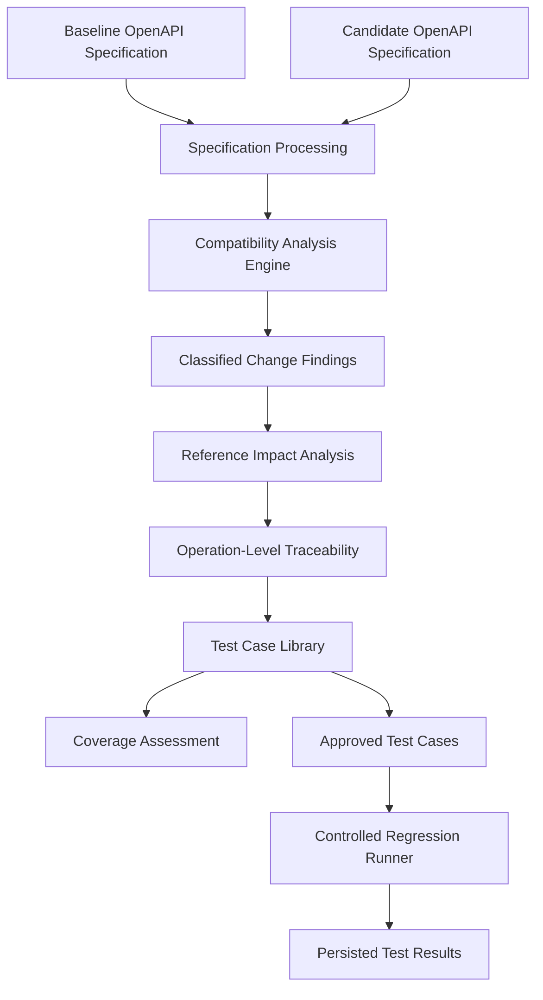
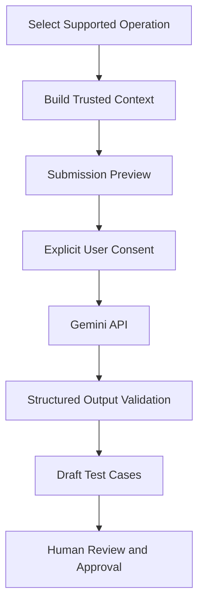

# ContractGuard
### API Contract Analysis, Change Impact Assessment & Regression Testing

ContractGuard is a full-stack API engineering platform designed to identify breaking changes in versioned OpenAPI specifications, trace their impact across API operations and test cases, and support controlled regression testing.

It brings API contract comparison, compatibility analysis, change-to-test traceability, regression execution and AI-assisted test generation into a unified workflow.

The goal is to help developers understand the consequences of an API change before it introduces compatibility issues for existing consumers.

---

## Overview

API contracts evolve as applications grow. Adding, removing or modifying an endpoint, parameter, response schema or referenced component can affect existing integrations in ways that are difficult to identify through manual inspection alone.

ContractGuard addresses this problem through a structured workflow:

1. Upload and manage versioned OpenAPI specifications.
2. Compare a baseline specification against a candidate specification.
3. Identify and classify contract changes using a deterministic compatibility engine.
4. Trace affected components to API operations and associated test cases.
5. Review test coverage and identify regression-testing gaps.
6. Execute approved test cases against a controlled API environment.
7. Generate additional test-case suggestions using an optional Gemini-powered AI integration.

**The compatibility engine remains deterministic. AI is an assistance layer for test creation, not the authority for compatibility decisions or test results.**

---

## Core Capabilities

### 1. API Specification Management

- Upload OpenAPI specifications in JSON and YAML formats.
- Parse and validate API specifications.
- Maintain versioned baseline and candidate specifications.
- Explore API operations, schemas and references.
- Identify and handle duplicate specification content.
- Resolve supported internal references for analysis.

### 2. Deterministic Compatibility Analysis

ContractGuard compares two specification versions and evaluates their differences using a dedicated rules-based compatibility engine.

The analysis considers changes to supported API contract elements, including operations, parameters, request bodies, responses, schemas and references.

Findings are classified into categories such as:

| Classification | Meaning |
|---|---|
| Breaking | A change that can invalidate an existing consumer contract |
| Potentially Breaking | A change whose compatibility impact requires additional consideration |
| Non-Breaking | A change that preserves the supported compatibility expectations |
| Informational | A change recorded for visibility without a compatibility violation |
| Unsupported | A construct or change that the analyzer cannot fully evaluate |

Each finding is associated with relevant change information and affected operations where available.

The analyzer uses a versioned ruleset:

`CG-COMPAT-1.1`

Its comparison direction is:

`BASELINE_CONSUMER_TO_CANDIDATE_PROVIDER`

Unsupported constructs are not silently treated as compatible; they can affect the completeness of the analysis.

### 3. Change Impact and Test Traceability

Identifying a breaking change is only part of the problem. Developers also need to understand which operations and tests may be affected.

ContractGuard connects compatibility findings with reference-impact analysis and test-case traceability.

Capabilities include:

- Mapping specification changes to affected API operations.
- Tracking canonical operation identifiers.
- Associating test cases with baseline API operations.
- Identifying covered and uncovered operations.
- Distinguishing approved test coverage from draft-only coverage.
- Highlighting unmapped or unresolved relationships.
- Reviewing the impact of contract changes on existing regression tests.

This creates a connection between **what changed in the API contract** and **what needs to be tested as a result**.

### 4. Test Case Management

ContractGuard includes a Test Case Library for managing API regression test cases.

The test-case lifecycle supports:

- Draft
- Approved
- Archived

Test cases are associated with API operations and contract versions, allowing the application to reason about test relevance and coverage.

AI-generated test cases enter the library as drafts. They must be reviewed and approved before they become eligible for execution.

### 5. Controlled Regression Execution

ContractGuard provides a regression-testing workflow for executing approved test cases against its bundled Demo Store environment.

The runner supports controlled GET-request execution and evaluates returned responses against the applicable test expectations.

Execution results are persisted and available for review.

The execution environment is intentionally constrained: arbitrary user-supplied production URLs and unrestricted HTTP methods are not supported.

### 6. AI-Assisted Test Generation

ContractGuard integrates Google's Gemini Developer API through the official `@google/genai` SDK.

The integration helps generate structured test-case suggestions for supported operations in the synthetic Demo Store API.

Currently supported operations:

| Operation | HTTP Method | Endpoint |
|---|---|---|
| `listProducts` | GET | `/products` |
| `getProduct` | GET | `/products/{productId}` |

The workflow is designed around validation and human control:

1. Select a supported API operation.
2. Build the trusted context for that operation.
3. Preview the information intended for provider submission.
4. Obtain explicit user consent.
5. Request structured suggestions from Gemini.
6. Validate the model output on the backend.
7. Persist valid suggestions as draft test cases.
8. Review and approve drafts through the Test Case Library.

AI-generated suggestions do not automatically become approved tests, and the AI provider does not determine compatibility classifications or regression execution outcomes.

---

## System Architecture

ContractGuard separates specification analysis, impact assessment, test management, execution and AI-assisted generation into distinct backend responsibilities.

### Primary Workflow



### AI-Assisted Workflow



The AI workflow complements the deterministic analysis pipeline rather than replacing it.

---

## Technology Stack

| Layer | Technologies |
|---|---|
| Language | JavaScript (ES Modules) |
| Frontend | React, Vite |
| Styling | Tailwind CSS, custom CSS |
| Client Routing | React Router |
| Server State | TanStack Query |
| Backend | Node.js, Express |
| Database | MongoDB |
| ODM | Mongoose |
| Validation | Zod, Ajv |
| OpenAPI Processing | `@scalar/openapi-parser` |
| YAML Processing | `yaml` |
| AI Integration | Google Gemini Developer API |
| AI SDK | `@google/genai` |
| Testing | Vitest, Supertest |
| Package Management | npm |

---

## Engineering Highlights

### Deterministic Analysis

Compatibility findings are derived from an explicitly versioned ruleset rather than generated by an LLM. This keeps the core analysis explainable, testable and independent of AI-provider output.

### Reference-Aware Change Analysis

Contract changes are connected to their affected API operations through reference-impact and traceability services. This makes the output more useful than a simple textual specification diff.

### Test Coverage Traceability

Test cases are mapped to canonical API operations, enabling coverage assessment across changed and unchanged parts of the contract.

### Controlled Test Lifecycle

Draft, approval and archive states separate test creation from test execution. Generated suggestions do not bypass the review process.

### Validated AI Integration

The Gemini integration uses trusted synthetic context, explicit submission consent, structured output validation and draft-only persistence.

### Modular Backend Design

The backend separates controllers, routes, middleware, models, validators and services. This supports independent testing and clearer separation of responsibilities.

---

## Project Structure

```text
ContractGuard/
│
├── client/
│   └── src/
│       ├── components/
│       ├── features/
│       └── pages/
│
├── server/
│   ├── src/
│   │   ├── config/
│   │   ├── controllers/
│   │   ├── middleware/
│   │   ├── models/
│   │   ├── routes/
│   │   ├── services/
│   │   └── validators/
│   │
│   └── tests/
│
├── docs/
│   ├── PRD.md
│   ├── Design.md
│   ├── TRD.md
│   ├── Architecture.md
│   ├── AppFlow.md
│   ├── Schema.md
│   ├── API.md
│   ├── Rules.md
│   ├── SecurityReview.md
│   └── ImplementationPlan.md
│
├── examples/
│
├── .env.example
├── MANIFEST.json
└── README.md
```

---

## Getting Started

### Prerequisites

- Node.js 24.x
- npm
- MongoDB instance or MongoDB Atlas connection
- Gemini API key (optional, required only for AI-assisted test generation)

### 1. Clone the Repository

```bash
git clone https://github.com/Swayam-Aggarwal/ContractGuard-temp.git

cd ContractGuard-temp
```

### 2. Install Dependencies

Install backend dependencies:

```bash
cd server
npm ci
```

Install frontend dependencies:

```bash
cd ../client
npm ci
```

### 3. Configure Environment Variables

Create a `.env` file in the project root using `.env.example` as the reference.

Configure the database connection, authentication secrets and other required application settings.

For AI-assisted test generation, configure:

```dotenv
GEMINI_API_KEY=your_gemini_api_key
GEMINI_MODEL=your_supported_gemini_model
```

The Gemini API key must remain on the backend and must never be exposed through frontend environment variables.

### 4. Start the Backend

From the `server` directory:

```bash
npm run dev
```

### 5. Start the Frontend

From the `client` directory, in a separate terminal:

```bash
npm run dev
```

Open the local development URL displayed by Vite.

---

## Running Tests

### Backend Test Suite

```bash
cd server
npm test
```

### Frontend Linting

```bash
cd client
npm run lint
```

### Frontend Production Build

```bash
npm run build
```

---

## Verification

The following results were recorded during project verification:

| Verification | Result |
|---|---:|
| Backend automated tests | 539 passed |
| Backend test files | 54 passed |
| AI-focused tests | 44 passed |
| AI-focused test files | 5 passed |
| Frontend linting | Passed |
| Frontend production build | Passed |
| Gemini generation for `listProducts` | Successful |
| Gemini generation for `getProduct` | Successful |
| AI-generated draft persistence | Verified |

The AI-focused tests are a subset of the backend test suite, not additional tests.

The live AI workflow was exercised for both supported Demo Store operations. Generated cases were persisted as drafts, while existing approved manual test cases remained intact.

These results describe the recorded verification run and should not be interpreted as a guarantee of production readiness.

---

## Scope and Limitations

ContractGuard is currently focused on its documented OpenAPI compatibility rules and bundled Demo Store workflow.

- Compatibility analysis is limited to supported OpenAPI constructs.
- Unsupported constructs can result in partial analysis.
- Regression execution is restricted to the controlled Demo Store environment.
- The current runner supports GET operations.
- AI test generation is currently available for the two documented Demo Store operations.
- Generated test cases require human review and approval.
- Gemini availability, model identifiers, quotas and provider policies may change.

The project is an engineering workbench and does not claim complete compatibility verification for every possible API contract or runtime behavior.

---

## Security and Data Handling

- The Gemini API key is configured and used server-side.
- AI submission requires explicit user consent.
- AI generation uses the trusted synthetic Demo Store context.
- Generated output is validated before persistence.
- AI-generated cases remain drafts until reviewed and approved.

Do not submit confidential specifications, production credentials, customer information or sensitive business data to the AI provider.

Review Google's applicable Gemini API data-use and pricing terms before enabling the integration.

References:

- [Gemini API Documentation](https://ai.google.dev/gemini-api/docs)
- [Gemini API Structured Output](https://ai.google.dev/gemini-api/docs/structured-output)
- [Gemini API Pricing](https://ai.google.dev/gemini-api/docs/pricing)

---

## Documentation

Additional technical documentation is available in the `docs/` directory.

| Document | Purpose |
|---|---|
| [Product Requirements](docs/PRD.md) | Product scope, requirements and acceptance criteria |
| [Design](docs/Design.md) | Interface and interaction design |
| [Technical Requirements](docs/TRD.md) | Technical requirements and technology decisions |
| [Architecture](docs/Architecture.md) | System architecture and module responsibilities |
| [Application Flow](docs/AppFlow.md) | User journeys and application workflows |
| [Database Schema](docs/Schema.md) | Data models and relationships |
| [API Documentation](docs/API.md) | Backend API endpoints and contracts |
| [Compatibility Rules](docs/Rules.md) | Compatibility rules and classification semantics |
| [Security Review](docs/SecurityReview.md) | Security considerations and requirements |
| [Implementation Plan](docs/ImplementationPlan.md) | Development milestones and implementation tracking |

---

## License

No open-source license has been specified for this project.