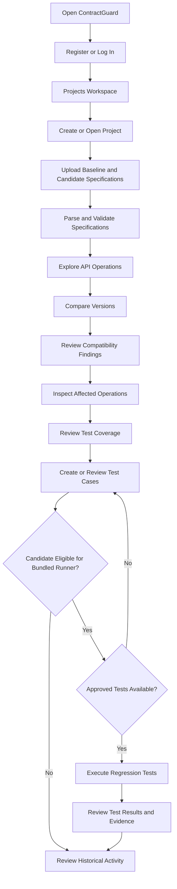
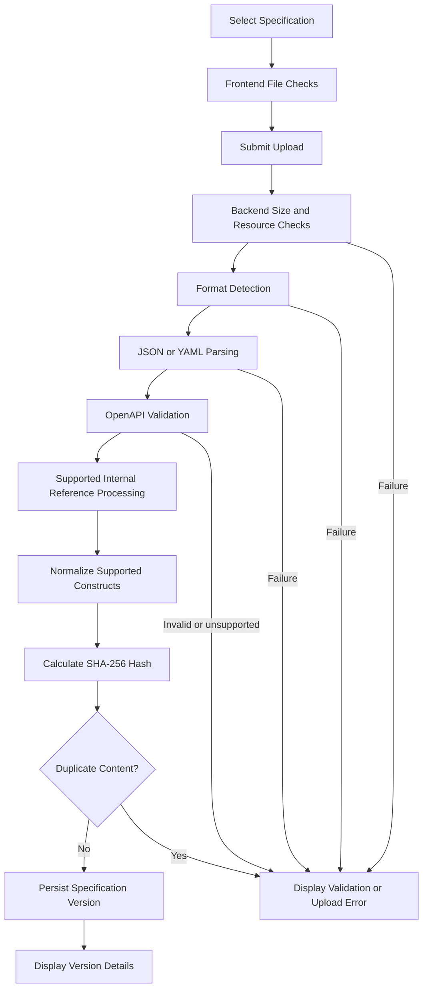
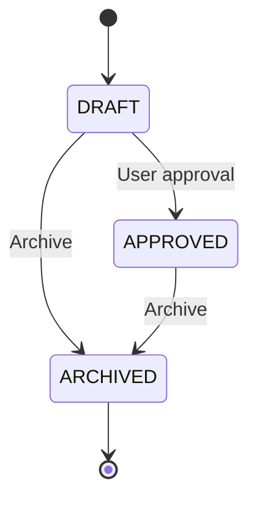

# Application Flow and User Journeys

**Product:** ContractGuard\
**Document version:** 1.2\
**Document status:** Application workflow specification\
**Last updated:** 14 November 2026

---

## 1. Purpose

This document defines the primary navigation structure, user journeys, application behavior, and workflow transitions of ContractGuard.

It describes how an authenticated user interacts with:

- Projects.
- OpenAPI specifications.
- API exploration.
- Compatibility comparisons.
- Change-impact analysis.
- Test coverage.
- Test-case management.
- Regression execution.
- AI-assisted test suggestions.
- Historical results.

The primary application workflow is:

**Create project → Upload specifications → Explore API operations → Compare versions → Review compatibility findings → Inspect affected operations and test coverage → Manage test cases → Execute eligible regression tests → Review evidence.**

## 2. User Model

V1 uses a single authenticated project-owner role.

An authenticated user can:

- Create and manage personal projects.
- Upload and inspect specification versions.
- Create comparisons.
- Review compatibility findings.
- Inspect affected operations.
- Review linked test cases and coverage.
- Create, edit, approve, and archive test cases.
- Run eligible regression tests.
- Review historical test results.
- Request optional AI test suggestions for supported synthetic operations.

There are no team-member, organization-administrator, reviewer, or billing roles in the current product scope.

Every project belongs to one authenticated user.

All child-resource access is verified through the owning project.

## 3. Application Navigation

### 3.1 Public Routes

```text
/login
/register
```

These routes provide account registration and authentication.

### 3.2 Authenticated Routes

```text
/app
/app/projects
/app/projects/:projectId

/app/projects/:projectId/specifications
/app/specifications/:specVersionId
/app/specifications/:specVersionId/explorer

/app/projects/:projectId/comparisons
/app/comparisons/:comparisonId
/app/comparisons/:comparisonId/tests

/app/test-cases/:testCaseId
/app/test-runs/:testRunId
```

The exact visual nesting may vary, but route responsibilities should remain consistent.

### 3.3 Navigation Structure

The authenticated workspace provides access to:

- Projects.
- Current project context.
- API specifications.
- Comparisons.
- Test cases.
- Test runs.
- Account and logout controls.

When navigating between comparison details, associated tests, and execution results, the application should preserve the relevant project and comparison context.

### 3.4 Navigation Rules

- Unauthenticated users cannot access protected application resources.
- Invalid resource identifiers display a safe not-found state.
- Inaccessible resources do not reveal another user's data.
- Soft-deleted projects cannot receive new uploads, comparisons, cases, or runs.
- Frontend route protection improves navigation but does not replace backend authorization.
- The backend remains the authority for resource ownership.

## 4. End-to-End User Journey



A comparison may be completed even when the candidate specification is not eligible for the bundled regression runner.

In that case, compatibility findings and test coverage can still be reviewed, but the execution action remains unavailable.

## 5. Authentication Flow

### 5.1 Registration

1. The user opens `/register`.
2. The user enters an email address and password.
3. Optional profile information is supplied where available.
4. The frontend performs preliminary validation.
5. The frontend sends the registration request to the backend.
6. The backend validates the request.
7. The backend checks for an existing account.
8. The backend hashes the password using bcrypt.
9. The account is created.
10. Authentication is established according to the configured cookie flow.
11. The user enters the authenticated application.

Expected outcomes:

- Valid registration creates the account.
- Duplicate email returns a validation error.
- Invalid fields return appropriate feedback.
- Server errors produce a recoverable error state.

Password values and authentication tokens must not be displayed or persisted in browser web storage.

### 5.2 Login

1. The user opens `/login`.
2. The user enters their email and password.
3. The frontend submits the authentication request.
4. The backend validates the credentials.
5. The backend issues the configured HttpOnly authentication cookie.
6. The frontend retrieves the current authenticated account.
7. The user is redirected to the projects workspace.

Incorrect credentials produce a generic authentication error.

### 5.3 Session Restoration

When the application loads:

1. The frontend requests the current-user resource.
2. The browser includes the configured authentication cookie.
3. The backend verifies the token.
4. A valid session restores the authenticated application state.
5. An invalid or expired session clears user-specific client state.
6. The user is redirected to login.

The frontend does not need to decode or directly read the HttpOnly token.

### 5.4 Logout

1. The user selects Logout.
2. The frontend submits the logout request.
3. The backend clears the authentication cookie.
4. The frontend clears cached user-specific application data.
5. The user is redirected to login.

The application must not falsely communicate successful server-side logout when the backend request has failed.

## 6. Project Management Flow

### 6.1 Projects Workspace

The authenticated user enters the projects workspace.

The page displays:

- Project name.
- Description where available.
- Last updated timestamp.
- Specification version information.
- Recent comparisons where available.
- Relevant recent test activity.

Primary action:

`Create Project`

### 6.2 Create Project

1. The user selects Create Project.
2. The application displays the project form.
3. The user enters a project name.
4. The user may enter a description.
5. The frontend validates the form.
6. The backend receives the creation request.
7. The backend derives ownership from the authenticated account.
8. The project is created.
9. The user is redirected to the project overview.

The client cannot assign or override the project owner.

### 6.3 Project Overview

The project overview provides:

- Project metadata.
- Specification versions.
- Recent comparisons.
- Recent regression runs.
- Specification upload action.
- Version comparison action.

An empty project presents a clear starting action:

`Upload your first OpenAPI specification`

### 6.4 Project Update and Deletion

A project owner may update the project name and description.

Project deletion is a soft-delete operation.

Soft deletion:

- Hides the project from normal project listings.
- Prevents creation of new child resources.
- Retains historical records and their references.
- Does not permanently delete all associated records.

A confirmation step is required before deletion.

## 7. Specification Upload Flow

### 7.1 Upload Entry Point

The user opens a project and selects:

`Upload Specification`

The upload workflow accepts JSON and YAML files.

The user supplies:

- A specification file.
- A version label.

### 7.2 Upload Processing



The backend is authoritative for all file and document validation.

### 7.3 Successful Upload

After a successful upload, the version detail view displays:

- Version label.
- OpenAPI version when available.
- Source format.
- Upload timestamp.
- Operation count.
- Parsing status.
- Support status.
- Warnings where applicable.
- Runner eligibility where applicable.

The original uploaded content is preserved.

### 7.4 Invalid Upload

Examples include:

- Malformed JSON.
- Invalid YAML.
- Invalid OpenAPI structure.
- Unsupported OpenAPI version.
- File-size limit exceeded.
- Excessive nesting or node count.
- Duplicate content.
- Unsupported or unresolved relevant references.

The application must:

- Display an actionable error.
- Show source-location details where available.
- Avoid marking the invalid specification as valid.
- Prevent invalid versions from being used for comparison or regression execution.
- Avoid silently treating unsupported constructs as successfully analyzed.

### 7.5 Partial Support

A structurally valid document can contain features that the application does not fully analyze.

The application distinguishes:

- Invalid document.
- Unsupported document version.
- Valid document with partial support.
- Valid document with complete supported analysis.

Warnings and partial-support information must remain visible to the user.

## 8. API Explorer Flow

### 8.1 Entry

The user opens a valid specification version and selects the API Explorer.

### 8.2 Explorer Information

The explorer presents:

- API path.
- HTTP method.
- Operation summary.
- Parameters.
- Request body.
- Responses.
- Supported schema information.
- Supported internal references.
- Validation or support warnings.

### 8.3 Operation Selection

When a user selects an operation:

1. The operation's method and path are displayed.
2. Its description and metadata are shown.
3. Parameters and request-body information are displayed where applicable.
4. Response definitions are presented.
5. Supported schema details can be expanded.
6. Relevant warnings remain associated with the selected operation.

The explorer is read-only with respect to the original specification content.

## 9. Version Comparison Flow

### 9.1 Entry

The user opens the project's comparisons area and selects:

`Compare Versions`

### 9.2 Version Selection

The user selects:

- Baseline specification version.
- Candidate specification version.

The backend validates:

- Both versions exist.
- Both versions belong to the same project.
- The project belongs to the authenticated user.
- The versions are different.
- Both versions satisfy the required parsing conditions.

### 9.3 Comparison Creation

The backend determines the comparison direction and ruleset version.

The client cannot override:

- Compatibility direction.
- Ruleset version.
- Server-controlled comparison behavior.

The comparison engine evaluates supported normalized contract elements and produces a persisted report.

### 9.4 Comparison Results

The result view presents:

- Baseline version.
- Candidate version.
- Comparison direction.
- Ruleset version.
- Analysis status.
- Finding summary.
- Individual findings.
- Warnings.

Finding classifications:

- `BREAKING`
- `POTENTIALLY_BREAKING`
- `NON_BREAKING`
- `INFORMATIONAL`
- `UNSUPPORTED`

Analysis statuses:

- `COMPLETE`
- `PARTIAL`
- `FAILED`

### 9.5 Finding Inspection

When a user selects a finding, the application displays:

- Finding summary.
- Rule identifier.
- Classification.
- Relevant API path and method.
- JSON Pointer or source location.
- Previous value.
- Candidate value.
- Rationale.
- Affected operation keys.

A partial report must clearly communicate that unsupported relevant constructs remain.

## 10. Change Impact and Coverage Flow

### 10.1 Impact Inspection

From a finding, the user opens its affected-operation information.

The application displays:

- Directly affected operations.
- Supported shared-schema impact.
- Canonical operation keys.
- Relevant operation paths.
- Warnings for incomplete or unsupported impact analysis.

### 10.2 Test Case Association

The application finds test cases belonging to the comparison's baseline specification version.

It matches their canonical operation keys against the finding's affected-operation keys.

Archived test cases are excluded from active coverage.

### 10.3 Coverage Presentation

Each finding receives one of the following coverage states:

| State | Meaning |
|---|---|
| `COVERED` | Every affected operation has an approved linked test case. |
| `DRAFT_ONLY` | Every affected operation has a linked case, but at least one is covered only by drafts. |
| `UNCOVERED` | At least one affected operation has no linked draft or approved case. |
| `UNMAPPED` | The finding has no affected operation key. |

Coverage is a measure of test-case availability.

It does not indicate whether a test has passed.

## 11. Test Case Management Flow

### 11.1 Test Case Creation

A user creates a test case from the Test Case Library or a relevant operation/finding context.

The user provides:

- Test title.
- Optional description.
- Linked operation.
- Supported path or query parameter inputs.
- Supported assertions.

The backend validates the project, baseline version, operation identity, request values, and assertion structure.

New manual test cases enter the draft state.

### 11.2 Test Case Lifecycle



Draft test cases may be edited.

Approval is a deliberate transition.

Approved cases must not be silently modified through ordinary draft-edit operations.

Archived cases are excluded from new regression runs.

### 11.3 Test Case Eligibility

A test case is eligible for a comparison run only when:

- It belongs to the comparison's project.
- It belongs to the comparison's baseline specification version.
- Its status is `APPROVED`.
- Its operation is supported by the selected bundled implementation.
- Its inputs and assertions pass backend validation.

## 12. Regression Execution Flow

### 12.1 Run Entry Point

The user opens a comparison and selects the test execution workflow.

The application presents eligible approved test cases.

### 12.2 Run Validation

Before creating a run, the backend verifies:

- Comparison existence.
- Project ownership.
- Baseline and candidate relationship.
- Candidate fixture eligibility.
- Test-case project ownership.
- Baseline specification association.
- Approval status.
- Operation support.
- Execution limits.

A client-supplied target URL is never accepted as an execution destination.

### 12.3 Execution

The server-controlled runner executes supported GET operations against the bundled Demo Store candidate implementation.

For each test:

1. Load the baseline operation.
2. Resolve the approved input parameters.
3. Invoke the trusted candidate handler.
4. Capture the actual response.
5. Validate the response against the baseline response contract.
6. Evaluate the test's explicit assertions.
7. Produce a bounded result snapshot.

### 12.4 Run Status

Run-level statuses:

- `QUEUED`
- `RUNNING`
- `PASSED`
- `FAILED`
- `PARTIAL`
- `INTERRUPTED`

Individual test outcomes:

- `PASSED`
- `FAILED`
- `SKIPPED`
- `UNSUPPORTED`
- `ERROR`

### 12.5 Results

The results view presents:

- Run status.
- Comparison reference.
- Selected test count.
- Passed count.
- Failed count.
- Skipped count.
- Unsupported count.
- Error count.
- Individual test results.
- Execution duration.
- Validation diagnostics.
- Bounded evidence.

A validation failure must remain distinguishable from an unsupported operation or execution error.

### 12.6 Historical Runs

Completed runs remain associated with their original comparison and selected test-case snapshots.

Updating or archiving a test case must not rewrite previously persisted execution evidence.

## 13. AI-Assisted Test Suggestion Flow

### 13.1 Entry

The user opens an eligible comparison or test-case workflow and selects AI-assisted suggestions for a supported operation.

Currently supported operations:

- `listProducts` — GET `/products`
- `getProduct` — GET `/products/{productId}`

### 13.2 Context Preparation

The backend resolves the selected operation against the trusted synthetic Demo Store fixture.

The context builder produces a bounded operation context.

The model context contains only the selected operation information required for suggestion generation.

The backend maintains the trusted fixture registry and context-validation boundary.

### 13.3 Provider Submission Preview

Before generation, the application displays a preview of the information intended for provider submission.

The user must explicitly consent before the provider request is made.

Without consent, the provider must not be called.

### 13.4 Generation

After consent:

1. The frontend submits the generation request.
2. The backend verifies the selected operation.
3. The backend validates the trusted context.
4. The backend calls the configured Gemini model.
5. The provider returns structured output.
6. The backend validates the output format and operation association.
7. Valid suggestions are passed to persistence.

### 13.5 Draft Persistence

Valid AI suggestions are saved with:

- `source: AI`
- `status: DRAFT`

The suggestion is associated with the relevant project, baseline specification version, and operation.

Generated suggestions do not become approved automatically.

### 13.6 Human Review

The user can inspect the generated suggestion, edit the draft where supported, approve it, or archive it.

Only approved eligible test cases may be executed.

### 13.7 Failure States

The application must handle:

- Missing Gemini API configuration.
- Provider rate limits.
- Provider quota exhaustion.
- Network errors.
- Invalid model output.
- Operation mismatch.
- Persistence failure.

AI failure must not disable normal comparison or regression workflows.

## 14. Application Feedback States

Every major workflow should support the following states.

### Loading

Used while data is being retrieved or an operation is processing.

### Empty

Used when the user has no projects, specifications, comparisons, test cases, or runs in the relevant context.

### Success

Used when an operation completes successfully.

### Validation Error

Used when input is invalid or violates a documented constraint.

### Not Found

Used when a resource does not exist or is inaccessible.

### Partial Analysis

Used when the document or comparison contains relevant unsupported constructs.

### Provider Unavailable

Used when the optional AI provider is not configured or cannot be reached.

### Rate Limited

Used when a configured request limit has been reached.

### Execution Error

Used when a test cannot be completed reliably.

The application must not convert uncertain or incomplete states into misleading success messages.

## 15. Navigation and Context Preservation

When a user navigates between:

- Specification details and API Explorer.
- Comparison findings and affected operations.
- Affected operations and test cases.
- Comparison details and regression runs.
- AI suggestions and the Test Case Library.

The application should preserve relevant project, specification, comparison, and operation context wherever possible.

Direct navigation to an inaccessible resource must still be validated by the backend.

## 16. Related Documentation

- [Product Requirements](PRD.md)
- [Design Specification](Design.md)
- [Technical Requirements](TRD.md)
- [System Architecture](Architecture.md)
- [Data Model and Schema](Schema.md)
- [Backend API](API.md)
- [Compatibility Rules](Rules.md)
- [Security Review](SecurityReview.md)