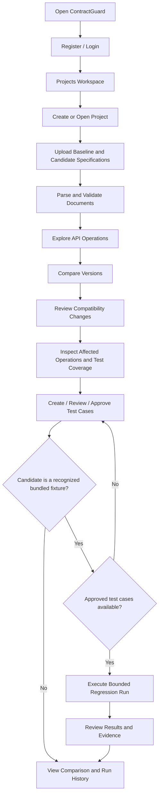
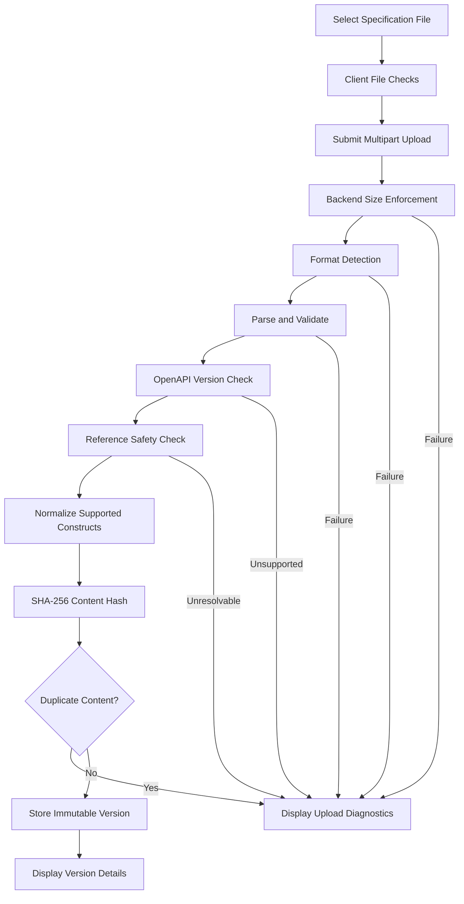
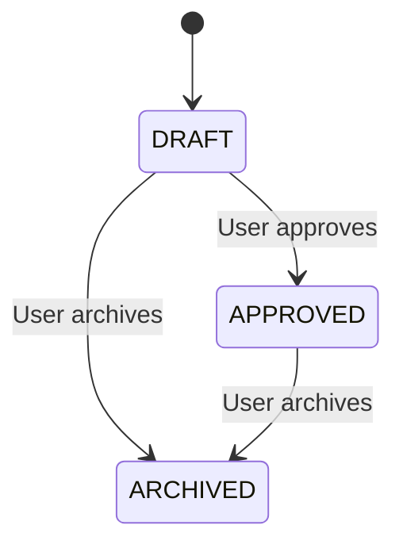
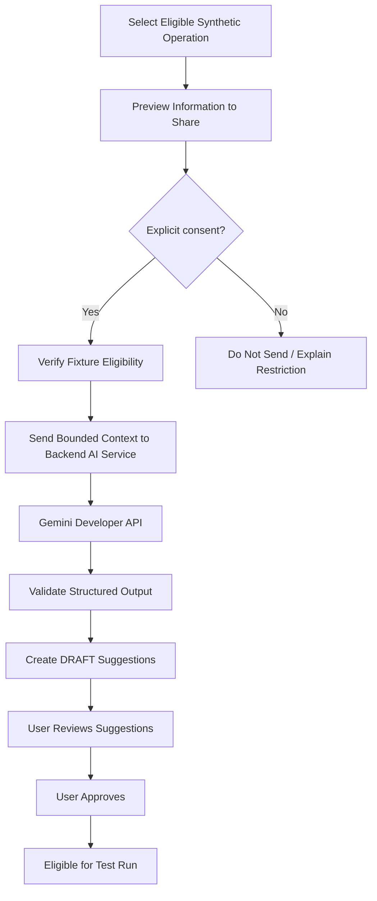
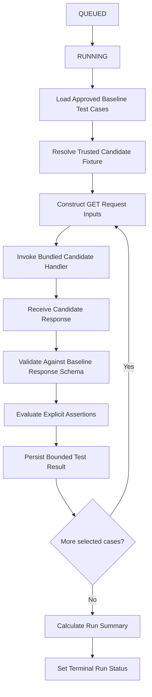

# Application Flow and User Journeys

**Product:** ContractGuard  
**Document version:** 1.1  
**Status:** Revised implementation baseline  
**Related documents:** PRD.md, Design.md, API.md, Schema.md, Architecture.md, SecurityReview.md

## 1. Purpose

This document describes how users navigate ContractGuard and how the application behaves during its primary workflows.

It defines:

- User journeys.
- Application navigation.
- Screen responsibilities.
- Specification upload and validation flow.
- API exploration.
- Version comparison.
- Change-to-test traceability.
- Test-case management.
- Regression execution.
- AI-assisted test suggestions.
- Loading, empty, error, and partial states.
- Important workflow and authorization constraints.

The primary product workflow is:

**Import API specifications → Compare versions → Understand changes → Identify affected operations and test coverage → Approve tests → Execute regression checks → Review evidence.**

## 2. User roles

V1 has one user role:

### Authenticated project owner

An authenticated user can:

- Create and manage personal projects.
- Upload API specifications.
- Explore specification versions and operations.
- Create comparisons.
- Inspect compatibility findings.
- View affected operations and linked test cases.
- Create and approve test cases.
- Execute eligible regression runs.
- Review historical comparisons and execution results.
- Request optional AI-generated test suggestions for eligible synthetic fixtures.

There are no organization administrators, team members, reviewers, or billing roles in v1.

Every project and its child resources belong to exactly one user.

## 3. Application navigation

### 3.1 Public routes

```text
/login
/register
```

Public routes provide account access.

### 3.2 Authenticated application routes

```text
/app
/app/projects
/app/projects/:projectId

/app/projects/:projectId/specifications
/app/specifications/:specVersionId
/app/specifications/:specVersionId/explorer

/app/projects/:projectId/comparisons
/app/comparisons/:comparisonId

/app/comparisons/:comparisonId/tests
/app/test-cases/:testCaseId
/app/test-runs/:testRunId
```

The exact nesting may change during frontend implementation, but the route responsibilities must remain consistent.

### 3.3 Primary navigation

The authenticated application provides:

- Projects
- Current project context
- API specifications
- Comparisons
- Test cases
- Test runs
- Account/logout

Comparison and test-run navigation should preserve the relevant project and comparison context.

### 3.4 Navigation rules

- Unauthenticated users attempting protected routes are redirected to login.
- Authenticated users visiting login or registration may be redirected to the application home.
- Invalid or inaccessible resource IDs display a safe not-found state.
- A deleted project cannot be used to create new resources.
- The backend remains the authority for ownership and permissions.
- Frontend route protection is a navigation convenience, not an authorization control.

## 4. End-to-end user journey



A comparison can be completed even when a candidate is not eligible for the bundled regression runner.

In that case, the user can still inspect comparison results and coverage, but the execution action is unavailable.

## 5. Authentication flow

### 5.1 Registration

1. User opens `/register`.
2. User enters email, password, and optional display name.
3. Frontend performs preliminary form validation.
4. Frontend submits the request to `POST /api/v1/auth/register`.
5. Backend validates the input.
6. Backend checks for duplicate email.
7. Backend hashes the password using Argon2id.
8. Backend creates the account.
9. Successful registration establishes authentication according to the configured cookie flow.
10. User is redirected to the authenticated application.

Expected outcomes:

- Valid registration: account created.
- Duplicate email: clear validation feedback.
- Invalid fields: field-level messages.
- Server failure: recoverable error message.

Passwords and authentication tokens must never be displayed or persisted in browser web storage.

### 5.2 Login

1. User opens `/login`.
2. User enters email and password.
3. Frontend submits to `POST /api/v1/auth/login`.
4. Backend validates credentials.
5. On success, backend issues the configured HttpOnly authentication cookie.
6. Frontend retrieves the current user through `GET /api/v1/auth/me`.
7. User enters `/app/projects`.

Incorrect credentials produce a generic authentication error.

### 5.3 Session restoration

When an authenticated application loads:

1. Frontend requests `/api/v1/auth/me`.
2. Backend validates the authentication cookie.
3. If valid, the user context is restored.
4. If invalid or expired, protected application state is cleared.
5. User is redirected to login.

The frontend must not attempt to decode or directly read the HttpOnly JWT.

### 5.4 Logout

1. User selects Logout.
2. Frontend sends `POST /api/v1/auth/logout`.
3. Backend clears the authentication cookie.
4. Frontend clears user-specific cached data.
5. User is redirected to login.

If the server request fails, the UI must not claim that the server-side logout succeeded. It may still clear local interface state and explain that the session could not be confirmed as terminated.

## 6. Project management flow

### 6.1 Projects list

The authenticated user opens `/app/projects`.

The screen displays:

- Project name.
- Short description.
- Last updated timestamp.
- Specification version count.
- Recent comparison activity where available.

Primary action:

`Create Project`

### 6.2 Create project

1. User selects Create Project.
2. A project form is displayed.
3. User enters a required name and optional description.
4. Frontend validates the form.
5. Backend receives `POST /api/v1/projects`.
6. Backend derives project ownership from the authenticated user.
7. Project is created.
8. User is redirected to the new project's overview.

The user cannot supply or change `ownerId`.

### 6.3 Project overview

The project overview displays:

- Project metadata.
- Specification versions.
- Recent comparisons.
- Recent test runs.
- Upload and compare actions.

An empty project displays a clear first action:

`Upload your first OpenAPI specification`

### 6.4 Update and deletion

A project owner may:

- Rename the project.
- Update its description.
- Soft-delete the project.

Soft deletion:

- Hides the project from normal project lists.
- Prevents new uploads, comparisons, tests, and runs.
- Retains historical resources and references.
- Does not permanently delete related records in v1.

A confirmation step is required before deletion.

## 7. Specification upload flow

### 7.1 Upload entry point

The user opens a project and selects:

`Upload Specification`

The upload interface accepts:

- JSON.
- YAML.

The user supplies:

- A file.
- A required version label.

Maximum upload size:

`1 MiB`

The interface clearly displays the allowed formats and size limit.

### 7.2 Upload processing



The backend is authoritative for all upload checks.

Frontend extension and size checks improve usability but do not replace backend validation.

### 7.3 Successful upload

The version detail screen displays:

- Version label.
- OpenAPI version.
- Source format.
- Upload time.
- Operation count.
- Parsing status.
- Runner eligibility.
- Warnings, where applicable.

The original uploaded specification is preserved.

A valid specification can be explored and used for comparison.

### 7.4 Invalid upload

Examples:

- Malformed JSON.
- Invalid YAML.
- Unsupported OpenAPI version.
- Invalid OpenAPI structure.
- Oversized document.
- Duplicate content.
- Unsupported custom dialect.
- Excessive nesting or parsed node count.
- Unresolved relevant references.

Behavior:

- Show an actionable error.
- Identify the relevant source location where available.
- Do not mark the version as valid.
- Do not allow invalid versions to be compared or executed.
- Do not silently discard unsupported constructs and report complete parsing.

A bounded invalid upload may be retained with parser status and diagnostics, according to the persistence policy.

### 7.5 Partial support

A structurally valid document may contain constructs that ContractGuard cannot fully analyze.

The application must distinguish:

- Invalid document.
- Unsupported OpenAPI version.
- Valid document with unsupported features.
- Fully supported document.

A valid document with unsupported relevant features may be stored and explored with warnings, but its comparison or validation result must reflect the unsupported behavior.

## 8. API Explorer flow

### 8.1 Entry

The user opens a valid specification version and selects:

`Explore API`

### 8.2 Explorer layout

The API Explorer presents:

- Path list.
- HTTP methods.
- Operation summaries.
- Parameters.
- Request body.
- Responses.
- Supported schema details.
- Reference navigation.
- Support warnings.

### 8.3 Interaction

1. User selects a path.
2. User selects an operation.
3. Operation details appear.
4. User expands a request or response section.
5. User selects a referenced schema.
6. The interface navigates to the schema definition or displays its supported details.
7. Unsupported constructs are clearly identified.

### 8.4 Restrictions

The API Explorer is read-only.

It does not:

- Send requests to specification server URLs.
- Execute user-provided examples.
- Contact external references.
- Act as a general HTTP client.

The explorer renders specification content as data, not executable browser markup.

## 9. Version comparison flow

### 9.1 Entry points

The user may open comparison creation from:

- Project overview.
- Specification version history.
- Comparison history.

Primary action:

`Compare Versions`

### 9.2 Version selection

The user selects:

- Baseline version.
- Candidate version.

The interface explains:

- Baseline = existing consumer contract.
- Candidate = new provider contract.

The same version cannot be selected for both sides.

Both versions must belong to the same project and be valid comparison inputs.

### 9.3 Comparison creation

1. User selects baseline and candidate.
2. Frontend displays the comparison direction.
3. User submits the request.
4. Backend verifies ownership and version compatibility.
5. Backend loads normalized representations.
6. Compatibility engine matches operations.
7. Supported rules are applied.
8. Shared-schema impact is evaluated.
9. Stable findings are generated.
10. Overall analysis status is calculated.
11. Report is persisted.
12. User is navigated to the comparison workspace.

The compatibility engine does not use AI to determine findings.

### 9.4 Comparison result

The comparison page displays:

- Baseline and candidate labels.
- Ruleset version.
- Comparison direction.
- Overall analysis status.
- Classification counts.
- Detected changes.
- Unsupported analysis warnings.

Classification filters:

- Breaking.
- Potentially breaking.
- Non-breaking.
- Informational.
- Unsupported.

The user can also filter by path and HTTP method.

### 9.5 Comparison outcomes

**Complete analysis**

Every relevant compared construct was handled by the supported ruleset.

This does not establish runtime compatibility.

**Partial analysis**

At least one relevant construct could not be completely evaluated.

The interface must highlight the unsupported portion and explain why.

**Failed analysis**

The comparison could not be produced due to an unrecoverable error.

The interface offers an appropriate recovery action, such as reviewing the documents or retrying after correcting a problem.

A partial result must never be presented as completely compatible.

## 10. Comparison workspace and change detail flow

### 10.1 Primary comparison workspace

This is the signature ContractGuard screen.

It presents three coordinated areas:

1. Version comparison and source context.
2. Change list and filters.
3. Change details and test impact.

The screen must support:

- Quick severity scanning.
- Operation-level navigation.
- JSON Pointer/source-location context.
- Rationale inspection.
- Affected-operation review.
- Test coverage inspection.

### 10.2 Change selection

1. User selects a finding from the change list.
2. Detail panel opens.
3. ContractGuard displays its rule ID.
4. Baseline and candidate values are shown where available.
5. Classification and rationale are displayed.
6. Affected operation keys are listed.
7. Linked baseline test cases are retrieved.
8. Coverage status is displayed.

### 10.3 Shared-schema change

When a shared component changes:

1. The finding identifies the source component.
2. The reference-impact analysis identifies supported referencing operations.
3. The detail panel lists affected operations.
4. The test-coverage projection retrieves test cases belonging to those operations.
5. Unsupported reference impact remains explicitly visible.

If a shared-reference relationship cannot be established, the application must not pretend that the impact list is exhaustive.

### 10.4 Coverage states

`COVERED`

At least one approved test case is linked to an affected operation.

`DRAFT_ONLY`

Test cases exist but none is approved.

`UNCOVERED`

No test case is linked.

The interface must explain that coverage means test-case availability, not successful execution.

## 11. Test-case management flow

### 11.1 Entry points

A user can open test-case management from:

- An API Explorer operation.
- A change detail panel.
- A comparison test-coverage section.
- The project's test-case list.

### 11.2 Create manual test case

1. User selects an operation.
2. User chooses Create Test Case.
3. Operation details are displayed.
4. User enters a title and optional description.
5. User supplies supported path/query parameter values.
6. User optionally configures supported assertions.
7. Frontend validates the form.
8. Backend validates the operation and input values.
9. Test case is stored as `DRAFT`.
10. User can review and approve it.

A test case is created against the specification version that defines the baseline consumer contract.

### 11.3 Approval flow



Only approved test cases are eligible for execution.

The backend controls the state transition.

The frontend cannot turn a test case into an approved case by changing a request-body field.

Approved test cases must not be silently modified after a run has used them.

If a correction is required, create a new draft based on the previous case and review it separately.

### 11.4 Test-case validation errors

Possible errors:

- Operation does not exist in the selected baseline version.
- Parameter name does not match the operation.
- Required input is missing.
- Input violates supported parameter constraints.
- Unsupported serialization behavior.
- Invalid assertion structure.
- Input exceeds configured length limits.

Display a field-specific diagnostic wherever possible.

## 12. AI-assisted test suggestion flow

### 12.1 Eligibility

AI suggestions are optional.

The feature is available only for recognized bundled synthetic Demo Store fixtures and supported operations.

A user-uploaded specification must not be sent to the unpaid AI provider.

### 12.2 User journey



### 12.3 Consent screen

Before submission, show:

- Selected operation.
- Fixture identity.
- Sanitized information to be shared.
- External provider disclosure.
- Relevant unpaid-provider data-use warning.

The user explicitly accepts the submission.

Consent is required for each provider submission.

### 12.4 AI output handling

- The backend validates the response structure.
- Unknown fields are rejected.
- Unsupported operations are rejected.
- Arbitrary URLs and executable code are rejected.
- Accepted suggestions become draft test cases.
- The user reviews and approves each case.

AI never determines compatibility classifications or regression results.

### 12.5 AI unavailable

Possible conditions:

- No API key.
- Feature disabled.
- Provider quota exceeded.
- Provider unavailable.
- Timeout.
- Invalid model output.
- Invalid structured response.

The application displays a useful explanation.

Manual test creation and all core comparison features continue working.

No paid provider fallback is attempted.

## 13. Regression execution flow

### 13.1 Eligibility requirements

The user can start a test run only when:

- The project is active.
- The comparison belongs to the project.
- The candidate version is associated with a recognized bundled implementation.
- The comparison has an appropriate baseline version.
- Every selected test case belongs to that baseline version.
- Every selected test case is approved.
- The test count is within the configured maximum.
- Execution concurrency limits permit the run.

An arbitrary uploaded specification cannot become a runner target merely by declaring a server URL.

### 13.2 Start run

1. User opens a comparison.
2. User selects the Tests section.
3. ContractGuard displays linked approved baseline test cases.
4. User chooses the cases to execute.
5. The UI displays the selected test count and known execution limitations.
6. User selects Run Tests.
7. Frontend sends the selected test-case IDs and comparison context.
8. Backend independently validates every relationship and approval state.
9. Server chooses the trusted bundled candidate implementation.
10. A test run is created with `QUEUED` status.
11. The API returns `202 Accepted`.
12. The interface opens the run-detail view.

The client never supplies the execution URL, host, IP address, or alternative implementation version.

### 13.3 Run execution



### 13.4 Execution constraints

V1 supports:

- GET operations only.
- Bundled Demo Store implementations.
- Up to 20 approved test cases per run.
- Two concurrent runs.
- Two concurrent tests per run.
- Five-second per-test timeout.
- Sixty-second total run deadline.

The interface must not suggest that ContractGuard can test arbitrary production APIs.

### 13.5 Run statuses

Run-level statuses:

- `QUEUED`
- `RUNNING`
- `PASSED`
- `FAILED`
- `PARTIAL`
- `INTERRUPTED`

Individual test results:

- `PASSED`
- `FAILED`
- `SKIPPED`
- `UNSUPPORTED`
- `ERROR`

A timeout, unsupported operation, or execution error must never be displayed as a successful test.

`CANCELLED` is not part of the v1 workflow.

### 13.6 Run result definitions

**PASSED**

Every executed supported test passed, with no unsupported or errored result affecting the run.

**FAILED**

One or more executed tests failed contract or assertion checks, and no unsupported or execution-error condition makes the run partial.

**PARTIAL**

One or more selected tests could not be completely evaluated, including unsupported cases or execution errors.

**INTERRUPTED**

The process stopped before the run could be finalized.

### 13.7 Run detail screen

Display:

- Run ID.
- Comparison reference.
- Baseline version.
- Candidate version.
- Ruleset version.
- Fixture implementation version.
- Run status.
- Start and completion times.
- Total/pass/fail/skip/unsupported/error counts.
- Individual test results.
- Actual response status when available.
- Duration.
- Validation diagnostics.
- Bounded sanitized evidence.

The interface must distinguish a contract failure from an infrastructure or support limitation.

### 13.8 Status updates

Use TanStack Query polling for non-terminal runs.

Suggested initial polling behavior:

- Poll every two seconds while the run is actively executing.
- Increase the interval when the run remains active for longer periods.
- Stop polling after a terminal state.
- Allow manual refresh.

Socket.IO and persistent streaming infrastructure are not required.

### 13.9 Interrupted run

If the application server restarts before completion:

1. Startup recovery identifies unfinished runs.
2. Their status becomes `INTERRUPTED`.
3. The user sees an interruption message.
4. The user may inspect any persisted evidence.
5. The user may start a new run after rechecking eligibility.

Do not automatically present an interrupted run as successful or retry it as though no execution occurred.

## 14. History and reporting flow

### 14.1 Comparison history

Project overview displays recent comparisons.

The comparison-history screen includes:

- Baseline version.
- Candidate version.
- Creation date.
- Ruleset version.
- Analysis status.
- Classification summary.

Selecting a report opens its saved findings without rerunning the comparison.

### 14.2 Test-run history

The user can inspect runs for a comparison.

The interface displays:

- Run date.
- Run status.
- Test count.
- Pass/fail/partial summary.
- Associated comparison.
- Selected baseline test cases.

Selecting a run displays its persisted result evidence.

### 14.3 Historical consistency

A new specification upload must not rewrite earlier comparisons.

A new ruleset version must not silently reinterpret old reports.

A new test case must not modify earlier run results.

A test case edited or replaced after a run must not alter the historical test-run snapshot.

## 15. Screen inventory

| Screen | Primary purpose | Key actions |
|---|---|---|
| Login | Authenticate user | Login |
| Registration | Create account | Register |
| Projects | Display personal projects | Create/open project |
| Project overview | Show versions and activity | Upload, compare |
| Specification upload | Import OpenAPI files | Upload |
| Specification detail | Inspect version and validation | Explore, compare |
| API Explorer | Inspect operations and schemas | Create test case |
| Comparison creation | Choose comparison versions | Compare |
| Comparison workspace | Inspect API changes | Filter, inspect |
| Change detail | Explain one finding | View impact and coverage |
| Test-case library | Manage baseline cases | Create, edit, approve, archive |
| Test-case detail | Inspect one test | Review and approve |
| AI suggestion review | Review proposed tests | Accept, edit, reject |
| Test-run detail | Monitor and inspect evidence | Refresh, view results |
| Comparison history | Revisit reports | Open report |
| Account | Account details and logout | Logout |

## 16. Global interface states

Every major screen must account for appropriate application states.

### 16.1 Loading

Display a clear loading state when data is being retrieved or an action is being processed.

Avoid showing stale or misleading data as if the new action has succeeded.

### 16.2 Empty

Examples:

- No projects yet.
- No specification versions uploaded.
- No comparisons created.
- No test cases exist.
- No test runs recorded.
- No test coverage is linked to a change.

Every empty state should explain what the user can do next.

### 16.3 Error

Examples:

- Authentication expired.
- Network failure.
- Invalid resource ID.
- Upload rejected.
- Database unavailable.
- Comparison failed.
- Test execution could not start.

Display an actionable error and preserve relevant user input where safe.

### 16.4 Partial

Partial states are particularly important.

Examples:

- Some OpenAPI constructs are unsupported.
- Reference impact cannot be fully determined.
- Some selected tests are unsupported.
- One or more execution errors occur.
- AI provider response fails validation.

The interface must explain what was evaluated and what remains uncertain.

### 16.5 Success

Display confirmation when an operation has actually succeeded according to the backend response.

Examples:

- Project created.
- Specification uploaded.
- Comparison completed.
- Test case approved.
- Test run completed.

Do not claim that an asynchronous run passed merely because it was accepted for execution.

## 17. Access and state-transition rules

The backend enforces the following conditions:

| Action | Required condition |
|---|---|
| Upload specification | Active project owned by user |
| Create comparison | Both valid versions belong to same owned project |
| Create test case | Valid operation in selected specification version |
| Approve test case | Owned draft test case |
| Create test run | Owned comparison with eligible candidate fixture |
| Select test case | Approved and belongs to comparison baseline |
| View test-run details | Run belongs to an owned project |
| Request AI suggestion | Eligible synthetic fixture and explicit consent |
| Update project | Active project owned by user |

The frontend may disable unavailable actions, but the backend must independently enforce all conditions.

## 18. Error and recovery matrix

| Scenario | Expected behavior |
|---|---|
| Upload exceeds 1 MiB | Reject upload and display size limit |
| Invalid JSON/YAML | Show parse diagnostics |
| Unsupported OpenAPI version | Show unsupported-version message |
| Unsupported schema construct | Preserve visible partial-analysis warning |
| Duplicate specification content | Show duplicate-upload error |
| Baseline/candidate belong to different projects | Reject comparison |
| Candidate lacks recognized fixture profile | Allow comparison; disable regression execution |
| Test case belongs to another baseline | Reject test-run creation |
| Test case is still a draft | Reject execution |
| User selects more than 20 cases | Reject or prevent selection according to the configured limit |
| Runner concurrency limit reached | Explain temporary unavailability |
| Individual execution times out | Mark individual result as error and aggregate appropriately |
| Server restarts during run | Mark unfinished run interrupted |
| AI is not configured | Disable AI feature; preserve manual workflow |
| AI quota is exceeded | Display provider-unavailable message |
| AI output is invalid | Reject suggestion and retain safe application state |
| Authentication expires | Clear protected state and request login |
| User accesses another user's resource | Return safe not-found response |

## 19. User-interface acceptance criteria

- The user can complete registration and login.
- The user can create and open a project.
- The user can upload valid JSON and YAML OpenAPI documents.
- The user receives understandable validation errors.
- The user can explore operations and supported schemas.
- The user can select baseline and candidate versions.
- The comparison page clearly identifies the comparison direction.
- The user can filter and inspect changes.
- Each supported change displays its rule ID, source location, and rationale.
- The user can inspect affected operations.
- The user can see linked test cases and coverage status.
- The user can create, review, approve, and archive test cases.
- AI suggestions are visibly optional and clearly identified as generated drafts.
- The user can execute eligible approved tests against the bundled candidate implementation.
- The user can review test-run status and bounded evidence.
- The user can distinguish passing, failing, partial, unsupported, and interrupted outcomes.
- Historical comparisons and test runs can be reopened.
- All major screens have loading, empty, error, and relevant partial states.
- Core application navigation remains usable without AI configuration.

## 20. Design dependency

The visual layout, screen density, interaction details, component hierarchy, responsive behavior, and accessibility requirements are specified in `Design.md`.

This document defines the application workflow and behavior.

`Design.md` defines how that behavior is presented to the user.

The two documents must remain consistent.

## 21. Related technical references

- React Router:  
  https://reactrouter.com/

- TanStack Query:  
  https://tanstack.com/query/latest/docs/framework/react

- Express:  
  https://expressjs.com/

- React Hook Form:  
  https://react-hook-form.com/

- OWASP CSRF Prevention:  
  https://cheatsheetseries.owasp.org/cheatsheets/Cross-Site_Request_Forgery_Prevention_Cheat_Sheet.html

- OWASP SSRF Prevention:  
  https://cheatsheetseries.owasp.org/cheatsheets/Server_Side_Request_Forgery_Prevention_Cheat_Sheet.html
