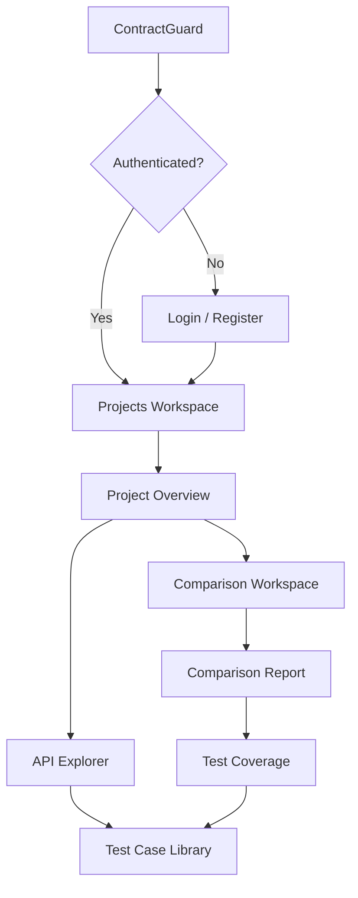
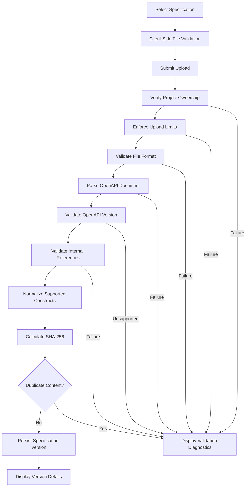
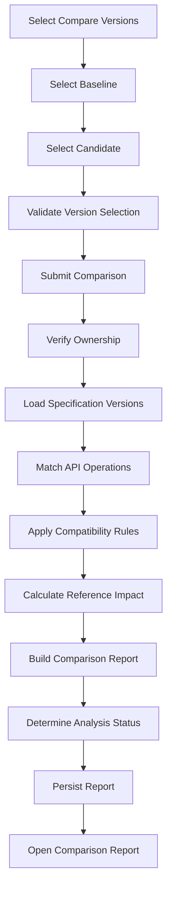

# ContractGuard — Application Flow and User Journeys

**Document:** Application Flow and User Journeys
**Version:** 1.2
**Product:** ContractGuard
**Status:** Revised implementation baseline
**Last updated:** 11 November 2026

---

## 1. Purpose

This document defines how users interact with ContractGuard, how they navigate between application screens, and how the primary product workflows operate.

It establishes the expected user journeys, application states, navigation structure, validation behavior, and relationships between the frontend and backend.

The central product workflow is:

**Import API Specifications → Explore API Contracts → Compare Versions → Identify Changes → Analyse Impact → Review Test Coverage → Approve Test Cases → Execute Regression Tests → Inspect Evidence.**

The application is designed around a single-user project workspace.

Every project and its associated resources belong to an authenticated user. The backend is responsible for authentication, authorization, validation, and all authoritative application state transitions.

This document distinguishes functionality available in the current implementation from functionality planned for subsequent development phases.

---

## 2. User Roles and Access Model

### 2.1 Authenticated Project Owner

ContractGuard v1 has one primary user role: an authenticated project owner.

The project owner can:

- Register and authenticate.
- Create and manage personal projects.
- Upload OpenAPI specifications.
- Inspect specification versions.
- Explore API operations and reusable components.
- Compare baseline and candidate specifications.
- Review compatibility findings.
- Inspect affected operations.
- Manage baseline-version test cases.
- Review test coverage.
- Approve and archive test cases.
- Access historical comparison reports.

Future execution capabilities will allow the owner to run eligible approved test cases against a controlled bundled implementation.

### 2.2 Access Boundaries

Every project-owned resource must be associated with its parent project.

The backend must verify ownership before allowing access to:

- Project records.
- Specification versions.
- Comparison reports.
- Test cases.
- Future test-run records.

The frontend may hide unavailable actions or protect navigation routes, but these measures do not replace backend authorization.

### 2.3 Out-of-Scope Roles

The following are not part of v1:

- Organization administrators.
- Team members.
- Workspace reviewers.
- Billing administrators.
- External API consumers.
- Multi-tenant organization managers.

---

## 3. Application Navigation

### 3.1 Application Entry Points

The primary public routes are:

| Route | Purpose | Access |
|---|---|---|
| `/` | Redirect to the projects workspace | Public entry |
| `/login` | User authentication | Public |
| `/register` | Account registration | Public |

Authenticated application routes:

| Route | Purpose |
|---|---|
| `/projects` | Projects workspace |
| `/projects/:projectId` | Project overview |
| `/projects/:projectId/specifications/:specVersionId/explorer` | API Explorer |
| `/projects/:projectId/comparisons` | Comparison workspace |
| `/projects/:projectId/diff-reports/:reportId` | Comparison report details |
| `/projects/:projectId/specifications/:specVersionId/test-cases` | Baseline test-case library |
| `/projects/:projectId/diff-reports/:reportId/coverage` | Comparison test-coverage projection |

These routes reflect the current Phase 6 React application routing structure.

### 3.2 Application Shell

Authenticated screens share a common application shell.

The shell contains:

**Sidebar**

- ContractGuard branding.
- Projects navigation.
- Context-sensitive Test Cases navigation.
- Context-sensitive Test Coverage navigation.
- Authenticated account details.
- Sign-out action.

**Top navigation bar**

- Workspace breadcrumb.
- Current page context.
- Personal workspace indicator.

**Main content area**

Displays the currently selected page through the nested application route.

The application shell should remain consistent across the Projects, Explorer, Comparison, and Test Case workflows.

### 3.3 Navigation Rules

- Unauthenticated users accessing protected routes are redirected to login.
- Authenticated users accessing login or registration can be redirected to the application workspace.
- Invalid or inaccessible resource IDs display a safe not-found state.
- Project-specific navigation must preserve the correct project context.
- Comparison-specific navigation must preserve the comparison identifier.
- The backend remains authoritative for project and resource ownership.
- Expired authentication must result in safe session recovery.

### 3.4 Navigation Structure



The regression-run and AI workflows are future capabilities and are intentionally excluded from the currently available route structure.

---

## 4. Authentication Flow

### 4.1 Registration

**Route:** `/register`

The registration workflow allows a new user to create a ContractGuard account.

User journey:

1. User opens the registration page.
2. User enters an email address.
3. User enters a password.
4. User optionally provides a display name.
5. Frontend performs preliminary validation.
6. User submits the registration form.
7. Backend validates the request.
8. Backend checks for an existing account with the same email.
9. Backend hashes the password using bcrypt.
10. Backend creates the account.
11. Backend issues the configured JWT authentication cookie.
12. Frontend establishes authenticated application state.
13. User is redirected to the Projects workspace.

Expected outcomes:

| Scenario | Application behavior |
|---|---|
| Valid registration | Account created and authenticated |
| Duplicate email | Display duplicate-account error |
| Invalid email | Display validation feedback |
| Invalid password | Display password validation feedback |
| Backend failure | Display recoverable error |

Passwords must never be displayed, returned in API responses, or stored in browser web storage.

### 4.2 Login

**Route:** `/login`

User journey:

1. User opens the login page.
2. User enters email and password.
3. Frontend validates basic form input.
4. User submits credentials.
5. Backend retrieves the account.
6. Backend verifies the password hash.
7. Backend creates a signed JWT.
8. Backend sets the `cg_access` HttpOnly cookie.
9. Frontend receives the successful authentication response.
10. User is redirected to `/projects`.

Incorrect credentials must return a generic authentication error rather than revealing whether an email address exists.

### 4.3 Session Restoration

When the application loads:

1. Frontend requests the authenticated user's information through `/api/v1/auth/me`.
2. Browser automatically supplies the authentication cookie.
3. Backend verifies the token.
4. Backend retrieves the authenticated account.
5. Frontend restores the user's application context.
6. Protected routes become accessible.

If the session is invalid or expired:

- User-specific cached information must be cleared.
- Protected routes must become inaccessible.
- User must be redirected to login.

The frontend must not attempt to read the HttpOnly JWT.

### 4.4 Logout

User journey:

1. User selects Sign Out from the sidebar.
2. Frontend initiates the logout mutation.
3. Backend clears the authentication cookie.
4. Frontend clears authenticated application state.
5. User is redirected to `/login`.

While logout is pending, the action must remain disabled to prevent repeated submissions.

If the logout request fails, the UI must show an error and must not claim that the server-side session was successfully terminated.

---

## 5. Project Management Flow

### 5.1 Projects Workspace

**Route:** `/projects`

The Projects workspace is the default authenticated landing page.

It displays the projects associated with the current user.

Primary information:

- Project name.
- Project description.
- Creation or modification timestamp.
- Specification version information where available.

Primary actions:

- Create Project.
- Open Project.
- Update Project.
- Delete Project.

The interface should remain uncluttered when the user owns only one or two projects.

### 5.2 Empty Projects State

When no project exists, display an empty state explaining that the user needs to create a project before uploading specifications.

Primary action:

**Create Your First Project**

The interface must make the next action obvious rather than displaying an empty table without explanation.

### 5.3 Create Project

User journey:

1. User selects Create Project.
2. Project creation form opens.
3. User enters a project name.
4. User optionally enters a description.
5. Frontend performs input validation.
6. Backend validates the request.
7. Backend derives ownership from the authenticated user.
8. Project is created.
9. Projects query is refreshed.
10. User can open the newly created project.

A client request must never be allowed to assign a different project owner.

### 5.4 Project Overview

**Route:** `/projects/:projectId`

The project overview provides the central context for specification management and comparisons.

It may display:

- Project name.
- Project description.
- Specification version history.
- Recent comparisons.
- Recent project activity.
- Upload Specification action.
- Compare Versions action.

An empty project should display an informative first-use state.

### 5.5 Update Project

User journey:

1. User opens the project overview.
2. User selects the project editing action.
3. Name and description fields become editable.
4. User makes the required changes.
5. Frontend validates input.
6. Backend verifies ownership.
7. Project is updated.
8. The displayed project information is refreshed.

### 5.6 Delete Project

The current Phase 5 project service performs project deletion through a MongoDB transaction.

The deletion process removes dependent project records before deleting the project record.

User journey:

1. User selects Delete Project.
2. Confirmation dialog explains the destructive action.
3. User explicitly confirms.
4. Frontend submits the deletion request.
5. Backend verifies project ownership.
6. Backend begins the database transaction.
7. Associated project-owned records are deleted.
8. Project is deleted.
9. Transaction commits.
10. Frontend returns to the Projects workspace.

Project deletion is currently a permanent deletion operation with dependent-record cleanup, not soft deletion.

The interface must display a clear warning before the action.

If the operation fails, the user must receive an error rather than a false success confirmation.

---

## 6. Specification Management Flow

### 6.1 Upload Entry Point

The user opens a project and selects:

**Upload Specification**

Supported formats:

- OpenAPI JSON.
- OpenAPI YAML.

The initial upload limit is:

`1 MiB`

The upload form contains:

- File selection.
- Version label where applicable.
- Upload action.

The application should communicate the supported file formats and size limit before submission.

### 6.2 Upload Processing



Client-side validation improves the user experience, but the backend independently performs all security and specification checks.

### 6.3 Successful Upload

Following successful processing, the version detail view displays:

- Specification label.
- OpenAPI version.
- Document title.
- Source format.
- Operation count.
- Upload timestamp.
- Parsing status.
- Explorer completeness.
- Relevant support warnings.

Original uploaded source content must remain unchanged.

The specification version becomes available to the API Explorer and comparison workflows when its validation status permits.

### 6.4 Duplicate Upload

The backend computes a SHA-256 hash from the original uploaded bytes.

If identical content already exists in the same project:

- Duplicate detection is triggered.
- A duplicate resource error is returned.
- A second identical version is not silently created.

### 6.5 Invalid Specification

Invalid conditions may include:

- Malformed JSON.
- Invalid YAML.
- Unsupported OpenAPI version.
- Invalid document structure.
- Oversized upload.
- Unsupported file format.
- Duplicate content.
- Unresolved internal references.
- Excessive parser depth or node count.

The application must:

- Present actionable error information.
- Preserve useful source-location diagnostics where available.
- Avoid enabling comparison for invalid specification versions.
- Avoid silently discarding unsupported features.
- Never report full compatibility merely because parsing succeeded.

### 6.6 Partially Supported Specification

A valid OpenAPI document may contain constructs outside ContractGuard's supported analysis subset.

The interface must distinguish:

- Valid and fully supported specification.
- Valid but partially supported specification.
- Invalid specification.
- Unsupported OpenAPI version.

A partially supported document may still be available for supported exploration operations, but comparison results must reflect the limitations.

---

## 7. API Explorer Flow

### 7.1 Entry

**Route:** `/projects/:projectId/specifications/:specVersionId/explorer`

A user reaches the API Explorer through a selected specification version in the project workspace.

### 7.2 Explorer Responsibilities

The explorer provides a read-only interface for inspecting the uploaded API contract.

It displays:

- API paths.
- HTTP methods.
- Operation identifiers.
- Operation summaries and descriptions.
- Effective parameters.
- Supported request-body definitions.
- Response definitions.
- Reusable schema components.
- Internal reference information.
- Source JSON Pointers.
- Support warnings.

### 7.3 Operation Exploration

User journey:

1. User opens the API Explorer.
2. The application retrieves the specification's operations.
3. The path and method list is displayed.
4. User selects an operation.
5. The operation-detail panel opens.
6. User inspects parameters, request definitions, and response definitions.
7. User can expand relevant schema structures.
8. User can navigate to referenced components when supported.

The selected operation should remain identifiable while the user explores its details.

### 7.4 Component Exploration

The explorer allows users to inspect supported reusable components.

User journey:

1. User selects a component category.
2. Application retrieves the components belonging to that category.
3. User selects a component.
4. The component definition is displayed.
5. Supported internal references can be followed.
6. The interface displays relevant reference-resolution information.

The displayed component must retain its original source identity.

### 7.5 Reference Navigation

The explorer provides visibility into:

- Original `$ref` values.
- Source locations.
- Resolved target pointers.
- Reference-resolution chains where available.
- Circular-reference information.
- Unresolved-reference diagnostics.

External references are not fetched.

The explorer must never use an uploaded document's server definitions as execution destinations.

### 7.6 Explorer Restrictions

The API Explorer is read-only.

It is not a general-purpose HTTP client.

It must not:

- Execute uploaded examples.
- Fetch arbitrary server URLs.
- Contact external reference URLs.
- Execute document-provided code or scripts.
- Treat specification content as browser markup.

Specification content must be rendered as safe data.

---

## 8. Version Comparison Flow

### 8.1 Entry Points

Comparison creation is accessible from:

- Project overview.
- Specification version history.
- Comparison workspace.

Primary action:

**Compare Versions**

### 8.2 Version Selection

The user selects:

- Baseline specification version.
- Candidate specification version.

The interface must clearly explain the distinction:

**Baseline:** The existing contract expected by consumers.

**Candidate:** The proposed updated contract provided by the API.

The same version cannot be selected for both roles.

Both versions must belong to the same owned project and meet the comparison eligibility requirements.

### 8.3 Comparison Creation



### 8.4 Comparison Direction

The comparison direction is:

`BASELINE_CONSUMER_TO_CANDIDATE_PROVIDER`

The interface must make it clear that the candidate is evaluated against existing consumer expectations.

The comparison uses the server-controlled ruleset:

`CG-COMPAT-1.1`

The frontend cannot change the ruleset identifier or select an alternative compatibility direction.

### 8.5 Comparison Processing

The backend:

1. Verifies project ownership.
2. Loads both specification versions.
3. Validates their eligibility.
4. Retrieves normalized representations.
5. Matches baseline and candidate operations.
6. Evaluates supported compatibility rules.
7. Evaluates supported shared-schema impact.
8. Generates stable finding identifiers.
9. Calculates classification summaries.
10. Determines overall analysis status.
11. Persists the comparison report.

The compatibility engine is deterministic and does not use AI for classifications.

### 8.6 Comparison Outcomes

#### COMPLETE

All relevant constructs within the supported analysis scope were evaluated.

This does not prove that a real provider implementation is runtime-compatible.

#### PARTIAL

One or more relevant constructs could not be completely evaluated.

The interface must display the unsupported or incomplete analysis information.

#### FAILED

The comparison could not be completed due to an unrecoverable failure.

The interface must display an appropriate error and preserve the user's ability to retry when appropriate.

A partial report must never be presented as a complete compatibility assessment.

---

## 9. Comparison Workspace

### 9.1 Overview

The comparison workspace is the primary ContractGuard analysis interface.

It should organize information around three connected responsibilities:

1. Comparison context and version information.
2. Compatibility findings and filters.
3. Selected finding details and test impact.

The interface must prioritize explainability rather than displaying only numerical classification totals.

### 9.2 Comparison Summary

The overview presents:

- Baseline version.
- Candidate version.
- Comparison direction.
- Ruleset version.
- Analysis status.
- Breaking finding count.
- Potentially breaking finding count.
- Non-breaking finding count.
- Informational finding count.
- Unsupported finding count.

### 9.3 Finding List

The finding list organizes changes by classification, operation, and source location.

The user should be able to:

- Filter by classification.
- Filter by HTTP method where applicable.
- Filter by API path.
- Select a finding.
- View its summary.
- Identify the associated compatibility rule.

Each finding should be understandable without requiring the user to inspect raw database records.

### 9.4 Finding Details

Selecting a finding opens its detail context.

The detail area displays:

- Stable change identifier.
- Rule identifier.
- Classification.
- HTTP method and path where applicable.
- Original operation key.
- Source JSON Pointer.
- Baseline value where available.
- Candidate value where available.
- Summary.
- Compatibility rationale.
- Affected operation keys.
- Available linked test cases.
- Coverage state where supported.

The rationale should explain why the relevant compatibility rule applies.

### 9.5 Shared-Schema Impact

When a shared schema component changes:

1. The compatibility engine identifies the changed schema location.
2. Reverse-reference impact analysis identifies supported referencing operations.
3. Candidate operation matches are translated to their corresponding baseline operation keys.
4. The finding receives its affected operation keys.
5. The detail area displays the affected operations.
6. Coverage lookup uses the baseline test-case library.

The v1 impact analysis uses a conservative reference closure within the containing operation scope. Consequently, it may over-approximate impact when several unrelated schemas are referenced in one scope.

Only schema-comparison findings fan out through shared references.

Non-schema metadata changes, status-code changes, parameter metadata changes, and request-body requiredness changes remain associated with their direct operation.

If the reference graph is incomplete, external, unresolved, circular, or exceeds configured analysis limits, the application must show the corresponding warning and partial-analysis status.

The interface must never imply pointer-exact impact when the underlying analysis is conservative.

---

## 10. Change-to-Test Coverage Flow

### 10.1 Purpose

Change-to-test traceability connects compatibility findings to test cases associated with the affected baseline operations.

The primary relationship is:

**Finding → Affected Operations → Baseline Test Cases → Coverage Status**

Coverage is derived from the current test-case library.

It is not an independent mutable record stored inside a completed comparison.

### 10.2 Coverage Entry Point

**Route:** `/projects/:projectId/diff-reports/:reportId/coverage`

The comparison report acts as the source of the baseline version ID.

The frontend retrieves the comparison and uses its baseline specification version to load the appropriate test-case library and coverage information.

### 10.3 Coverage Summary

The coverage view displays:

- Total comparison changes.
- Covered changes.
- Draft-only changes.
- Uncovered changes.
- Unmapped changes.

### 10.4 Coverage Status Definitions

**COVERED**

Every affected baseline operation has at least one approved linked test case.

**DRAFT_ONLY**

Every affected baseline operation has a linked case, but at least one affected operation is covered only by draft cases.

**UNCOVERED**

At least one affected baseline operation has no linked draft or approved test case.

**UNMAPPED**

The finding does not contain a usable affected operation key.

### 10.5 Operation-Complete Coverage Rule

Coverage is evaluated independently for every affected baseline operation.

For example, if a shared-schema change affects three operations:

- Operation A has an approved case.
- Operation B has an approved case.
- Operation C has only a draft.

The finding is `DRAFT_ONLY`, not `COVERED`.

If Operation C has no linked case, the finding is `UNCOVERED`.

Archived cases are ignored.

A single approved case for one affected operation cannot cover a finding affecting multiple operations.

### 10.6 Coverage Details

For each finding, the view displays:

- Number of affected operations.
- Number of approved-covered operations.
- Number of draft-only operations.
- Number of uncovered operations.
- Number of linked test cases.
- Approved case count.
- Draft case count.
- Linked test-case information.

### 10.7 Important Interpretation

Coverage represents test-case availability.

It does not establish:

- Test execution success.
- Candidate response validity.
- Production compatibility.
- API availability.

Successful regression execution will be represented separately through the future test-run workflow.

---

## 11. Test-Case Management Flow

### 11.1 Entry Points

The test-case library is accessible from:

- API Explorer operation context.
- Specification-version context.
- Project workspace navigation.
- Comparison coverage view.

Current route:

`/projects/:projectId/specifications/:specVersionId/test-cases`

### 11.2 Test-Case Library

The library displays saved cases associated with one specification version.

Information includes:

- Test-case title.
- Operation method.
- Operation path.
- Source.
- Lifecycle status.
- Creation date.
- Updated date.

Available status filters:

- All cases.
- Draft.
- Approved.
- Archived.

The library must distinguish draft test definitions from approved cases.

### 11.3 Create Manual Test Case

The current v1 manual workflow supports GET path operations only.

User journey:

1. User opens the baseline test-case library.
2. User selects New Test Case.
3. A creation panel opens.
4. User selects an available GET operation.
5. User enters a title.
6. User optionally enters a description.
7. User enters path and query parameter values as JSON.
8. User defines supported response assertions.
9. Frontend validates JSON structure.
10. User submits the form.
11. Backend verifies the baseline specification version.
12. Backend verifies the canonical operation key and original operation path.
13. Backend verifies required and declared parameter values.
14. Backend validates assertions.
15. Test case is stored in `DRAFT` status.
16. The library refreshes.
17. The created case becomes available for inspection.

### 11.4 Supported Request Inputs

The current test-case model supports:

- Path parameters.
- Query parameters.

The request input structure is:

```json
{
  "pathParams": {
    "recordId": "record-100"
  },
  "queryParams": {
    "includeHistory": "false"
  }
}
```

The backend validates parameter names and required values against the effective baseline operation definition.

The following are not accepted:

- User-supplied target URLs.
- Arbitrary hostnames.
- Custom request headers.
- Authentication credentials.
- Arbitrary network destinations.
- Request-body execution.
- Executable scripts or shell commands.

### 11.5 Response Assertions

The current test-case workflow supports:

- Expected HTTP status.
- Property-value assertions.
- Property-presence assertions.
- Required-property assertions.

Assertions must be valid, bounded JSON structures.

The baseline API response schema remains the authoritative contract for the future regression runner.

### 11.6 Test-Case Detail

Selecting a saved case opens its detail panel.

The detail view displays:

- Title.
- Description.
- Baseline operation.
- Canonical operation key.
- Request inputs.
- Response assertions.
- Current lifecycle status.
- Creation timestamp.
- Updated timestamp.
- Approval timestamp where applicable.

### 11.7 Draft Editing

Only draft test cases can be modified.

The user can update:

- Title.
- Description.
- Request inputs.
- Assertions.

The backend revalidates the operation and its required input values.

Attempts to edit approved or archived cases are rejected.

### 11.8 Approval Workflow

Allowed state transitions:

`DRAFT → APPROVED`

`DRAFT → ARCHIVED`

`APPROVED → ARCHIVED`

Only draft cases can be approved.

Approval is a server-controlled action.

On successful approval:

- Status becomes `APPROVED`.
- Approval timestamp is recorded.
- The test-case library refreshes.
- Associated comparison coverage queries are invalidated.

Approved cases are not silently edited.

Corrections require a new draft test case.

### 11.9 Archive Workflow

Archiving removes a test case from active coverage and future eligibility.

The historical record remains available.

Archived cases are read-only and do not contribute to coverage calculations.

### 11.10 Validation and Error States

Possible failures include:

- Unsupported operation method.
- Invalid operation key.
- Incorrect operation path.
- Missing required path value.
- Missing required query value.
- Undeclared parameter.
- Invalid JSON input.
- Invalid assertion format.
- Input-size violation.
- Invalid lifecycle transition.
- Resource ownership failure.

The interface should preserve user-entered values where appropriate and display the returned validation message.

---

## 12. Regression Execution Flow — Planned Phase 7

**Status: Not implemented.**

This section documents the intended user journey for the subsequent regression-runner phase. It must not be presented as an available current feature.

### 12.1 Purpose

The regression runner will determine whether a bundled candidate implementation continues to satisfy the expectations of test cases created against the baseline contract.

The runner is intentionally restricted to a known bundled implementation rather than arbitrary external API URLs.

### 12.2 Execution Eligibility

A future test run will require:

- An accessible comparison report.
- An eligible candidate specification version.
- A recognized trusted bundled fixture.
- An accessible baseline specification version.
- Approved test cases belonging to that baseline version.
- Supported GET operations.
- Valid request inputs.
- Available execution capacity.

Draft and archived cases must not be executed.

### 12.3 Planned User Journey

1. User opens a comparison.
2. User accesses the Test Cases section.
3. Application displays approved baseline test cases.
4. User selects eligible test cases.
5. Application displays the selection count.
6. Application validates runner eligibility.
7. User selects Run Tests.
8. Backend validates the comparison and test-case references.
9. Server resolves the trusted bundled implementation.
10. A test-run record is created.
11. The execution queue processes the selected cases.
12. Candidate responses are received from the bundled implementation.
13. Responses are validated against the baseline response schema.
14. Explicit assertions are evaluated.
15. Results and bounded evidence are persisted.
16. User reviews individual test outcomes and the overall run summary.

### 12.4 Planned Execution Boundaries

- Maximum 20 cases per run.
- Maximum two concurrent runs.
- Maximum two concurrent tests per run.
- Five-second per-test timeout.
- Sixty-second total run deadline.
- GET operations only.
- Bounded response bodies and evidence.
- Server-controlled fixture selection.
- No arbitrary network target.

### 12.5 Planned Run States

- `QUEUED`
- `RUNNING`
- `PASSED`
- `FAILED`
- `PARTIAL`
- `INTERRUPTED`

Individual test results:

- `PASSED`
- `FAILED`
- `SKIPPED`
- `UNSUPPORTED`
- `ERROR`

### 12.6 Planned Result Interpretation

**PASSED:** Every executed supported case passes.

**FAILED:** One or more executed cases fail and no unsupported or execution-error condition makes the result partial.

**PARTIAL:** One or more selected cases cannot be evaluated completely.

**INTERRUPTED:** Execution cannot be completed because the application process stops or the run is otherwise interrupted.

A failed assertion must not be confused with a runner infrastructure error.

A partially evaluated run must not be presented as completely successful.

### 12.7 Planned Run Detail Screen

The future run detail page should display:

- Run identifier.
- Comparison reference.
- Baseline and candidate versions.
- Ruleset version.
- Candidate fixture version.
- Run status.
- Execution timestamps.
- Total test count.
- Passed count.
- Failed count.
- Unsupported count.
- Error count.
- Individual results.
- Bounded validation diagnostics.
- Sanitized evidence.

### 12.8 Planned Run History

The user will be able to reopen previous test runs through their associated comparison.

Historical records must preserve their original test inputs, assertions, comparison reference, and execution evidence.

---

## 13. AI-Assisted Test Suggestions — Planned Phase 8

**Status: Not implemented.**

AI-assisted test generation is an optional enhancement.

It will not be a prerequisite for the core ContractGuard workflow.

### 13.1 Purpose

The proposed feature will help users identify additional test scenarios for supported operations in the bundled synthetic Demo Store fixtures.

### 13.2 Eligibility

Only recognized bundled synthetic fixtures may be submitted to the unpaid AI provider.

The following information must not be submitted:

- Arbitrary user-uploaded specifications.
- Private production contracts.
- Authentication credentials.
- Production request or response data.
- Sensitive user information.

### 13.3 Planned User Journey

1. User selects an eligible synthetic operation.
2. Application constructs a bounded context preview.
3. User reviews what information would be submitted.
4. Application explains the external AI-provider disclosure.
5. User explicitly consents.
6. Backend verifies fixture eligibility.
7. Backend constructs a controlled prompt.
8. Gemini Developer API generates structured suggestions.
9. Backend validates the response schema.
10. Unsupported or malformed output is rejected.
11. Valid suggestions are stored as `DRAFT` test cases.
12. User reviews each suggestion.
13. User edits, approves, or archives the suggestion.

### 13.4 AI Restrictions

AI must never:

- Decide compatibility classifications.
- Determine actual regression pass/fail results.
- Approve test cases autonomously.
- Select arbitrary execution targets.
- Execute generated code.
- Bypass backend validation.

The application must remain functional without AI configuration.

No paid fallback is permitted within the v1 design.

---

## 14. Comparison and Test History

### 14.1 Comparison History

The project workspace provides access to previous comparison reports.

Users should be able to inspect:

- Baseline and candidate version labels.
- Comparison date.
- Comparison direction.
- Ruleset version.
- Analysis status.
- Classification summaries.

Opening an existing comparison retrieves its stored findings rather than rerunning the compatibility engine.

Its coverage projection may be refreshed from the current baseline test-case library.

### 14.2 Historical Integrity

Historical comparison findings must remain immutable.

Creating or approving a new test case may change the current coverage projection, but must not rewrite the original comparison findings or change their ruleset.

A future test run must preserve the comparison and specification-version references that were used during execution.

Historical execution evidence must not be silently replaced by newer results.

### 14.3 Navigation Between History and Analysis

The user should be able to move between:

- Project overview.
- Comparison list.
- Individual comparison report.
- Test-case library.
- Comparison coverage.

Each navigation transition must preserve the appropriate project and resource context.

---

## 15. Global Application States

Every significant screen must handle appropriate application states.

### 15.1 Loading

Loading states are required when:

- Current user information is being retrieved.
- Project information is loading.
- Specification details are being retrieved.
- Operations are being loaded.
- Comparison reports are being generated or retrieved.
- Test cases are being loaded.
- Coverage projections are being calculated.

Loading indicators should be clear and proportional to the operation.

Avoid replacing an entire screen when a smaller section can display its own loading state.

### 15.2 Empty

Examples:

- No projects exist.
- A project contains no specifications.
- No operations are available.
- No comparisons have been created.
- No test cases exist.
- No cases are available under the selected filter.
- No test cases are linked to a finding.
- A comparison has no changes.

Empty states should explain why the section is empty and provide an appropriate next action.

### 15.3 Error

Errors may arise from:

- Authentication expiry.
- Network failures.
- Invalid request data.
- Inaccessible resources.
- Upload validation.
- Unsupported documents.
- Comparison failures.
- Test-case lifecycle conflicts.
- Database failures.

Display useful messages and provide retry or recovery actions wherever practical.

Do not expose internal stack traces, database queries, or implementation details.

### 15.4 Partial

Partial states are particularly important to ContractGuard.

Examples:

- Unsupported OpenAPI constructs.
- Unresolved references.
- Incomplete shared-schema impact analysis.
- Unsupported response-schema validation.
- Partial future regression runs.
- Unsupported candidate operations.

The interface must explain which parts were analyzed successfully and which remain uncertain.

### 15.5 Success

Success messages should only appear after the backend confirms the action.

Examples:

- Project created.
- Specification uploaded.
- Comparison created.
- Test case created.
- Test case approved.
- Test case archived.

Starting a future asynchronous test run must not be represented as a successful test execution merely because the run was accepted.

---

## 16. Security and Authorization Workflow

The backend enforces the following rules independently of the frontend.

| Action | Required condition |
|---|---|
| Register | Valid registration data |
| Login | Valid account credentials |
| Retrieve current user | Valid authentication cookie |
| Create project | Authenticated user |
| Update project | Project owned by authenticated user |
| Delete project | Project owned by authenticated user |
| Upload specification | Active accessible project and valid upload |
| Explore specification | Accessible specification version |
| Create comparison | Both versions belong to the same owned project |
| View comparison | Report belongs to an owned project |
| List test cases | Specification belongs to an owned project |
| Create test case | Valid GET path operation in the selected version |
| Update test case | Owned draft test case |
| Approve test case | Owned draft test case |
| Archive test case | Owned draft or approved test case |
| Create future test run | Eligible comparison, candidate fixture, and approved baseline cases |
| Request future AI suggestion | Eligible synthetic fixture and explicit consent |

Unsafe cookie-authenticated requests must satisfy the configured Origin validation policy.

The browser must not be able to bypass ownership, approval, or execution eligibility rules through modified request payloads.

---

## 17. Error and Recovery Matrix

| Scenario | Expected application behavior |
|---|---|
| Invalid login credentials | Generic authentication error |
| Authentication cookie expired | Clear protected state and redirect to login |
| User opens another user's project | Safe not-found state |
| Project creation validation fails | Display field-level error |
| Upload exceeds configured limit | Reject upload and display size information |
| Invalid JSON/YAML | Display parser diagnostics |
| Unsupported OpenAPI version | Display unsupported-version message |
| Relevant schema construct unsupported | Display warning and partial-analysis state |
| Duplicate specification content | Display duplicate-resource error |
| Baseline and candidate are identical | Reject comparison |
| Specification versions belong to different projects | Reject comparison |
| Comparison fails | Preserve the project context and display an error |
| Reference impact is incomplete | Display partial-analysis warning |
| Test case uses an unsupported HTTP method | Reject creation |
| Required parameter is missing | Display validation error |
| User edits an approved case | Reject with lifecycle conflict |
| User edits an archived case | Reject with lifecycle conflict |
| Test case is archived | Exclude it from current coverage |
| One affected operation lacks an approved case | Do not mark the finding covered |
| Candidate lacks a trusted execution fixture | Future runner must disable execution |
| AI provider unavailable | Keep manual workflow functional |

---

## 18. Screen Inventory

| Screen | Primary responsibility | Current status |
|---|---|---|
| Registration | Create user account | Implemented |
| Login | Authenticate user | Implemented |
| Projects workspace | Display personal projects | Implemented |
| Project overview | Display project information and versions | Implemented |
| Specification upload | Import OpenAPI file | Implemented |
| Specification version detail | Inspect uploaded version | Implemented |
| API Explorer | Browse operations and references | Core implemented |
| Comparison workspace | Create comparisons | Implemented |
| Comparison report | Inspect compatibility findings | Implemented |
| Test-case library | Manage baseline test cases | Phase 6 implementation prepared |
| Test-case detail/editor | Edit and approve drafts | Phase 6 implementation prepared |
| Test coverage | Inspect change coverage | Phase 6 implementation prepared |
| Regression run screen | Execute and inspect results | Planned Phase 7 |
| AI suggestion review | Review generated cases | Planned Phase 8 |

Implementation status is subject to the verification and acceptance checks recorded in `ImplementationPlan.md`.

---

## 19. User Experience Acceptance Criteria

The application flow is considered acceptable when:

1. A user can register and authenticate.
2. Authentication state is restored safely after page reload.
3. A user can create, update, open, and delete a project.
4. A user can upload supported OpenAPI documents.
5. Upload errors and unsupported constructs are communicated clearly.
6. A user can explore paths, operations, and supported schemas.
7. A user can compare a baseline and candidate specification.
8. The comparison direction is visible and understandable.
9. A user can filter and inspect compatibility findings.
10. Findings display meaningful rule IDs, source locations, and rationales.
11. Shared-schema changes identify supported affected operations.
12. Incomplete impact analysis is presented honestly.
13. A user can open the baseline test-case library.
14. A user can create and edit manual GET test cases.
15. A user can approve or archive eligible test cases.
16. Coverage is derived from baseline test cases and affected operation keys.
17. Every affected operation must have approved coverage before a change is marked `COVERED`.
18. Archived cases do not contribute to coverage.
19. Coverage and regression execution results are presented as separate concepts.
20. The application does not expose arbitrary external API execution.
21. Future AI functionality remains optional, consent-gated, and human-reviewed.
22. Primary screens provide appropriate loading, empty, error, and partial states.
23. Navigation preserves project and comparison context.
24. Backend ownership and lifecycle controls remain authoritative.

---

## 20. Related Documentation

| Document | Responsibility |
|---|---|
| `README.md` | Product overview, setup, technology stack, and current status |
| `PRD.md` | Product goals, scope, personas, and functional requirements |
| `Design.md` | Visual system, interface composition, and accessibility |
| `TRD.md` | Runtime, dependencies, technical choices, and implementation constraints |
| `Architecture.md` | System architecture, module responsibilities, and data flow |
| `Schema.md` | MongoDB models, relationships, and data lifecycle |
| `API.md` | Backend endpoints and request/response contracts |
| `Rules.md` | Compatibility direction, classifications, and deterministic rules |
| `SecurityReview.md` | Security threats, controls, and verification requirements |
| `ImplementationPlan.md` | Development phases, milestones, and acceptance tracking |

These documents should remain consistent.

A change to application behavior must be reflected in the relevant product, technical, API, and implementation documentation.