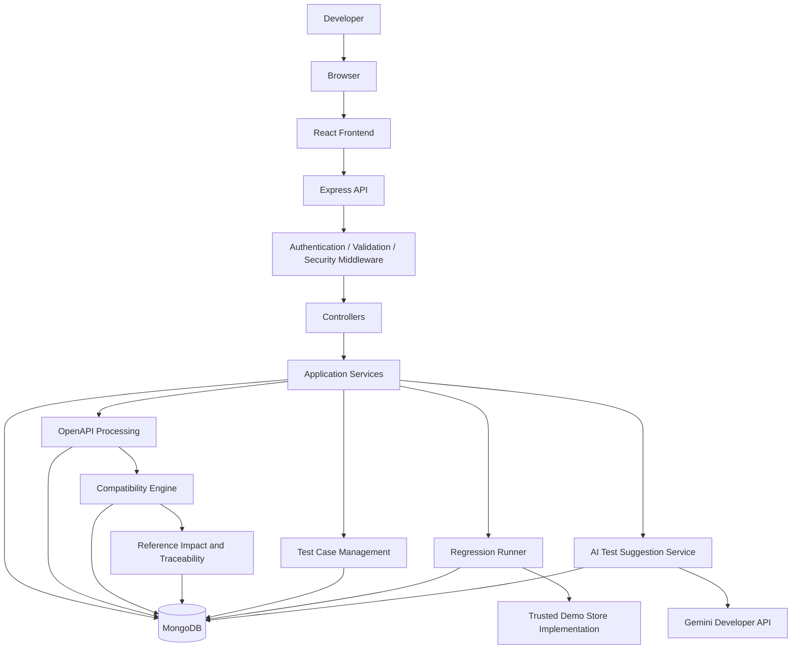
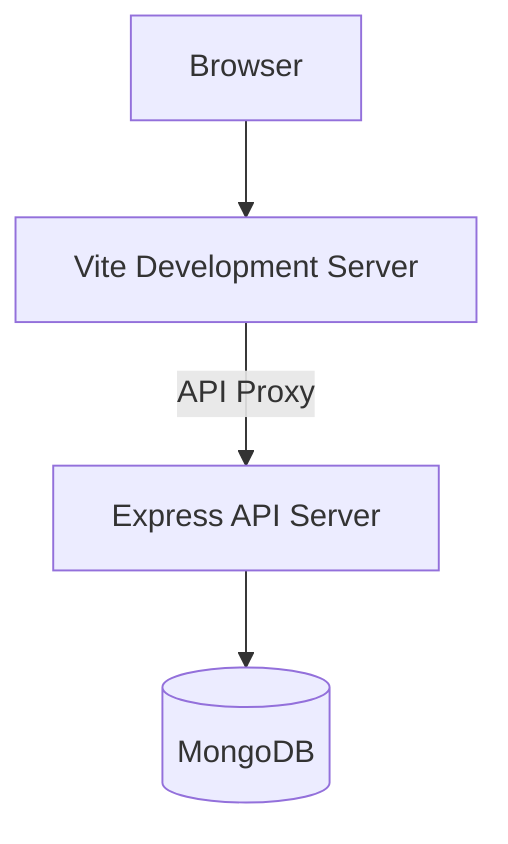
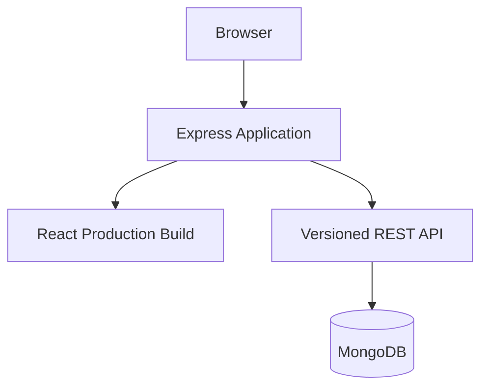
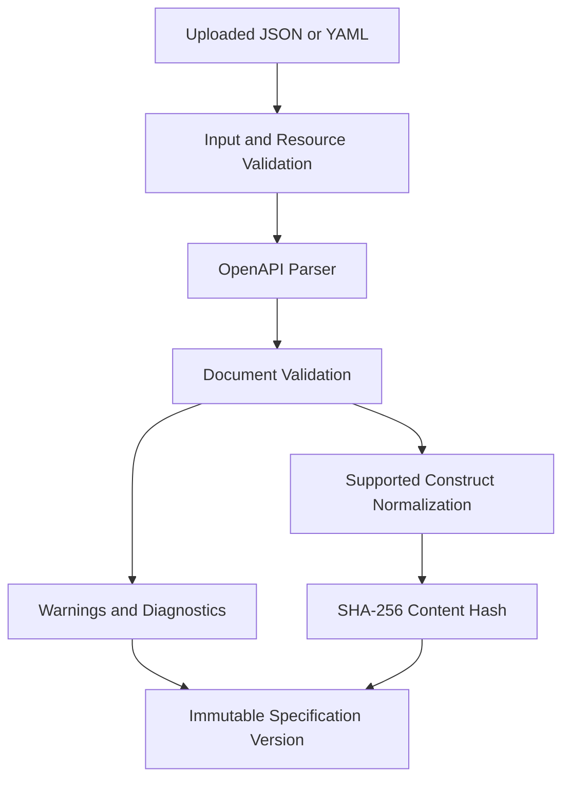
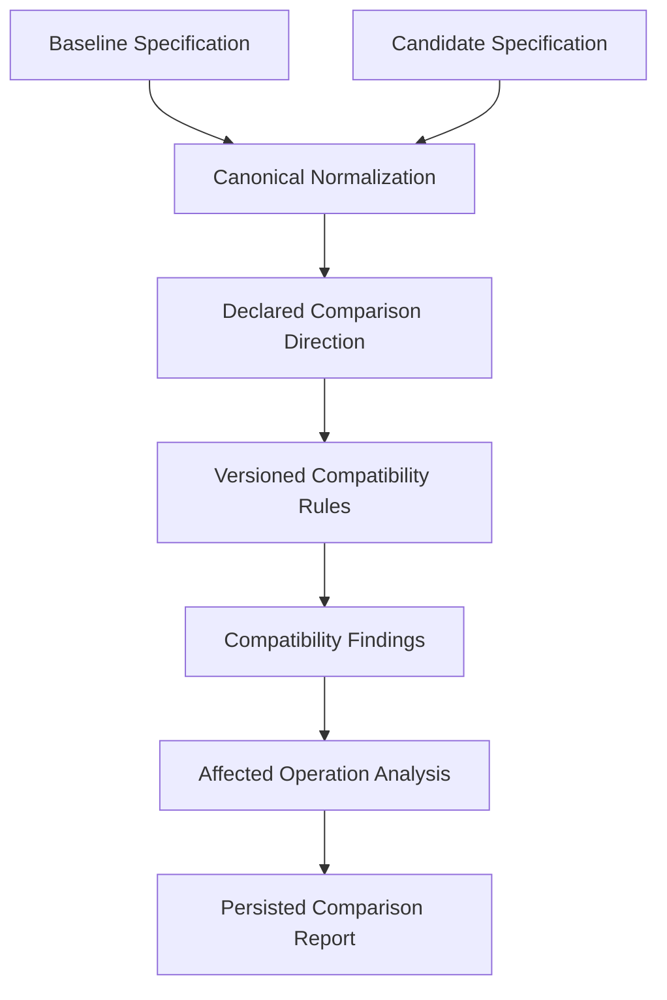
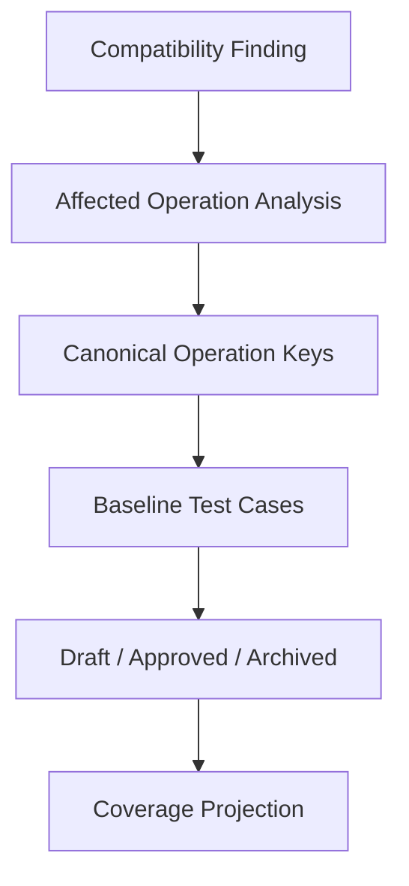
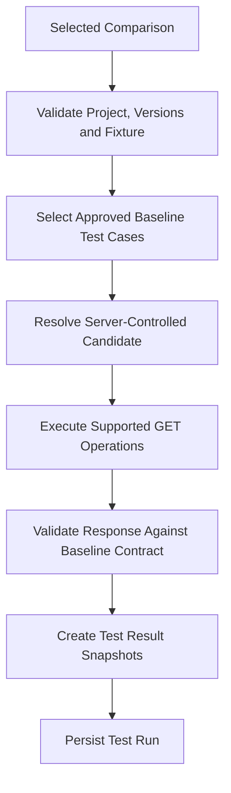
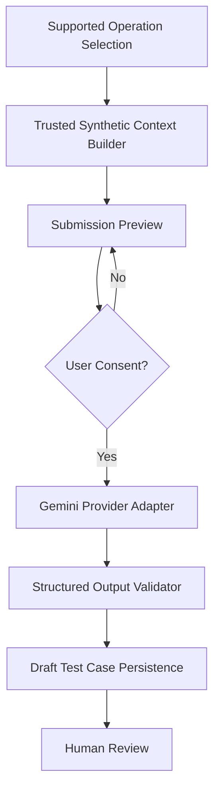
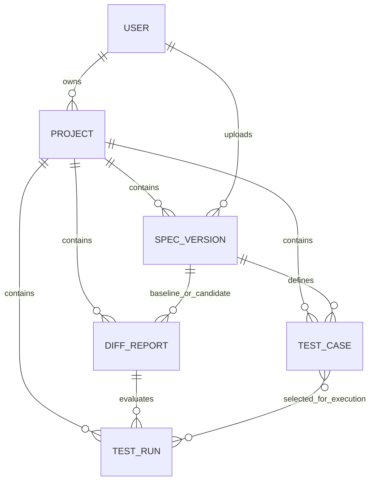

# System Architecture

**Product:** ContractGuard\
**Document version:** 1.2\
**Architecture style:** React Single-Page Application + Express Modular Monolith\
**Document status:** System architecture specification\
**Last updated:** 14 November 2026

---

## 1. Architecture Overview

ContractGuard is implemented as a full-stack JavaScript application consisting of a React frontend, an Express backend, and a MongoDB database.

The frontend is responsible for user interaction, navigation, and presentation.

The backend is responsible for authentication, authorization, specification ingestion, normalization, deterministic compatibility analysis, test-case management, regression execution, AI-provider interaction, and persistence.

The application follows a modular-monolith architecture. Backend responsibilities are separated into routes, controllers, middleware, services, validators, and models, but remain part of one application deployment.

The central architectural principle is:

**Specification processing, compatibility decisions, impact analysis, regression validation, and AI-assisted test generation must remain distinct responsibilities with explicit interfaces.**

The compatibility engine does not depend on AI output. Regression execution does not execute AI-generated code.

## 2. Architectural Principles

1. **Modular monolith:** A single Express application with clear internal module boundaries.
2. **Single source of truth:** The backend is authoritative for compatibility, ownership, test eligibility, and regression outcomes.
3. **Deterministic compatibility:** Compatibility classifications are produced by versioned application rules.
4. **Explicit trust boundaries:** Uploaded documents, browser inputs, stored data, and provider responses are treated as untrusted inputs.
5. **Immutable history:** Specification versions, completed comparison findings, and completed test-run evidence retain their original meaning.
6. **Directional comparison:** Candidate provider behavior is evaluated against the baseline consumer contract.
7. **Traceable findings:** Every supported finding retains its rule, source location, and affected-operation information.
8. **Bounded execution:** The regression runner operates only against trusted bundled implementations.
9. **Optional AI:** Core application functionality remains independent of Gemini availability.
10. **Human approval:** AI-generated test suggestions remain drafts until reviewed and approved.
11. **No arbitrary network execution:** Uploaded server URLs and external references are not used as execution destinations.
12. **Minimal infrastructure:** The current system does not require microservices, distributed queues, or a separate gateway.

## 3. High-Level Architecture

The diagram represents logical responsibilities. It does not represent separate backend deployments.

## 4. Deployment Architecture

### 4.1 Development Environment

During development, the frontend and backend run as separate local processes.

Responsibilities:

- Vite serves the frontend during development.
- Express provides the backend API.
- The frontend communicates with the backend through the configured API proxy.
- MongoDB stores application records.

### 4.2 Production Model

The production model uses Express to serve the built frontend and backend API from the application deployment.

The production model requires:

- HTTPS.
- Server-side secret configuration.
- Persistent MongoDB storage.
- Correct authentication-cookie configuration.
- Production frontend build assets.
- Appropriate request and upload limits.

## 5. Frontend Architecture

### 5.1 Responsibilities

The frontend provides:

- Registration and login.
- Protected application navigation.
- Project management.
- Specification upload and exploration.
- Version comparison.
- Compatibility finding inspection.
- Change-impact and test coverage views.
- Test-case creation and lifecycle management.
- AI suggestion preview and review.
- Regression execution and result inspection.

The frontend does not independently determine compatibility classifications or test outcomes.

### 5.2 State Management

The application uses:

- React state for local interface behavior.
- React hooks for reusable UI logic.
- TanStack Query for server-state fetching, caching, and mutation lifecycle.
- React Router for navigation.

Server responses must not be duplicated unnecessarily in unrelated client state.

### 5.3 Feature Boundaries

Frontend responsibilities are organized around application features such as:

- Authentication.
- Projects.
- Specifications.
- Comparisons.
- Test cases.
- AI test suggestions.
- Test runs.

Shared components handle navigation, status presentation, common inputs, dialogs, and feedback.

Feature-specific components remain close to the workflows they support.

## 6. Backend Architecture

### 6.1 HTTP Layer

The Express application receives frontend requests and applies:

- Request parsing.
- Security middleware.
- Authentication middleware.
- Ownership checks.
- Rate limiting where applicable.
- Request validation.
- Controller dispatch.
- Centralized error handling.

### 6.2 Controllers

Controllers coordinate application requests.

Typical responsibilities:

- Read validated request values.
- Obtain the authenticated user context.
- Invoke the relevant service.
- Return the documented response format.
- Pass errors to centralized error handling.

Controllers should not contain complex compatibility rules or reference-graph algorithms.

### 6.3 Services

Services implement domain responsibilities.

The main service areas include:

| Service area | Responsibility |
|---|---|
| Authentication | Account validation and authentication operations |
| Projects | Project lifecycle and ownership |
| Specifications | Upload, parsing, validation, and version persistence |
| Compatibility | Deterministic baseline/candidate comparison |
| Reference impact | Discovering affected operations |
| Traceability | Connecting findings to baseline test cases |
| Test cases | Draft, approval, edit, and archive lifecycle |
| Regression | Controlled test execution and result persistence |
| AI suggestions | Context construction, provider interaction, and output validation |
| Reports | Comparison and result representation |

### 6.4 Models and Validators

Mongoose models define database persistence structures.

Zod validators define request and structured-data validation contracts.

Model validation is an additional safeguard; it does not replace request validation or service-level relationship checks.

## 7. Specification Processing Architecture

Specification processing is isolated from compatibility analysis.

The processing service is responsible for:

- Enforcing upload limits.
- Detecting the source format.
- Parsing JSON and YAML.
- Validating supported OpenAPI structures.
- Identifying unsupported constructs.
- Resolving supported internal references.
- Preventing external reference fetching.
- Producing normalized data.
- Preserving source content.
- Assigning a server-controlled fixture profile where applicable.

The original uploaded document and normalized representation serve different purposes and must not overwrite one another.

## 8. Compatibility Analysis Architecture

The compatibility engine operates on supported normalized specification content.

### 8.1 Comparison Direction

`BASELINE_CONSUMER_TO_CANDIDATE_PROVIDER`

### 8.2 Ruleset Version

`CG-COMPAT-1.1`

### 8.3 Finding Classifications

- `BREAKING`
- `POTENTIALLY_BREAKING`
- `NON_BREAKING`
- `INFORMATIONAL`
- `UNSUPPORTED`

### 8.4 Analysis Status

- `COMPLETE`
- `PARTIAL`
- `FAILED`

The compatibility engine is deterministic. It does not send documents to Gemini and does not consume generated AI recommendations.

## 9. Reference Impact and Traceability Architecture

Reference-impact analysis establishes the relationship between specification changes and affected operations.

For each finding, the application derives:

- Directly associated operation information.
- Canonical operation keys.
- Supported affected-operation relationships.
- Shared-schema reference impact where resolvable.

The traceability layer then associates affected operations with test cases belonging to the comparison's baseline specification version.

Coverage states:

- `COVERED`
- `DRAFT_ONLY`
- `UNCOVERED`
- `UNMAPPED`

Coverage is derived from the test-case library. It is not equivalent to successful regression execution.

## 10. Test Case and Regression Architecture

### 10.1 Test Case Lifecycle

Test cases support:

- `DRAFT`
- `APPROVED`
- `ARCHIVED`

A test case is associated with:

- A project.
- A baseline specification version.
- A canonical operation key.
- Supported request inputs.
- Explicit assertions.

AI-generated test cases enter the same lifecycle as manual test cases, with `source: AI` identifying their origin.

### 10.2 Regression Execution

The runner requires an existing comparison and approved baseline test cases.

The runner does not derive a network destination from an uploaded OpenAPI `servers` entry.

The candidate implementation is selected through the trusted server-side Demo Store fixture registry.

### 10.3 Historical Integrity

A test run preserves:

- Comparison identifier.
- Baseline version.
- Candidate version.
- Ruleset version.
- Selected test case identifiers.
- Test-case input and assertion snapshots.
- Server-controlled execution target.
- Individual result statuses.
- Bounded validation diagnostics.
- Bounded evidence.

Updating a test case later must not rewrite previously persisted execution evidence.

## 11. AI Suggestion Architecture

The AI integration is an optional branch of the application.

### 11.1 Trust Boundary

The backend uses a trusted synthetic fixture registry to determine eligible AI context.

The currently supported operations are:

- `listProducts`
- `getProduct`

The AI provider receives only the approved selected-operation context.

### 11.2 Separation from Core Logic

The AI integration cannot:

- Change compatibility classifications.
- Modify persisted comparison findings.
- Approve generated cases.
- Execute generated code.
- Select regression targets.
- Determine regression pass/fail results.

Invalid provider output is rejected before persistence.

## 12. Data Architecture

V1 uses six MongoDB collections:

1. `users`
2. `projects`
3. `specVersions`
4. `diffReports`
5. `testCases`
6. `testRuns`

The primary relationship model is:

Every relationship is validated by application services. A Mongoose reference alone does not establish ownership or project consistency.

See [Schema.md](Schema.md) for the detailed persistence model.

## 13. Security and Trust Boundaries

The application treats the following as untrusted:

- Browser request payloads.
- Uploaded OpenAPI files.
- Parsed document structures.
- User-supplied text.
- AI provider responses.
- Persisted values originating from external inputs.

Security controls include:

- Password hashing using bcrypt.
- JWT authentication through an HttpOnly cookie.
- Backend ownership enforcement.
- Zod request validation.
- Upload and parser resource limits.
- Controlled internal-reference handling.
- No arbitrary regression target URLs.
- GET-only regression execution.
- AI submission preview and explicit consent.
- Strict AI output validation.
- Bounded result evidence.
- Server-side API key storage.

## 14. Failure Handling

Failures must remain explicit and traceable.

Relevant failure categories include:

- Authentication and authorization errors.
- Invalid or inaccessible resources.
- Specification parsing errors.
- Unsupported specification constructs.
- Partial compatibility analysis.
- Compatibility processing failure.
- Test eligibility rejection.
- Regression execution errors.
- Response validation failures.
- AI configuration and provider errors.
- AI output validation failure.

A provider outage must not compromise the deterministic comparison or test-execution modules.

## 15. Architectural Constraints

The current architecture intentionally excludes:

- Microservices.
- Distributed message queues.
- Distributed worker orchestration.
- Arbitrary outbound test execution.
- Arbitrary external reference fetching.
- AI-controlled compatibility decisions.
- AI-generated executable test code.

These exclusions keep the application focused on the implemented product workflow and reduce unnecessary operational complexity.

## 16. Related Documentation

- [Product Requirements](PRD.md)
- [Design Specification](Design.md)
- [Technical Requirements](TRD.md)
- [Application Flow](AppFlow.md)
- [Data Model and Schema](Schema.md)
- [Compatibility Rules](Rules.md)
- [Backend API](API.md)
- [Security Review](SecurityReview.md)