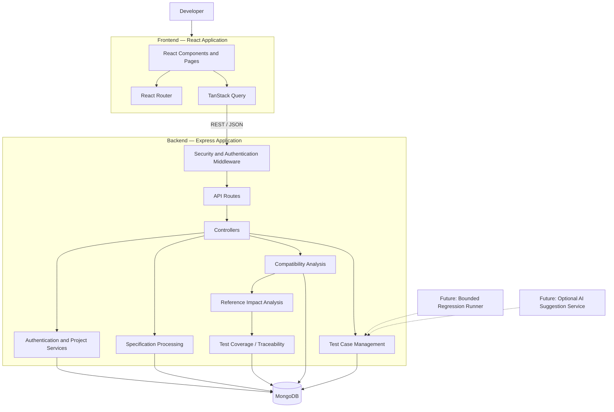
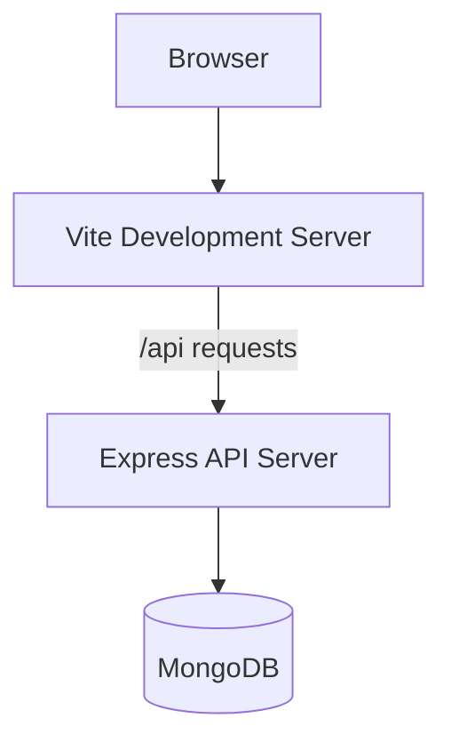
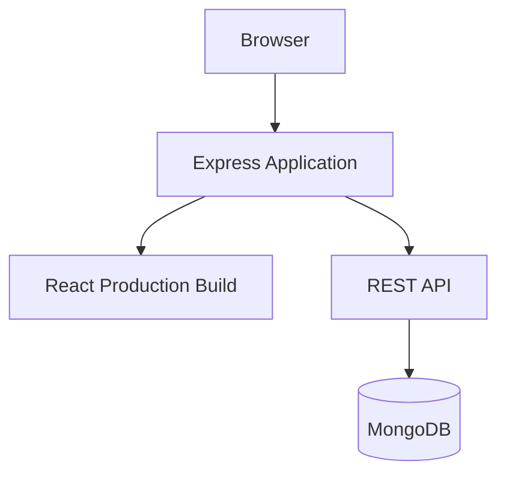
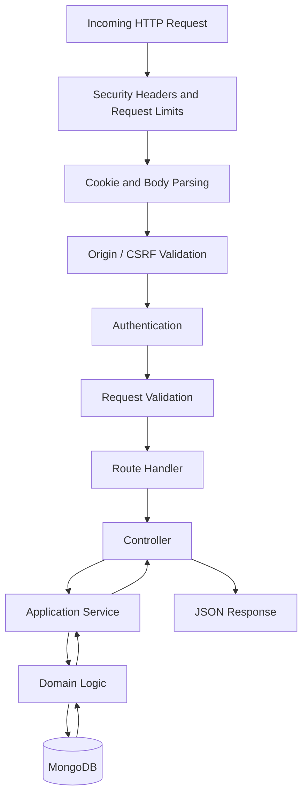
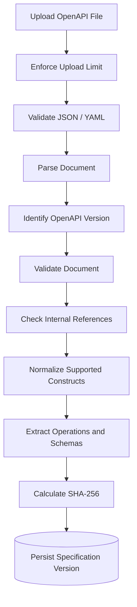
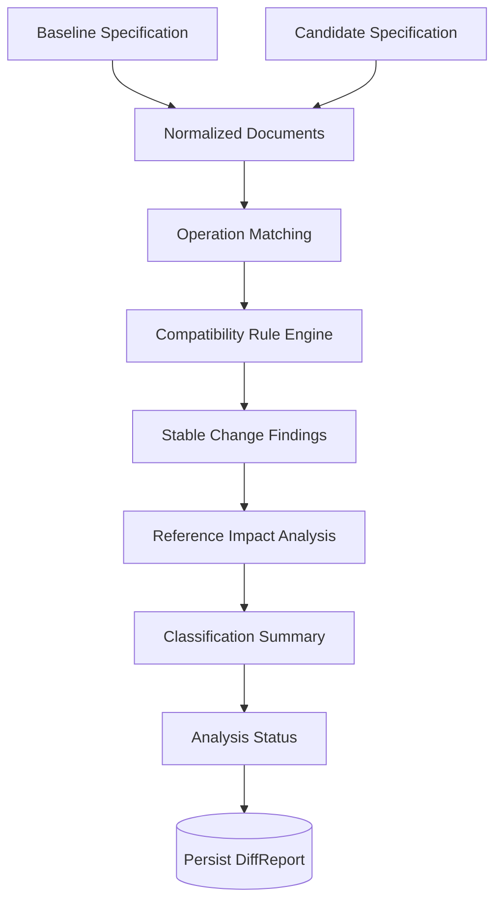
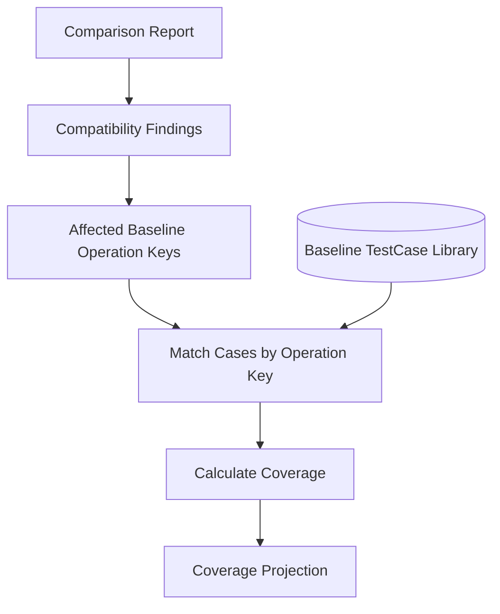
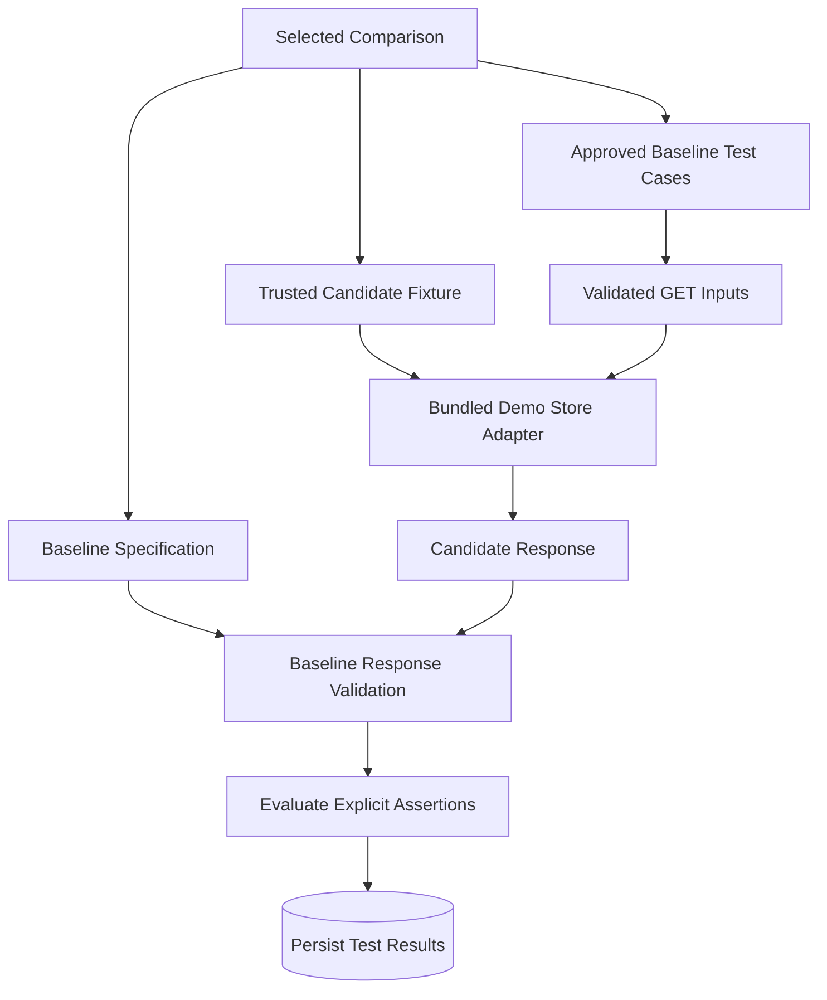

# ContractGuard — System Architecture

**Document:** System Architecture
**Version:** 1.2
**Architecture style:** React Single-Page Application + Express Modular Monolith
**Last updated:** 11 November 2026

## 1. Architecture Overview

ContractGuard uses a React single-page application and a single Express backend organized into feature-specific modules.

The frontend handles navigation, user interaction, application state, and presentation. The backend manages authentication, authorization, OpenAPI processing, compatibility analysis, change-impact mapping, test-case management, and persistence.

MongoDB stores user accounts, projects, immutable specification versions, comparison reports, and test cases.

The architecture follows three central principles:

1. **Deterministic analysis:** Compatibility classifications and change-impact decisions are produced by application logic, not AI.
2. **Separation of responsibilities:** Parsing, normalization, comparison, traceability, and presentation remain independently maintainable.
3. **Controlled execution:** Future regression execution is restricted to approved test cases and trusted bundled implementations.

ContractGuard follows a modular monolith architecture. Backend features run within the same Express application rather than being deployed as independent services.

## 2. High-Level Architecture



The diagram represents logical responsibilities, not independently deployed services.

The regression runner and AI suggestion service are future capabilities. They are not part of the currently implemented Phase 6 application.

## 3. Architectural Principles

### 3.1 Modular Monolith

One Express application contains the backend modules.

Each module has a defined responsibility and communicates through application services.

This keeps deployment, debugging, testing, and maintenance manageable for a single-developer project.

### 3.2 Deterministic Core

Compatibility analysis must produce consistent findings for identical normalized inputs and the same ruleset version.

The compatibility engine is independent of:

- React components.
- Express request/response objects.
- MongoDB persistence.
- AI providers.
- External network requests.

### 3.3 Immutable Historical Records

Uploaded specification versions are preserved as immutable snapshots.

Completed comparison findings retain the original baseline, candidate, direction, and ruleset information.

Live test coverage is calculated from the current test-case library without rewriting historical comparison findings.

### 3.4 Explicit Partial Analysis

Unsupported constructs and incomplete reference relationships must remain visible.

The application must never silently classify an unsupported change as compatible.

### 3.5 Server-Side Authority

The backend is responsible for:

- Authentication.
- Resource ownership.
- Input validation.
- Lifecycle transitions.
- Compatibility classifications.
- Change-impact mapping.
- Test-case approval.
- Resource limits.

Frontend validation improves usability but does not replace backend enforcement.

### 3.6 Optional AI

AI is not a dependency of the deterministic application workflow.

It cannot override compatibility findings, approve test cases autonomously, or determine regression results.

## 4. System Components

### 4.1 Frontend Application

**Technology:** React 19, JavaScript, Vite, React Router, Tailwind CSS, TanStack Query.

Responsibilities:

- Authentication screens.
- Projects workspace.
- Project overview.
- Specification uploads and version history.
- API Explorer.
- Comparison workspace.
- Compatibility finding details.
- Test-case library and editor.
- Change-coverage presentation.
- Loading, validation, error, and partial-result states.

The frontend communicates with the backend through the `/api/v1` REST interface.

TanStack Query manages server state, including projects, specifications, comparison reports, and test cases.

React component state manages local interface interactions.

The frontend does not calculate authoritative compatibility classifications or independently establish resource ownership.

### 4.2 Express API Layer

**Technology:** Express 5.

Responsibilities:

- Receive HTTP requests.
- Apply security middleware.
- Authenticate protected requests.
- Validate request parameters and bodies.
- Route requests to controllers.
- Invoke application services.
- Serialize successful responses.
- Handle errors through centralized error middleware.

Routes should remain focused on HTTP method, endpoint, and middleware configuration.

Controllers should coordinate application services without containing large domain algorithms.

### 4.3 Authentication and Authorization Module

Responsibilities:

- User registration.
- Login and logout.
- JWT signing and verification.
- HttpOnly cookie management.
- Current-user retrieval.
- Project ownership verification.
- Protected-resource access control.

Password hashing uses bcrypt.

Authentication uses the configured JWT cookie named `cg_access`.

Every project-owned resource must be checked against the authenticated user's ownership.

The client must never be trusted to provide its own `ownerId`.

### 4.4 Specification Processing Module

Responsibilities:

- Receive bounded JSON/YAML uploads.
- Validate uploaded content.
- Parse OpenAPI documents.
- Identify supported OpenAPI versions.
- Normalize supported document constructs.
- Extract API operations.
- Process supported internal references.
- Preserve original source text.
- Calculate SHA-256 content hashes.
- Store immutable specification versions.
- Generate parser and support diagnostics.

The original document and its normalized representation serve different purposes and must not overwrite each other.

External `$ref` resources are not fetched.

Uploaded OpenAPI server URLs are never used as execution destinations.

### 4.5 Compatibility Analysis Module

Responsibilities:

- Normalize comparison inputs.
- Match baseline and candidate operations.
- Detect supported structural differences.
- Evaluate deterministic compatibility rules.
- Generate stable change identifiers.
- Assign rule IDs and classifications.
- Preserve source JSON Pointers.
- Generate human-readable rationales.
- Calculate classification summaries.
- Determine overall analysis status.

The current ruleset is:

`CG-COMPAT-1.1`

Comparison direction:

`BASELINE_CONSUMER_TO_CANDIDATE_PROVIDER`

The baseline represents existing consumer expectations. The candidate represents the updated provider contract.

The compatibility engine must not depend on the database or AI provider.

### 4.6 Reference Impact Analysis Module

Responsibilities:

- Identify references to supported shared schema components.
- Determine directly affected operations.
- Determine indirectly affected operations through supported internal references.
- Preserve canonical operation keys.
- Maintain reference-impact diagnostics.
- Identify incomplete or unsupported dependency graphs.

Only schema-comparison findings propagate through shared references.

Non-schema response metadata, parameter metadata, status-code changes, and request-body requiredness remain associated with their direct operation.

The current implementation uses conservative reference closure within the containing operation scope. It can over-approximate impact when an operation references multiple unrelated schemas in that scope. It must not claim pointer-exact attribution.

Unresolved, external, circular, or bounded-out references produce warnings and partial impact analysis.

### 4.7 Test-Case Management Module

Responsibilities:

- Create manual test cases.
- Associate cases with an immutable baseline specification version.
- Validate canonical operation keys.
- Validate operation paths and parameters.
- Store bounded request inputs.
- Store supported response assertions.
- Manage draft, approved, and archived states.
- Enforce approval and editing restrictions.

Current v1 manual test cases support GET path operations.

The request-input structure supports:

- Path parameters.
- Query parameters.

Only draft cases can be edited or approved.

Approved cases cannot be silently modified. Archived cases are excluded from coverage calculations.

### 4.8 Change-to-Test Traceability Module

Responsibilities:

- Receive comparison findings.
- Read affected baseline operation keys.
- Retrieve test cases associated with the exact baseline specification version.
- Match cases using canonical operation keys.
- Separate draft and approved cases.
- Exclude archived cases.
- Derive operation-complete coverage.
- Return coverage projections with comparison information.

Supported coverage states:

| Status | Meaning |
|---|---|
| `COVERED` | Every affected baseline operation has an approved linked case. |
| `DRAFT_ONLY` | Every affected operation has a case, but at least one is covered only by drafts. |
| `UNCOVERED` | At least one affected operation has no linked draft or approved case. |
| `UNMAPPED` | No affected operation key is available. |

Coverage is derived when comparison information is retrieved.

It is not stored as mutable coverage data inside the original comparison report.

Coverage represents case availability, not successful test execution.

### 4.9 Regression Runner — Planned

The regression runner is a subsequent implementation milestone.

Its intended responsibilities are:

- Select approved baseline test cases.
- Resolve trusted candidate fixture profiles.
- Construct bounded GET-operation inputs.
- Invoke bundled candidate handlers.
- Validate candidate responses against baseline response schemas.
- Evaluate explicit assertions.
- Persist test-run results and evidence.

The runner will use a server-controlled in-process adapter.

It will not accept arbitrary client-supplied URLs, hostnames, credentials, or network destinations.

### 4.10 AI Suggestion Service — Planned

The optional AI service will generate structured test suggestions for eligible bundled synthetic operations.

Its responsibilities will include:

- Constructing bounded operation context.
- Obtaining explicit user consent.
- Calling the configured AI provider from the backend.
- Validating structured output with Zod.
- Rejecting unsupported or malformed suggestions.
- Returning suggestions for human review.

AI-generated cases will begin as drafts.

AI cannot execute code, approve tests, or determine compatibility classifications.

The core application must remain functional without an AI provider key.

## 5. Repository and Module Boundaries

The current repository structure is organized as follows:

```text
ContractGuard/
│
├── README.md
├── .env
├── .env.example
├── MANIFEST.json
│
├── client/
│   └── src/
│       ├── components/
│       ├── features/
│       │   ├── auth/
│       │   ├── comparisons/
│       │   ├── projects/
│       │   └── specifications/
│       ├── lib/
│       ├── pages/
│       ├── App.jsx
│       └── main.jsx
│
├── server/
│   └── src/
│       ├── config/
│       ├── controllers/
│       ├── middleware/
│       ├── models/
│       ├── routes/
│       ├── services/
│       ├── utils/
│       ├── validators/
│       ├── app.js
│       └── server.js
│
├── docs/
│
└── examples/
```

The structure evolves with the implementation phases.

New folders and modules should be introduced only when required by a concrete feature.

## 6. Runtime Topology

### 6.1 Development Environment

The development environment uses two application servers.



Responsibilities:

- Vite serves the React application.
- Express handles backend API requests.
- Vite proxies `/api` requests to Express.
- MongoDB stores application records.

The Demo Store fixtures are maintained separately from arbitrary user-uploaded API specifications.

### 6.2 Production Environment

The intended production architecture uses one application origin.



Responsibilities:

- Vite builds frontend assets.
- Express serves the production React application.
- Express exposes `/api/v1` endpoints.
- MongoDB stores persistent application information.
- Optional AI communication occurs only from the backend.

The application must not depend on persistent local filesystem storage for uploaded specifications or historical records.

## 7. Backend Request Lifecycle

A typical protected API request follows this sequence:



The actual middleware applied to a route depends on its authentication and security requirements.

The backend must ensure:

1. Request sizes are bounded.
2. Cookies and JSON bodies are parsed safely.
3. Unsafe cookie-authenticated requests pass origin validation.
4. Protected requests are authenticated.
5. Incoming data is validated.
6. Ownership and business constraints are checked.
7. Services perform the required domain operations.
8. Responses follow the application's standard JSON contract.
9. Errors reach centralized error handling.

Public authentication routes still require appropriate request validation and rate limiting.

## 8. Core Data Flows

### 8.1 Specification Ingestion



Important boundaries:

- Uploaded files are untrusted.
- File-size and parser limits are enforced server-side.
- Original source content is preserved.
- Normalization creates derived information.
- External references are not fetched.
- Uploaded server URLs are not executed.
- Unsupported constructs remain visible.

### 8.2 Compatibility Analysis



The comparison engine evaluates supported constructs using the configured ruleset.

Unsupported behavior must result in appropriate diagnostics and partial analysis.

### 8.3 Change-to-Test Traceability



Traceability uses:

- The finding's affected operation keys.
- The comparison's exact baseline specification version.
- Current test-case lifecycle status.

Coverage is calculated dynamically and returned as part of the comparison presentation.

The original stored comparison report is not modified.

### 8.4 Future Regression Execution

The intended future execution pipeline is:



This execution pipeline is planned, not an implemented Phase 6 feature.

## 9. Persistence Architecture

MongoDB provides the primary persistence layer through Mongoose.

### 9.1 Primary Collections

| Collection | Responsibility | Current implementation |
|---|---|---|
| `users` | User accounts and authentication metadata | Implemented |
| `projects` | Personal API workspaces | Implemented |
| `specVersions` | Immutable OpenAPI specification versions | Implemented |
| `diffReports` | Compatibility findings and comparison history | Implemented |
| `testCases` | Baseline-version test-case definitions | Phase 6 implementation |
| `testRuns` | Regression execution history | Planned Phase 7 |

### 9.2 Relationship Boundaries

- A user owns projects.
- A project contains specification versions.
- A project contains comparison reports.
- A comparison references one baseline and one candidate specification version.
- A test case belongs to one project and one specification version.
- Test-case operation keys identify operations within that specification version.
- A future test run must reference an exact comparison.
- Selected test cases must belong to the comparison's baseline specification version.

### 9.3 Historical Integrity

Specification versions must remain immutable.

Completed comparison findings must retain their original comparison inputs and ruleset.

Test coverage must be calculated from the current baseline test-case library without rewriting historical comparison findings.

A future test run must preserve the selected test-case inputs and assertion snapshots so that later test-case changes cannot modify historical execution evidence.

### 9.4 Database Responsibilities

Mongoose provides:

- Schema definitions.
- Field validation safeguards.
- ObjectId relationships.
- Timestamps.
- Indexes.
- Query execution.

However, Mongoose references do not automatically guarantee ownership integrity.

The service layer must verify project, version, comparison, and test-case relationships before performing protected operations.

## 10. Security Architecture

Security controls apply at the application boundaries and individual feature modules.

### Authentication

- JWT authentication through an HttpOnly cookie.
- bcrypt password hashing.
- Server-side token verification.
- Protected API routes.
- Safe public user serialization.

### Authorization

- Project ownership is checked server-side.
- Child resources are verified through their parent project.
- Client-provided owner identifiers are rejected.
- Inaccessible resources return controlled errors.

### Request Protection

- Security headers through Helmet.
- Request-body size limits.
- Origin validation for unsafe cookie-authenticated methods.
- Rate limiting for sensitive endpoints.
- Zod validation.
- Controlled error serialization.

### Specification Processing

- Bounded file uploads.
- Safe JSON/YAML parsing.
- Disabled YAML aliases.
- Controlled internal-reference resolution.
- No external `$ref` fetching.
- No arbitrary filesystem or network access through uploaded documents.

### Future Regression Execution

- Trusted server-side fixture registry.
- Approved test cases only.
- GET path operations only.
- Server-controlled request dispatch.
- No arbitrary URLs, hostnames, credentials, or client-selected execution targets.
- Bounded response sizes and execution timeouts.

### Future AI Integration

- Backend-only provider access.
- Explicit user consent.
- Synthetic fixture restriction.
- Structured response validation.
- Human approval before test execution.
- No autonomous code execution.

## 11. Error Handling and Failure Boundaries

Failures must be handled at the module responsible for the affected operation.

| Failure | Expected behavior |
|---|---|
| MongoDB unavailable | Controlled service error; do not report unpersisted work as successful. |
| Authentication failure | Return a stable authentication error. |
| Ownership failure | Return a safe not-found response where appropriate. |
| Invalid request | Return structured validation details. |
| Invalid specification | Return parsing or validation diagnostics. |
| Unsupported schema construct | Preserve diagnostics and partial-analysis status. |
| Compatibility engine failure | Do not present the report as complete. |
| Reference graph incomplete | Preserve impact warning and partial status. |
| Test-case lifecycle conflict | Return a controlled conflict response. |
| Future runner timeout | Record an execution error rather than a passing result. |
| Future AI provider failure | Disable or fail the AI action without affecting deterministic application features. |

Unexpected errors must be handled through centralized Express error middleware.

Production responses must not expose internal stack traces, credentials, database queries, or sensitive document content.

## 12. Scaling Model and Known Limitations

ContractGuard v1 is a single-process application intended for controlled demonstration and portfolio use.

The current architecture does not claim horizontal scalability.

Known limitations:

- The backend is a modular monolith.
- MongoDB is the single primary database.
- In-memory rate-limit counters are process-local.
- The future regression runner uses bounded in-process execution.
- No distributed job orchestration is implemented.
- No team-level or organization-level ownership model exists.
- AI is an optional external dependency.
- Supported OpenAPI and JSON Schema constructs are explicitly bounded.

Future scaling decisions should be introduced only when justified by actual requirements.

Possible future improvements include:

- Durable job processing.
- Shared rate-limit storage.
- Worker isolation.
- Persistent execution recovery.
- Team collaboration.
- Expanded schema-dialect support.

Redis, Kafka, Docker, Kubernetes, and microservices are not prerequisites for the current architecture.

## 13. Architectural Decisions

| Decision | Selected approach | Reason |
|---|---|---|
| Backend architecture | Modular monolith | Maintainability without distributed-service complexity |
| Frontend | React SPA | Component-based application interface |
| Backend framework | Express | Existing JavaScript ecosystem and straightforward REST API |
| Database | MongoDB and Mongoose | Document-oriented specification and report storage |
| Authentication | JWT in HttpOnly cookie | Browser authentication without exposing tokens to JavaScript |
| Password hashing | bcrypt | Existing project implementation |
| Compatibility analysis | Deterministic JavaScript engine | Repeatable and explainable classifications |
| Change impact | Dedicated reference-impact service | Separation from classification logic |
| Test coverage | Dedicated traceability service | Derived from baseline test cases |
| Execution model | Bundled in-process adapter, planned | Controlled execution without arbitrary network targets |
| AI integration | Optional backend adapter, planned | Human-reviewed test suggestions without affecting deterministic decisions |
| Production delivery | Express serving React build | Same-origin application deployment |

## 14. Architecture Acceptance Criteria

The architecture is considered acceptable when:

1. Frontend and backend responsibilities are clearly separated.
2. The backend follows a modular monolith structure.
3. Route handlers do not contain substantial domain logic.
4. Authentication and project ownership are enforced server-side.
5. Specification parsing and normalization are separate from compatibility analysis.
6. The compatibility engine produces deterministic results.
7. Compatibility findings preserve rule IDs, classifications, and source locations.
8. Shared-reference impact analysis is isolated from classification logic.
9. Change coverage is derived using baseline specification versions and affected operation keys.
10. Test-case approval transitions are controlled by the backend.
11. Historical comparison findings are not modified by live coverage calculations.
12. Unsupported constructs never produce a false complete analysis result.
13. Future regression execution uses trusted server-controlled targets.
14. AI remains isolated from compatibility and execution decisions.
15. Errors are handled centrally and do not expose sensitive information.
16. Production can serve the React application and API from one origin.
17. The architecture diagram reflects the actual implementation and clearly identifies planned capabilities.

## 15. Technical References

- React: https://react.dev/
- Vite: https://vite.dev/
- React Router: https://reactrouter.com/
- Express: https://expressjs.com/
- TanStack Query: https://tanstack.com/query/latest/docs/framework/react
- MongoDB: https://www.mongodb.com/docs/
- Mongoose: https://mongoosejs.com/docs/
- Zod: https://zod.dev/
- OpenAPI Specification: https://spec.openapis.org/
- OWASP Security Cheat Sheets: https://cheatsheetseries.owasp.org/

---

**End of Architecture Document**
