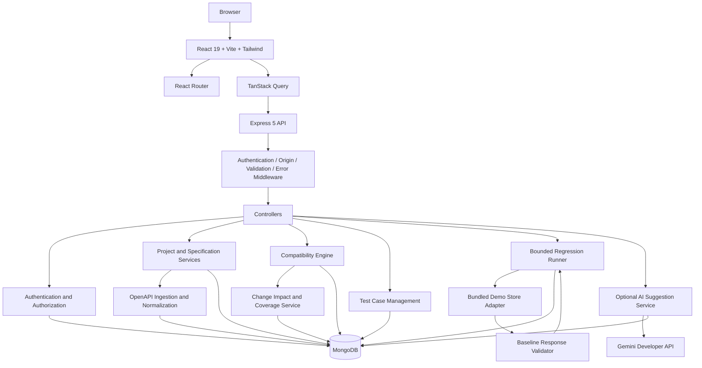
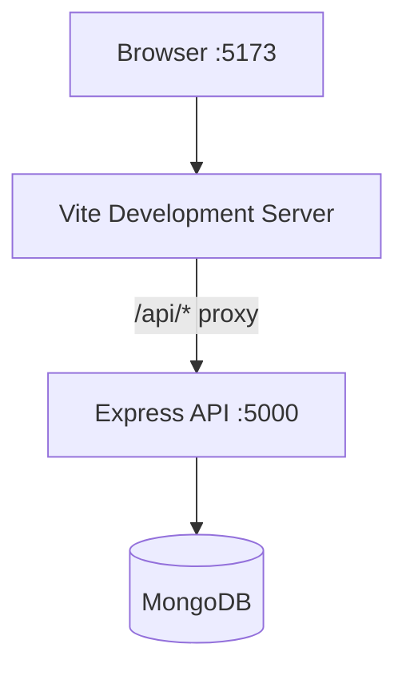
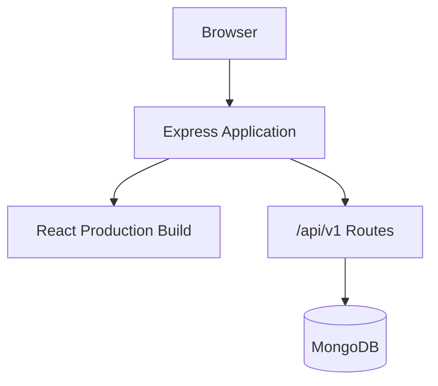
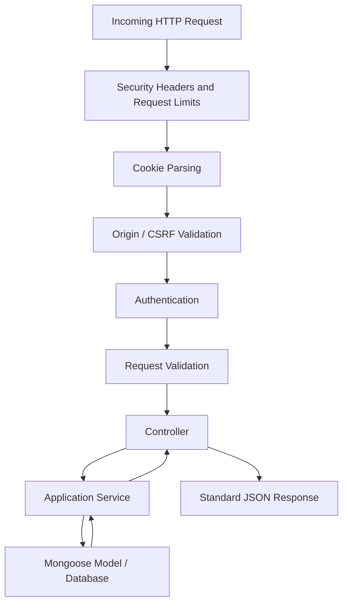
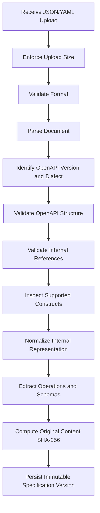
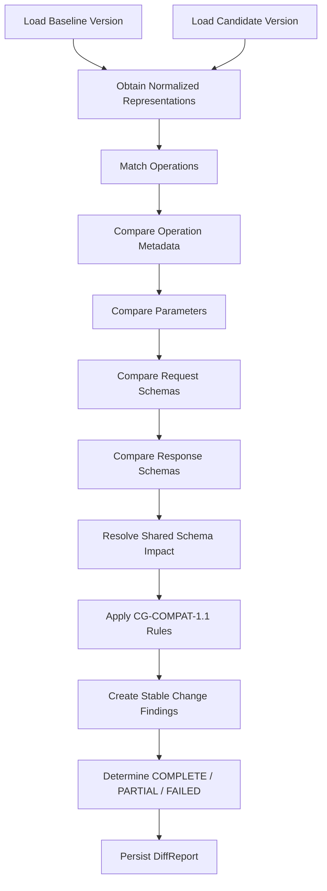
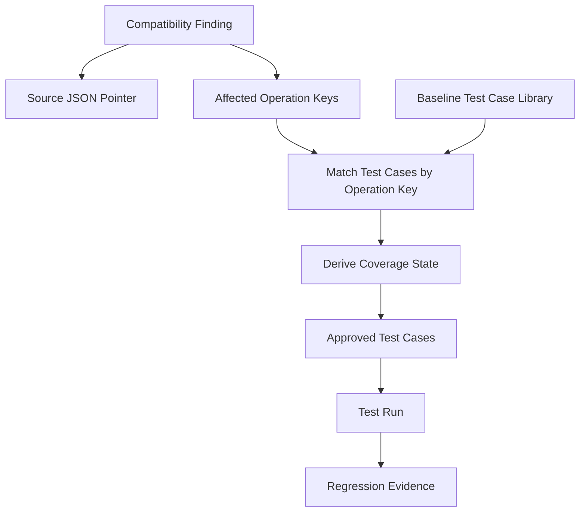
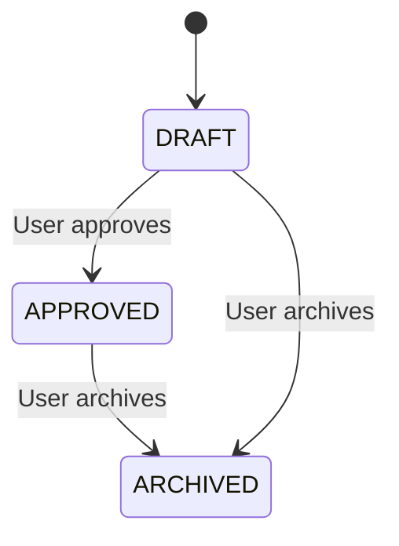
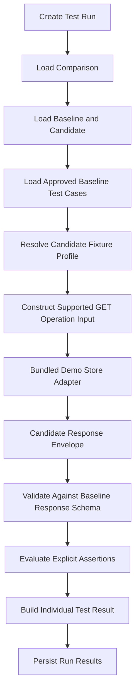
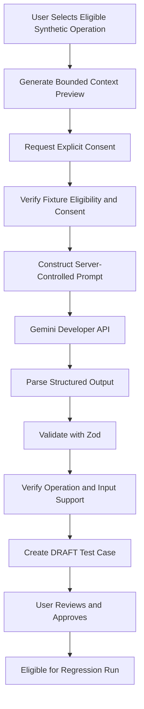

# System Architecture

**Product:** ContractGuard  
**Document version:** 1.1  
**Architecture style:** JavaScript modular monolith  
**Status:** Revised implementation baseline  
**Related documents:** PRD.md, TRD.md, Schema.md, API.md, Rules.md, SecurityReview.md

## 1. Architecture overview

ContractGuard is a single-user API compatibility and regression-testing workbench implemented as a React single-page application and an Express modular monolith.

The frontend is responsible for interaction and presentation.

The backend is responsible for authentication, authorization, OpenAPI ingestion, normalization, compatibility analysis, test-case management, regression execution, AI-provider interaction, and persistence.

MongoDB stores user accounts, projects, immutable specification versions, comparison reports, test cases, and test runs.

The central architectural principle is:

**Parsing, compatibility decisions, and regression validation must remain separate, explicit, and independently testable responsibilities.**

ContractGuard does not delegate deterministic compatibility decisions to an AI model. The AI integration is an optional assistant for proposing test cases.

## 2. Architecture principles

1. **Single deployment unit:** One Express backend serves the application API and production React build.
2. **Modular monolith:** Each backend feature has a defined responsibility and communicates through application services.
3. **JavaScript throughout:** No TypeScript is introduced in v1.
4. **Explicit trust boundaries:** Uploaded specifications, AI responses, browser inputs, and stored content are treated as untrusted data.
5. **Deterministic domain logic:** Identical normalized input documents and ruleset versions produce identical comparison findings.
6. **Immutable history:** Uploaded specification versions, completed comparison findings, and completed test-run evidence are preserved.
7. **Directional compatibility:** The candidate provider is evaluated against expectations established by the baseline consumer contract.
8. **Bounded execution:** The regression runner uses approved inputs and a server-controlled bundled implementation.
9. **No arbitrary network execution:** Uploaded server URLs and external references are never used as execution destinations.
10. **Optional AI:** Core product behavior is independent of AI provider availability.
11. **No infrastructure without a requirement:** Redis, Kafka, Kubernetes, Docker, microservices, and distributed workers are excluded from the v1 baseline.
12. **Explainability:** Every compatibility finding contains a rule identifier, source location, classification, and rationale.

## 3. High-level architecture



The diagram shows logical responsibilities. It does not represent separate deployable services. All backend modules run in the same Node.js application process.

## 4. Deployment architecture

### 4.1 Development



During development:

- Vite runs the React development server.
- Express runs as a separate local server.
- Vite proxies `/api` requests to Express.
- Both servers run on the developer's machine.
- MongoDB is accessed through its configured connection string.

### 4.2 Production



Production requirements:

- Express serves the built React application.
- The same Express origin handles `/api/v1`.
- Authentication cookies remain same-origin.
- HTTPS is required.
- Application data is persisted in MongoDB.
- Local filesystem storage is not used for durable user data.

This arrangement avoids the need for a separate frontend hosting origin and unnecessary CORS configuration.

## 5. Frontend architecture

### 5.1 Responsibilities

The React application provides:

- Registration and login.
- Project management.
- Specification uploads and version navigation.
- API operation exploration.
- Baseline/candidate comparison.
- Change classification filters.
- Change details and affected-operation inspection.
- Test-case management.
- AI suggestion review.
- Regression-run monitoring.
- Historical comparison and test-run results.

The frontend does not make authoritative compatibility or authorization decisions.

### 5.2 Frontend feature boundaries

The intended feature structure is:

```text
client/src/
│
├── app/
│   ├── App.jsx
│   ├── router.jsx
│   └── queryClient.js
│
├── components/
│   ├── layout/
│   ├── navigation/
│   ├── feedback/
│   └── common/
│
├── features/
│   ├── auth/
│   │   ├── components/
│   │   ├── hooks/
│   │   └── services/
│   │
│   ├── projects/
│   │   ├── components/
│   │   ├── hooks/
│   │   └── services/
│   │
│   ├── specifications/
│   │   ├── components/
│   │   ├── hooks/
│   │   └── services/
│   │
│   ├── comparisons/
│   │   ├── components/
│   │   ├── hooks/
│   │   └── services/
│   │
│   ├── tests/
│   │   ├── components/
│   │   ├── hooks/
│   │   └── services/
│   │
│   └── ai/
│       ├── components/
│       ├── hooks/
│       └── services/
│
├── hooks/
├── pages/
├── services/
└── main.jsx
```

Create these subdirectories as needed during implementation rather than creating empty folders in advance.

### 5.3 Navigation and routing

Use React Router 8 Declarative Mode.

Suggested route organization:

```text
/login
/register

/app
/app/projects
/app/projects/:projectId
/app/projects/:projectId/specifications
/app/specifications/:specVersionId
/app/specifications/:specVersionId/explorer

/app/projects/:projectId/comparisons
/app/comparisons/:comparisonId

/app/comparisons/:comparisonId/tests
/app/test-cases/:testCaseId
/app/test-runs/:testRunId
```

The exact route layout can be refined during implementation without changing the backend data model.

Protected routes provide navigation control and account-aware UI.

The backend remains responsible for all authentication and authorization checks.

### 5.4 Server-state management

TanStack Query manages information retrieved from the backend.

Examples:

- Current account.
- Project lists.
- Project details.
- Specification versions.
- Operation summaries.
- Comparison reports.
- Derived test coverage.
- Test cases.
- Test-run status and results.

React component state manages local interaction such as:

- Selected tabs.
- Open panels.
- Expanded JSON sections.
- Active filters.
- Modal visibility.
- Temporary form input.

Avoid maintaining duplicate copies of the same server state in component state.

### 5.5 Frontend service layer

API calls should be organized by feature.

For example:

- `authService`
- `projectService`
- `specificationService`
- `comparisonService`
- `testCaseService`
- `testRunService`
- `aiService`

Services call the ContractGuard backend through the same-origin `/api/v1` path.

The browser never communicates directly with MongoDB or the Gemini API.

The browser never receives the Gemini API key or the JWT value.

## 6. Backend architecture

### 6.1 Request lifecycle

A protected API request follows this flow:



The exact middleware order must ensure that:

- Request size limits are enforced.
- Cookie parsing is available where required.
- Unsafe cookie-authenticated requests receive origin/CSRF validation.
- Authentication is enforced on protected routes.
- Request validation happens before business logic.
- Errors reach centralized error handling.

Public endpoints such as registration and login still receive applicable origin validation, rate limiting, and request validation.

### 6.2 Backend folder boundaries

```text
server/src/
│
├── config/
│   ├── database.js
│   ├── env.js
│   ├── limits.js
│   └── fixtures.js
│
├── models/
│   ├── user.model.js
│   ├── project.model.js
│   ├── specVersion.model.js
│   ├── diffReport.model.js
│   ├── testCase.model.js
│   └── testRun.model.js
│
├── routes/
├── controllers/
├── services/
│   ├── openapi/
│   ├── comparison/
│   ├── testing/
│   └── ai/
│
├── validators/
├── middleware/
├── fixtures/
├── utils/
└── server.js
```

### 6.3 Architectural responsibilities

**Routes**

- Define HTTP method and path.
- Attach the required middleware.
- Delegate the request to the appropriate controller.

Routes must not contain compatibility algorithms, parsing pipelines, or database workflows.

**Controllers**

- Receive validated request information.
- Invoke application services.
- Convert service results into HTTP responses.
- Pass errors to centralized error handling.

Controllers must remain thin.

**Application services**

- Coordinate business workflows.
- Enforce domain-level conditions.
- Retrieve and persist records.
- Invoke domain modules.
- Handle expected application-level failures.

**Domain modules**

- Contain deterministic business rules.
- Avoid direct Express request/response dependencies.
- Avoid direct database dependencies where practical.
- Expose predictable inputs and outputs.
- Have independent unit tests.

**Mongoose models**

- Define persistence structure.
- Enforce database-level validation safeguards.
- Provide indexes and timestamps.

They do not decide API compatibility.

**Middleware**

- Authentication.
- Ownership enforcement where applicable.
- Request validation.
- CSRF/origin validation.
- Rate limiting.
- Error handling.
- Request logging.

## 7. OpenAPI ingestion architecture

### 7.1 Ingestion pipeline

OpenAPI ingestion is a dedicated backend workflow.



### 7.2 Responsibilities by stage

**Upload controller**

Accepts the bounded multipart request and delegates the uploaded bytes to the ingestion service.

**Format detector**

Recognizes the supported JSON or YAML format.

**Parser**

Uses the Scalar OpenAPI parser and the configured YAML/JSON parser behavior.

**Version and dialect detector**

Identifies the declared OpenAPI version and applicable schema dialect.

**Reference processor**

Resolves supported internal references within bounded limits.

External resource fetching is disabled.

**Support analyzer**

Identifies constructs that ContractGuard cannot fully analyze.

**Normalization adapter**

Transforms supported constructs into ContractGuard's internal representation.

It must preserve enough source information to produce JSON Pointers and meaningful diagnostics.

**Operation extractor**

Creates the structured operation and schema representation needed by the explorer, comparison engine, and test-case services.

**Persistence stage**

Stores:

- Original uploaded source text.
- Content hash.
- Parsed document information when available.
- OpenAPI version.
- Operation count.
- Parse status.
- Warnings.
- Server-derived runner profile.

The original specification remains unchanged.

### 7.3 Internal representation

The normalization layer should expose a stable internal interface rather than allowing the comparison engine to depend directly on parser-specific object structures.

At a conceptual level:

```js
{
  documentVersion: "3.2.1",
  dialect: "SUPPORTED_DIALECT_IDENTIFIER",
  operations: [],
  schemas: [],
  references: [],
  warnings: [],
  supportStatus: "COMPLETE"
}
```

This is an interface illustration, not a complete JSON schema or final implementation.

The internal representation must preserve:

- Original path and HTTP method.
- Canonical operation key.
- Original parameter names.
- Effective parameter definitions.
- Request-body definitions.
- Response definitions.
- Schema references.
- Source JSON Pointers.
- Unsupported-feature diagnostics.

The representation must not silently discard constructs that could change compatibility or response validation.

## 8. Compatibility-analysis architecture

### 8.1 Direction

The comparison engine evaluates:

`BASELINE_CONSUMER_TO_CANDIDATE_PROVIDER`

The baseline represents existing consumer expectations.

The candidate represents the new provider contract.

### 8.2 Comparison pipeline



### 8.3 Domain-module boundaries

The comparison feature should have separable internal responsibilities:

- `pathNormalizer`: canonicalizes paths for matching.
- `operationMatcher`: pairs baseline and candidate operations.
- `parameterComparator`: evaluates parameter differences.
- `requestComparator`: analyzes request-body and request-schema changes.
- `responseComparator`: analyzes response and response-schema changes.
- `referenceImpactAnalyzer`: identifies affected operations through supported shared schemas.
- `ruleEngine`: applies the documented deterministic classifications.
- `changeIdGenerator`: generates stable finding identifiers.
- `reportBuilder`: creates the report summary and analysis status.

These are conceptual boundaries. They do not require one file per module if that would create unnecessary complexity.

### 8.4 Engine contract

The comparison engine receives normalized inputs and returns a structured result.

Conceptual output:

```js
{
  rulesetVersion: "CG-COMPAT-1.1",
  direction: "BASELINE_CONSUMER_TO_CANDIDATE_PROVIDER",
  analysisStatus: "COMPLETE",
  summary: {
    breaking: 0,
    potentiallyBreaking: 0,
    nonBreaking: 0,
    informational: 0,
    unsupported: 0
  },
  changes: [],
  warnings: []
}
```

The actual number of changes and counts are determined by the supplied specifications.

The engine must not:

- Perform database operations.
- Make HTTP requests.
- Access the Gemini API.
- Depend on React.
- Accept classifications supplied by the frontend.

### 8.5 Determinism

The engine must produce stable results for the same:

- Normalized baseline.
- Normalized candidate.
- Ruleset version.

Changes must have stable identifiers and consistent ordering.

Every finding must contain:

- `changeId`
- `ruleId`
- `classification`
- `operationKey`
- `affectedOperationKeys`
- `jsonPointer`
- `summary`
- `rationale`

Unsupported constructs must influence report status rather than being silently ignored.

## 9. Change-to-test traceability architecture

Change-to-test traceability is a core v1 workflow.

It must be implemented separately from the compatibility decision engine.

### 9.1 Relationship



### 9.2 Traceability service

The traceability service receives:

- A completed comparison.
- Its baseline specification version.
- The associated test-case records.

It then:

1. Reads the affected operation keys for each finding.
2. Finds test cases associated with the baseline specification version.
3. Matches test cases using canonical operation keys.
4. Separates approved cases from drafts.
5. Derives coverage status.
6. Returns the coverage projection to the controller.

Coverage is calculated from the current test-case library.

It is not persisted as a mutable duplicate of test-case data inside the completed comparison.

### 9.3 Coverage semantics

| State | Meaning |
|---|---|
| `COVERED` | At least one approved linked test exists |
| `DRAFT_ONLY` | Linked test cases exist but none is approved |
| `UNCOVERED` | No linked test case exists |

A coverage state does not indicate whether a test has passed.

Actual execution results belong to test runs.

### 9.4 Shared schema changes

For shared schema components:

1. The reference-impact analyzer identifies supported references to the changed component.
2. It builds the set of affected canonical operation keys.
3. The comparison report stores these keys.
4. The traceability service matches them to baseline test cases.

Where reference impact cannot be determined reliably, the report must indicate partial analysis.

Do not assume that a component change affects only the operation in which the component was first discovered.

## 10. Test-case management architecture

### 10.1 Lifecycle



A test case is created against one baseline specification version.

It contains:

- Canonical operation key.
- Original operation path.
- Bounded path and query inputs.
- Optional explicit assertions.
- Source (`MANUAL` or `AI`).
- Approval status.

### 10.2 Test-case rules

- Test cases are not global to all versions.
- A test case must belong to the baseline version selected for a comparison.
- Only approved cases are eligible for a run.
- AI-generated cases begin as drafts.
- Users review and approve each suggestion.
- Approved cases are not silently edited.
- Changes to an approved case should create a new draft rather than rewriting the historical version.
- Archived cases are excluded from new test runs.

The test-case service controls these transitions.

The frontend cannot change the approval status directly through arbitrary update fields.

## 11. Regression-runner architecture

### 11.1 Purpose

The runner tests whether a candidate implementation continues to satisfy test inputs and response expectations defined by the baseline consumer contract.

It is not a general external API testing proxy.

### 11.2 Execution architecture

Use a server-controlled in-process adapter.



### 11.3 Bundled adapter

The adapter dispatches only known operations to bundled candidate handlers.

For example, its conceptual interface might be:

```js
{
  execute({
    fixtureId,
    operationKey,
    pathParams,
    queryParams
  })
}
```

The adapter returns a bounded response envelope.

Conceptually:

```js
{
  status: 200,
  headers: {
    "content-type": "application/json"
  },
  body: {},
  durationMs: 12
}
```

These are interface illustrations, not final source code.

### 11.4 Fixture recognition

The execution profile must be assigned by the server through a trusted fixture registry.

Use the exact source-content SHA-256 values of the bundled demonstration specifications as the initial recognition mechanism.

The trusted registry maps:

- Known bundled specification hash.
- Fixture identifier.
- Supported implementation version.
- Allowed operation keys.

The uploaded specification's title, description, hostname, `servers` value, or client-supplied `runnerProfile` must never be sufficient to establish fixture eligibility.

A copy of a bundled fixture can be recognized only when its uploaded bytes match the trusted registered content. Minor changes require a newly reviewed and explicitly registered fixture rather than loose title-based matching.

### 11.5 Execution constraints

V1 supports:

- Approved test cases.
- GET operations.
- Known bundled fixture implementations.
- Validated path and query inputs.
- Bounded response data.
- Fixed server-controlled dispatch.

It does not support:

- Arbitrary target URLs.
- External network destinations.
- User-defined hostnames or IP addresses.
- Arbitrary HTTP methods.
- User-defined request headers.
- User-defined authentication credentials.
- User-supplied JavaScript or shell commands.

### 11.6 Validation direction

The bundled candidate implementation supplies the response.

The baseline specification defines the consumer's expectations.

Therefore, the validator uses the baseline response schema.

The candidate schema is not a substitute for the baseline schema during regression validation.

### 11.7 Result states

Individual test outcomes:

- `PASSED`
- `FAILED`
- `SKIPPED`
- `UNSUPPORTED`
- `ERROR`

Run-level states:

- `QUEUED`
- `RUNNING`
- `PASSED`
- `FAILED`
- `PARTIAL`
- `INTERRUPTED`

Timeouts, unsupported operations, and execution errors must remain distinct from actual contract failures.

### 11.8 Execution scheduling

The initial runner uses a bounded in-process execution queue.

Limits:

- 20 approved test cases per run.
- Two concurrent runs.
- Two concurrent tests per run.
- Five-second per-test timeout.
- Sixty-second total run deadline.

Concurrency controls are local to the running Node process.

The initial architecture assumes one Express application instance.

It does not claim distributed coordination or safe horizontal scaling of the runner.

When the application restarts, unfinished runs are identified and marked `INTERRUPTED`.

A future persistent distributed queue would require a separate design decision and is not part of v1.

## 12. Persistence architecture

### 12.1 Collections

MongoDB stores six primary collections:

| Collection | Responsibility |
|---|---|
| `users` | Account and authentication metadata |
| `projects` | User-owned project records |
| `specVersions` | Immutable uploaded OpenAPI versions |
| `diffReports` | Directional compatibility findings |
| `testCases` | Baseline-version test definitions |
| `testRuns` | Comparison-linked execution evidence |

Refer to `Schema.md` for detailed fields, indexes, and relationships.

### 12.2 Persistence principles

- Every project is owned by one user.
- Every child resource is associated with a project.
- Project ownership is verified on each protected operation.
- Uploaded source specifications are immutable.
- Completed comparison findings are immutable.
- Completed test-run results are immutable.
- Test-run records preserve the comparison and exact version references.
- No persistent filesystem dependency is used for user data.
- Test evidence and schema previews are bounded.

### 12.3 Historical integrity

A comparison is a record of a specific pair of specification versions and a specific ruleset.

A test run is a record of a specific comparison and approved test-case selection.

The run preserves:

- Comparison ID.
- Baseline version ID.
- Candidate version ID.
- Ruleset version.
- Test-case identifiers and result snapshots.
- Candidate implementation version.
- Execution results and bounded evidence.

New specification versions or newer compatibility rules must not silently rewrite historical records.

### 12.4 Write consistency

For a comparison:

1. Load and validate both specification versions.
2. Compute the complete comparison result in memory.
3. Validate report limits.
4. Persist the completed report as one bounded record.
5. Return the persisted report.

Do not persist a partially constructed report with a misleading complete status.

For a test run:

1. Validate all selected references.
2. Create the run in `QUEUED`.
3. Transition the run to `RUNNING`.
4. Execute and collect bounded results.
5. Persist each safe result update.
6. Finalize the run summary and terminal status.

Use conditional updates for lifecycle transitions so an already completed run cannot be overwritten by an outdated execution path.

Startup recovery identifies queued or running records left by an interrupted process and marks them `INTERRUPTED`.

The application must not claim exactly-once execution across process crashes. A run interrupted after a side effect or partial persistence must not be automatically retried as if no work had occurred.

The bundled runner is GET-only and designed to avoid external side effects.

## 13. AI integration architecture

### 13.1 Position in the system

The AI integration is a separate optional backend module.

The browser does not call Gemini directly.

The AI module cannot invoke the compatibility engine to override a finding or control test execution.

### 13.2 Flow



### 13.3 Data restrictions

Only bundled synthetic Demo Store context may be submitted to the unpaid AI provider.

Arbitrary uploaded API documents, confidential production contracts, credentials, and production data are excluded.

The user must see the information being sent and explicitly consent to the provider submission.

### 13.4 Output restrictions

AI output is untrusted.

The backend:

- Validates structure with Zod.
- Rejects unknown fields.
- Verifies that the suggested operation exists in the eligible fixture.
- Validates suggested inputs against the supported operation definition.
- Creates draft test cases only.
- Never executes returned code or instructions.

The application remains fully functional with the AI module disabled.

## 14. Error-handling architecture

Errors are classified into:

- Request validation errors.
- Authentication failures.
- Authorization failures.
- Upload and parsing errors.
- Unsupported-document conditions.
- Comparison failures.
- Partial-analysis conditions.
- Test-case validation errors.
- Runner execution errors.
- AI provider errors.
- Unexpected internal errors.

Expected errors should have stable application error codes.

Unexpected errors go through centralized Express error middleware.

Production responses must not expose:

- Stack traces.
- File paths.
- Database credentials.
- JWTs.
- Gemini keys.
- Raw driver error objects.
- Full untrusted uploaded documents.

The frontend must display actionable feedback for expected failures and retain a useful state when a comparison or run is partial.

## 15. Main architectural decisions

### ADR-001: Modular monolith

**Decision:** Use one Express application with separated feature modules.

**Reason:** The feature count and expected traffic do not justify distributed services.

**Trade-off:** Future scaling requires deliberate extraction or infrastructure work, but the current design is simpler to build and explain.

### ADR-002: JavaScript rather than TypeScript

**Decision:** Use JavaScript throughout v1.

**Reason:** The developer's existing skill set and learning constraints favor JavaScript.

**Trade-off:** Runtime validation with Zod and clear module boundaries become especially important.

### ADR-003: MongoDB and Mongoose

**Decision:** Use MongoDB as the only application database.

**Reason:** User-owned projects and versioned specification documents fit the existing MongoDB/Mongoose learning path.

**Trade-off:** Relationships and historical integrity must be enforced deliberately.

### ADR-004: Custom bounded compatibility rules

**Decision:** Implement a deterministic JavaScript compatibility engine for the documented supported subset.

**Reason:** Its logic is a core technical demonstration and should be directly understandable and fixture-tested.

**Trade-off:** It cannot claim the exhaustive coverage of mature production compatibility tools.

### ADR-005: Server-controlled in-process runner

**Decision:** Use a bundled Demo Store adapter rather than arbitrary HTTP execution.

**Reason:** It provides repeatable regression evidence without exposing the application to arbitrary target URLs or SSRF.

**Trade-off:** It tests the bundled implementation, not arbitrary deployed APIs.

### ADR-006: Baseline response validation

**Decision:** Validate candidate implementation responses against the baseline response schema.

**Reason:** The product must establish whether existing consumers can still understand the candidate provider's output.

**Trade-off:** Supported schema normalization and directional validation require careful implementation.

### ADR-007: Change-to-test traceability

**Decision:** Treat affected-operation mapping and test coverage as a P0 feature.

**Reason:** The product's value is connecting API changes to test coverage and regression evidence.

**Trade-off:** Shared schema references need bounded reverse-reference analysis.

### ADR-008: Optional synthetic-only AI

**Decision:** Restrict unpaid AI-provider submissions to bundled synthetic examples, with explicit consent.

**Reason:** Unpaid provider data-use terms are not appropriate for unrestricted confidential specification uploads.

**Trade-off:** AI is less personalized but the core product remains safe and functional without it.

### ADR-009: In-process execution queue

**Decision:** Use bounded local execution concurrency without Redis or BullMQ.

**Reason:** The runner is small and restricted to a bundled implementation.

**Trade-off:** Multiple application instances and durable distributed execution are outside v1.

### ADR-010: Same-origin production deployment

**Decision:** Serve the React build and API from Express.

**Reason:** It simplifies cookie authentication and removes unnecessary cross-origin complexity.

**Trade-off:** Frontend and backend deployment are coupled in the initial release.

## 16. Security architecture boundaries

The following are mandatory boundaries rather than optional implementation enhancements:

- Uploaded specifications are untrusted.
- External `$ref` resolution is disabled.
- Uploaded `servers` URLs are never executed.
- YAML aliases are disabled.
- Resource limits are enforced before and during parsing.
- Authentication is enforced server-side.
- Project ownership is checked for every child-resource access.
- Unsafe cookie-authenticated requests receive origin/CSRF validation.
- Client-supplied execution destinations are rejected.
- The regression runner dispatches only to recognized bundled handlers.
- Only approved GET test cases execute.
- AI provider calls are limited to consented synthetic fixture context.
- AI responses are validated and never executed as code.
- Secrets remain on the backend.
- Logs and stored evidence are bounded and sanitized.

Refer to `SecurityReview.md` for the full threat model and security acceptance tests.

## 17. Scalability and future extension boundaries

The v1 design deliberately assumes:

- One Express application process.
- One application database.
- Bounded in-process execution.
- Single-user project ownership.
- Bounded uploaded specifications.
- Small demonstration workloads.

Potential future directions are not v1 commitments:

- Durable distributed test execution.
- Multiple application instances with shared execution coordination.
- General external API testing with explicit SSRF/network-isolation design.
- CI integration and release checks.
- Team and organization collaboration.
- Additional API specification formats.
- Broader JSON Schema dialect and vocabulary support.
- Alternative AI providers and private deployment options.

Any future addition must have its own security and operational design review.

## 18. Architecture acceptance criteria

The architecture is accepted when:

1. Frontend and backend responsibilities are separated.
2. Backend domain logic does not depend on React or Express request objects.
3. OpenAPI parsing and normalization are separate from compatibility comparison.
4. The compatibility engine is deterministic and independently unit-tested.
5. Shared-reference impact analysis is separate from compatibility classification.
6. Change-to-test coverage is derived from baseline test cases and affected operation keys.
7. Test execution is tied to a specific comparison.
8. The runner uses a trusted server-side fixture registry.
9. Candidate responses are validated against baseline response schemas.
10. The runner cannot use arbitrary external URLs.
11. AI is isolated from deterministic compatibility and execution decisions.
12. Historical reports and completed runs preserve their original references and evidence.
13. Application failures are handled through centralized error handling.
14. The system works without Redis, Docker, microservices, or a paid AI provider.
15. The production application can serve the React build and API from one origin.

## 19. Official technical references

Recheck these official sources when implementing the corresponding modules:

- Express documentation:  
  https://expressjs.com/

- React Router modes:  
  https://reactrouter.com/start/modes

- TanStack Query:  
  https://tanstack.com/query/latest/docs/framework/react

- Mongoose documentation:  
  https://mongoosejs.com/docs/

- Scalar OpenAPI Parser:  
  https://github.com/scalar/scalar/tree/main/packages/openapi-parser

- Ajv JSON Schema documentation:  
  https://ajv.js.org/json-schema.html

- OpenAPI Specification 3.2.1:  
  https://spec.openapis.org/oas/v3.2.1.html

- OWASP SSRF Prevention Cheat Sheet:  
  https://cheatsheetseries.owasp.org/cheatsheets/Server_Side_Request_Forgery_Prevention_Cheat_Sheet.html

- Google Gemini API terms:  
  https://ai.google.dev/gemini-api/terms
