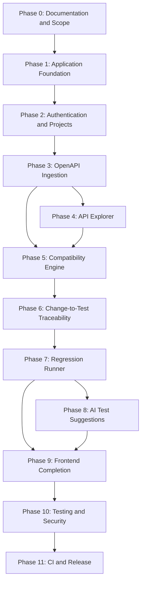

# ContractGuard — Implementation Plan and Development Tracker

**Document version:** 1.3\
**Development approach:** Incremental, test-driven modular monolith\
**Primary language:** JavaScript\
**Last updated:** 14 November 2026\
**Document status:** Active development and release-readiness tracker

---

## 1. Purpose

This document defines the implementation roadmap, development phases, technical milestones, verification requirements, and release-readiness criteria for ContractGuard.

It acts as the central development tracker.

The project follows an incremental implementation approach. Every phase must produce a defined outcome supported by implementation and verification evidence.

New functionality must preserve:

- Existing application behavior.
- Architectural boundaries.
- Data integrity.
- Security restrictions.
- Historical comparison and test-run records.
- Deterministic compatibility semantics.

The tracker distinguishes implemented functionality from completed acceptance testing and release readiness.

## 2. Development Principles

1. **Incremental implementation:** Develop related functionality in logical, testable batches.
2. **Preserve architecture:** Keep parsing, normalization, compatibility analysis, impact assessment, execution, and AI integration separate.
3. **Deterministic domain logic:** Compatibility classifications and regression outcomes remain independent of AI.
4. **Test-driven development:** Meaningful domain behavior must have automated tests.
5. **JavaScript throughout:** TypeScript is outside the current project scope.
6. **Security first:** Validate untrusted input and enforce ownership on the backend.
7. **Immutable history:** Preserve original specifications and completed comparison and test-run evidence.
8. **Honest verification:** Do not mark a phase complete solely because its happy path works.
9. **Minimal infrastructure:** Avoid services and dependencies without a concrete product requirement.
10. **Reproducible evidence:** Performance and accuracy claims require documented fixtures and measurements.

## 3. Priority Definitions

| Priority | Meaning |
|---|---|
| `P0` | Required for the v1 release |
| `P1` | Valuable enhancement after the core product workflow is complete |
| `P2` | Deferred beyond the current release scope |

The Product Requirements Document is the source of truth for functional scope and priority.

## 4. Overall Development Roadmap

Frontend implementation may proceed alongside its corresponding backend feature. The phase dependencies describe the order of domain capabilities rather than requiring all interface work to be postponed.

## 5. Definition of Done

A feature is considered complete when:

- The relevant product acceptance criteria are satisfied.
- Input validation and authorization are enforced server-side.
- Loading, empty, success, error, and partial states are handled where applicable.
- Unit tests cover meaningful domain behavior and edge cases.
- Integration tests cover relevant API workflows.
- The frontend behavior follows the Design specification.
- Existing working functionality is preserved.
- Documentation reflects the actual implementation.
- No temporary secret, unsafe fallback, debug endpoint, or unreviewed test bypass remains.

A completed implementation phase does not automatically mean every security, accessibility, deployment, or end-to-end acceptance requirement is complete.

---

## 6. Phase 0 — Documentation and Scope

**Priority:** P0\
**Status:** Documentation baseline established; consistency update in progress.

### Objective

Maintain one coherent product, design, technical, architecture, API, data, compatibility, and security reference.

### Completed documentation work

- [x] Product direction and scope established.
- [x] Core API compatibility workflow documented.
- [x] Baseline-to-candidate comparison direction defined.
- [x] Technology stack documented.
- [x] Data relationships documented.
- [x] Backend endpoint contracts documented.
- [x] Compatibility classifications and rules documented.
- [x] Security boundaries documented.
- [x] Demo Store fixtures documented.
- [x] Implementation phases consolidated into one tracker.

### Remaining review work

- [ ] Verify every documented endpoint against the current route implementation.
- [ ] Verify fixture hashes and runner eligibility.
- [ ] Verify every documented resource limit against backend configuration.
- [ ] Verify documentation links and repository paths.
- [ ] Complete the final cross-document consistency review.

### Exit Criteria

- All documents use the same comparison direction and ruleset.
- Test cases are associated with baseline specification versions.
- Comparison findings preserve their original ruleset.
- Shared-schema impact and coverage semantics are documented consistently.
- Unsupported functionality remains explicit.
- AI remains optional and consent-gated.
- The runner has a clearly defined execution boundary.

---

## 7. Phase 1 — Application Foundation

**Priority:** P0\
**Status:** Core application foundation implemented; clean-checkout acceptance review remains.

### Objective

Provide the React frontend, Express backend, MongoDB integration, and initial application shell.

### Repository and Environment

- [x] Establish the ContractGuard repository.
- [x] Separate frontend and backend applications.
- [x] Configure JavaScript ES modules.
- [x] Establish environment configuration.
- [x] Configure Git and `.gitignore`.
- [x] Establish dependency manifests and lockfiles.
- [x] Establish development scripts.

### Frontend

- [x] Initialize React with Vite.
- [x] Configure Tailwind CSS.
- [x] Establish application entry points.
- [x] Configure React Router.
- [x] Establish TanStack Query.
- [x] Implement the application shell.
- [x] Configure the development API proxy.

### Backend

- [x] Initialize Express.
- [x] Establish backend entry points.
- [x] Configure MongoDB and Mongoose.
- [x] Establish centralized error handling.
- [x] Configure security middleware.
- [x] Establish the common API response structure.
- [x] Implement the health endpoint.

### Remaining Verification

- [ ] Verify startup from a clean checkout.
- [ ] Verify missing and invalid environment configuration.
- [ ] Verify MongoDB unavailable and reconnect behavior.
- [ ] Verify all production startup requirements.

### Milestone

Working frontend, backend, and database foundation.

---

## 8. Phase 2 — Authentication and Project Management

**Priority:** P0\
**Status:** Core functionality implemented; complete security acceptance review remains.

### Database Models

- [x] User model.
- [x] Project model.
- [x] Ownership relationships.
- [x] Database indexes.
- [x] Mongoose validation.

### Authentication

- [x] User registration.
- [x] Password hashing using bcrypt.
- [x] Password verification.
- [x] JWT generation and verification.
- [x] HttpOnly authentication cookie.
- [x] Login and logout.
- [x] Current-user endpoint.

### Security

- [x] Authentication middleware.
- [x] Project ownership checks.
- [x] Security headers.
- [x] Rate limiting.
- [x] Request validation.
- [x] Origin-protection middleware.
- [ ] Complete production cookie and CSRF acceptance audit.
- [ ] Complete cross-user authorization review across every resource type.

### Project Management

- [x] Create projects.
- [x] List personal projects.
- [x] Retrieve project details.
- [x] Update project information.
- [x] Delete projects with dependent-record handling.

### Frontend

- [x] Login screen.
- [x] Registration screen.
- [x] Protected application navigation.
- [x] Projects workspace.
- [x] Project creation and management.

### Milestone

Authenticated project workspace with backend-enforced ownership.

---

## 9. Phase 3 — OpenAPI Ingestion and Normalization

**Priority:** P0\
**Status:** Core implementation present; complete support-boundary audit remains.

### File Upload

- [x] Multipart uploads.
- [x] Bounded upload handling.
- [x] JSON support.
- [x] YAML support.
- [x] Upload-size enforcement.
- [x] UTF-8 content validation.
- [x] Duplicate upload detection.
- [x] SHA-256 hashing of original uploaded bytes.

### OpenAPI Processing

- [x] Integrate OpenAPI parsing.
- [x] Identify declared OpenAPI versions.
- [x] Validate supported OpenAPI documents.
- [x] Extract operation information.
- [x] Preserve original source documents.
- [x] Retain parser diagnostics and support warnings.
- [x] Persist specification versions.

### Reference Handling

- [x] Supported internal-reference handling.
- [x] JSON Pointer preservation.
- [x] Reference-resolution information.
- [ ] Complete circular-reference edge-case audit.
- [ ] Complete unresolved-reference audit.
- [ ] Verify all parser and reference resource limits.

### Normalization

- [x] Operation extraction.
- [x] Canonical operation identifiers.
- [x] Original API path preservation.
- [x] Supported parameter extraction.
- [x] Supported response extraction.
- [x] Supported component extraction.
- [ ] Complete supported-construct audit across accepted OpenAPI versions.

### Verification

The Demo Store v1 and v2 specifications have been used during the application workflow.

Full acceptance still requires testing of malformed documents, unsupported constructs, resource-limit boundaries, and reference edge cases.

### Milestone

Working specification-ingestion pipeline with explicit support diagnostics.

---

## 10. Phase 4 — API Explorer

**Priority:** P0\
**Status:** Core workflows implemented and browser-verified; remaining acceptance checks are part of the release review.

### Backend

- [x] Retrieve extracted operations.
- [x] Retrieve operation details.
- [x] Retrieve reusable components.
- [x] Resolve supported internal references.
- [x] Return source JSON Pointers.
- [x] Return reference-resolution information.

### Frontend

- [x] API operation list.
- [x] Operation detail view.
- [x] Method and path presentation.
- [x] Component navigation.
- [x] Reference browsing.
- [x] Schema inspection.
- [x] Response definition presentation.
- [x] Source-location presentation.

### Remaining Verification

- [ ] Complete non-empty request-body edge-case review.
- [ ] Verify method and path filtering.
- [ ] Exercise unsupported-construct diagnostics.
- [ ] Verify loading and error states.
- [ ] Complete hostile-content rendering checks.
- [ ] Complete external-reference and server-URL security checks.

### Milestone

Read-only API Explorer for supported specification structures.

---

## 11. Phase 5 — Compatibility Engine

**Priority:** P0\
**Status:** Core implemented and integrated; exhaustive paired analyzer verification remains open.

### Objective

Provide deterministic compatibility analysis between baseline and candidate OpenAPI specification versions.

Comparison direction:

`BASELINE_CONSUMER_TO_CANDIDATE_PROVIDER`

Ruleset:

`CG-COMPAT-1.1`

### Engine Foundation

- [x] Establish compatibility-analysis services.
- [x] Define ruleset identifier.
- [x] Define report contracts.
- [x] Define finding identifiers.
- [x] Define rule identifiers.
- [x] Define classification structures.
- [x] Define analysis-status structures.
- [x] Establish deterministic finding ordering.

### Operation Matching

- [x] Canonical operation identity.
- [x] Operation matching.
- [x] Path-parameter normalization.
- [x] Original path preservation.
- [x] Conservative handling of ambiguous matches.
- [x] Affected-operation information in findings.

### Compatibility Rule Coverage

The ruleset covers supported changes to:

- Operations and paths.
- Parameters.
- Request bodies.
- Response schemas.
- Required and optional properties.
- Data types and enums.
- Supported schema constraints.
- Security requirements.
- Server metadata.
- Documentation metadata.
- Unsupported schema constructs.

### Recorded Fixture and Test Coverage

- [x] Mapping fixtures cover the documented normative rule identifiers.
- [x] Finding-contract fixtures verify rule IDs and classifications.
- [x] Stable finding identifiers are tested.
- [x] Operation linkage is tested.
- [x] JSON Pointer structures are tested.
- [x] Summaries and rationales are tested.
- [x] Unsupported diagnostics are covered.
- [ ] Complete paired baseline/candidate analyzer fixtures for every applicable rule.
- [ ] Complete exhaustive per-rule directional fixture verification.
- [ ] Complete the final supported-schema normalization audit.

The mapping and finding-contract matrix must not be represented as complete end-to-end analyzer coverage for every rule.

### Acceptance Criteria

- Supported rules produce deterministic findings.
- Request and response compatibility directions are correct.
- Findings contain rule identifiers, classifications, rationales, and source locations.
- Unsupported constructs produce partial-analysis outcomes.
- Ambiguous relationships are not silently guessed.
- Paired analyzer fixtures demonstrate the expected behavior for applicable rules.

### Milestone

Compatibility-engine core implemented and integrated; final rule-level acceptance audit pending.

---

## 12. Phase 6 — Change-to-Test Traceability

**Priority:** P0\
**Status:** Core implementation integrated; remaining full release acceptance belongs to the system-wide verification phase.

### Objective

Connect compatibility findings to affected operations and test cases associated with the exact baseline specification version.

### Reference Impact Analysis

- [x] Reverse-reference analysis.
- [x] Directly affected operation identification.
- [x] Supported indirectly affected operation identification.
- [x] Canonical operation-key matching.
- [x] Shared-schema impact propagation.
- [x] Source-location preservation.
- [x] Unsupported-impact diagnostics.

### Test Traceability

- [x] Test cases linked to baseline specification versions.
- [x] Test cases linked to canonical operation keys.
- [x] Approved and draft test cases distinguished.
- [x] Archived cases excluded from active coverage.
- [x] Per-change coverage projection.
- [x] Coverage summary calculation.
- [x] Unmapped findings represented explicitly.

### Test Case Management

- [x] Test Case model.
- [x] Test-case validator.
- [x] Test-case service.
- [x] Test-case controller.
- [x] Test-case routes.
- [x] Draft case creation.
- [x] Draft editing.
- [x] Approval transition.
- [x] Archive transition.
- [x] Test-case integration tests.

### Verification

Phase 6 implementation was integrated with the compatibility report workflow.

Its functionality is included in the recorded backend suite and report/traceability testing.

### Milestone

Change-to-test traceability and test-case lifecycle integrated.

---

## 13. Phase 7 — Bundled Regression Runner

**Priority:** P0\
**Status:** Implemented; broader release-level execution verification remains part of Phase 10.

### Objective

Execute approved baseline test cases against trusted bundled candidate implementations and validate candidate responses against the baseline contract.

### Fixture and Eligibility

- [x] Establish trusted Demo Store fixture handling.
- [x] Associate fixture eligibility with server-controlled data.
- [x] Define supported bundled operation profiles.
- [x] Prevent client-supplied execution target selection.
- [x] Validate comparison and version relationships.

### Runner

- [x] Implement bounded regression execution.
- [x] Validate approved test-case eligibility.
- [x] Construct supported GET requests.
- [x] Execute through the bundled implementation boundary.
- [x] Reject unsupported operations.
- [x] Enforce execution limits.
- [x] Validate candidate responses against baseline response expectations.
- [x] Evaluate explicit assertions.
- [x] Persist result snapshots and run summaries.
- [x] Preserve historical run information.

### Execution Constraints

The runner uses configured server-side limits for:

- Maximum approved cases per run.
- Concurrent runs.
- Concurrent tests per run.
- Per-test timeout.
- Total run deadline.
- Response size.
- Stored evidence.
- Validation diagnostic count.

The current data-model baseline is:

| Constraint | Limit |
|---|---:|
| Test cases per run | 20 |
| Concurrent runs | 2 |
| Concurrent tests per run | 2 |
| Per-test timeout | 5 seconds |
| Total run deadline | 60 seconds |
| Maximum response body | 256 KiB |
| Stored evidence per result | 16 KiB |
| Validation diagnostics per result | 50 |

### Verification

- [x] Regression execution is covered by backend tests.
- [x] Run eligibility and persistence are covered by automated testing.
- [ ] Complete full browser-driven regression workflow.
- [ ] Complete interrupted-run recovery acceptance test.
- [ ] Complete final execution-boundary security review.

### Milestone

Controlled GET-only regression runner implemented.

---

## 14. Phase 8 — AI-Assisted Test Suggestions

**Priority:** P1\
**Status:** Implemented; targeted automated tests and live provider workflows verified.

### Objective

Generate structured test-case suggestions for supported operations in the trusted synthetic Demo Store context.

### Provider Integration

- [x] Integrate the official `@google/genai` JavaScript SDK.
- [x] Configure the provider key on the backend.
- [x] Configure model selection through backend environment settings.
- [x] Handle missing provider configuration.
- [x] Handle provider errors and quota conditions.

### Context and Consent

- [x] Establish trusted synthetic fixture context.
- [x] Restrict generation to supported operations.
- [x] Construct selected-operation context.
- [x] Generate provider-submission preview.
- [x] Require explicit consent.
- [x] Validate selected operation identity.
- [x] Keep provider credentials server-side.

### Structured Output

- [x] Request structured suggestions.
- [x] Validate provider output.
- [x] Reject invalid or mismatched operation output.
- [x] Validate required draft fields.
- [x] Reject unsupported content.
- [x] Prevent generated executable code from reaching the runner.

### Persistence and Review

- [x] Persist valid suggestions as draft test cases.
- [x] Preserve AI source metadata.
- [x] Keep AI drafts separate from approved cases.
- [x] Require human review and approval.
- [x] Preserve existing manual test cases.

### Current Supported Operations

| Operation ID | Method | Path |
|---|---|---|
| `listProducts` | GET | `/products` |
| `getProduct` | GET | `/products/{productId}` |

### Recorded Verification

- 44 AI-focused tests passed across 5 test files.
- The AI-focused tests are included within the complete backend suite, not additional to it.
- Live generation succeeded for `listProducts`.
- Live generation succeeded for `getProduct`.
- Generated suggestions were persisted as draft test cases.
- Existing approved manual test cases remained intact.

The AI workflow is optional. Core compatibility and regression behavior does not depend on Gemini availability.

### Milestone

AI-assisted test suggestion workflow implemented and verified for the documented synthetic operations.

---

## 15. Phase 9 — Frontend Completion

**Priority:** P0\
**Status:** Core screens and AI workflow integrated; complete end-to-end, responsive, and accessibility acceptance remains.

### Frontend Integration

- [x] Authentication screens.
- [x] Projects workspace.
- [x] Specification upload and history.
- [x] API Explorer.
- [x] Comparison workflow.
- [x] Compatibility finding presentation.
- [x] Affected-operation and coverage presentation.
- [x] Test Case Library.
- [x] Test-case lifecycle controls.
- [x] AI suggestion preview.
- [x] AI suggestion review.
- [x] Regression-run workflow and result views.

### Recorded Verification

- [x] Frontend ESLint passed.
- [x] Vite production build passed.
- [x] AI suggestions were exercised for both supported operations.
- [x] Generated drafts appeared in the Test Case Library.
- [x] Existing manual approved cases remained present after refresh.

### Remaining Acceptance

- [ ] Complete primary browser-driven workflow from project creation through regression history.
- [ ] Verify every page's loading, empty, error, and partial states.
- [ ] Verify responsive layout at desktop, tablet, and mobile widths.
- [ ] Complete keyboard-navigation audit.
- [ ] Complete accessible dialog and form review.
- [ ] Verify all technical content is rendered safely.
- [ ] Verify navigation and context preservation across all workflows.

### Milestone

Complete v1 frontend experience with verified core workflows.

---

## 16. Phase 10 — Testing and Security Review

**Priority:** P0\
**Status:** Automated suite and selected security checks recorded; comprehensive release review remains.

### 16.1 Backend Verification

Recorded result:

- 539 backend tests passed.
- 54 backend test files passed.

The backend suite covers the implemented application areas, including authentication, specifications, compatibility analysis, traceability, test-case management, regression execution, and AI suggestion workflows.

### 16.2 AI Verification

Recorded result:

- 44 AI-focused tests passed.
- 5 AI-focused test files passed.

These tests are a subset of the backend test suite.

### 16.3 Frontend Verification

Recorded result:

- ESLint passed.
- Production build passed.

### 16.4 Remaining Verification

- [ ] Complete a fresh full-suite run against the final source state.
- [ ] Complete cross-user ownership review for every resource route.
- [ ] Complete cookie and CSRF/origin acceptance review.
- [ ] Complete malicious-upload and parser-boundary review.
- [ ] Complete external-reference and server-URL SSRF review.
- [ ] Complete arbitrary execution-target rejection review.
- [ ] Complete evidence-redaction review.
- [ ] Complete interrupted-run recovery review.
- [ ] Complete responsive and accessibility review.
- [ ] Complete primary browser-driven end-to-end workflow.
- [ ] Verify behavior when Gemini is not configured.
- [ ] Verify behavior when Gemini returns invalid output.
- [ ] Review dependency vulnerabilities.
- [ ] Document the remaining compatibility support limitations.

### 16.5 Compatibility Benchmarks

Prepare a labelled baseline/candidate fixture suite and measure:

- Breaking-change precision.
- Breaking-change recall.
- Non-breaking classification correctness.
- Unsupported-feature detection.
- Shared-schema impact accuracy.
- Operation-matching correctness.

Every benchmark report must include:

- Application and ruleset version.
- Runtime version.
- Fixture count.
- Environment.
- Measurement methodology.
- Actual observed results.

Performance and accuracy claims must not be invented.

### Milestone

Verified v1 release candidate with documented limitations and completed security acceptance.

---

## 17. Phase 11 — CI, Deployment and Release

**Priority:** P0\
**Status:** Pending release engineering.

### 17.1 Continuous Integration

- [ ] Configure GitHub Actions.
- [ ] Install dependencies using committed lockfiles.
- [ ] Run frontend lint.
- [ ] Run frontend production build.
- [ ] Run backend unit tests.
- [ ] Run backend integration tests.
- [ ] Run compatibility fixture tests.
- [ ] Run selected end-to-end tests.
- [ ] Fail required workflows when checks fail.

GitHub Actions will initially verify ContractGuard's own repository.

Customer-facing CI integrations are outside the current v1 scope.

### 17.2 Documentation

- [x] Establish public project README.
- [x] Establish product requirements.
- [x] Establish design documentation.
- [x] Establish technical requirements.
- [x] Establish architecture documentation.
- [x] Establish application-flow documentation.
- [x] Establish database schema documentation.
- [x] Establish backend API documentation.
- [x] Establish compatibility rules documentation.
- [x] Establish security review documentation.
- [x] Establish Demo Store fixture documentation.
- [x] Establish the implementation tracker.
- [x] Establish the documentation manifest.
- [ ] Verify every documentation statement against the final source state.
- [ ] Add verified product screenshots.
- [ ] Complete a clean-checkout documentation and setup test.

### 17.3 Deployment

- [ ] Select the production deployment configuration.
- [ ] Configure production MongoDB.
- [ ] Configure production environment variables.
- [ ] Configure HTTPS.
- [ ] Configure secure authentication cookies.
- [ ] Build and serve the React production assets.
- [ ] Verify same-origin API behavior.
- [ ] Verify persistent database storage.
- [ ] Verify process-restart behavior.
- [ ] Verify optional AI configuration.
- [ ] Run deployed application smoke tests.

Durable user data must not depend on an ephemeral deployment filesystem.

Free-tier hosting limitations must be disclosed.

### 17.4 Release Preparation

- [ ] Complete all required P0 requirements.
- [ ] Complete the comprehensive security review.
- [ ] Verify the complete backend suite.
- [ ] Verify frontend lint and build.
- [ ] Complete primary end-to-end workflows.
- [ ] Verify documentation against implementation.
- [ ] Confirm no secrets are committed or exposed.
- [ ] Verify the bundled fixtures.
- [ ] Prepare a reproducible demonstration.
- [ ] Verify a clean repository checkout.
- [ ] Review final repository changes before release.

### Milestone

ContractGuard v1 release candidate.

---

## 18. Central Development Tracker

This table is the central status summary. Detailed tasks and evidence remain in their respective phase sections.

| Phase | Deliverable | Priority | Current status |
|---|---|---|---|
| 0 | Documentation and scope | P0 | Documentation baseline updated; final source cross-check pending |
| 1 | Application foundation | P0 | Core implemented; clean-checkout review pending |
| 2 | Authentication and projects | P0 | Core implemented; full security acceptance pending |
| 3 | OpenAPI ingestion | P0 | Core implemented; support-boundary audit pending |
| 4 | API Explorer | P0 | Core implemented and browser-verified; remaining checks pending |
| 5 | Compatibility engine | P0 | Core implemented; exhaustive paired analyzer audit pending |
| 6 | Change-to-test traceability | P0 | Implemented and integrated |
| 7 | Regression runner | P0 | Implemented; release-level verification pending |
| 8 | AI test suggestions | P1 | Implemented; targeted tests and live workflows verified |
| 9 | Frontend completion | P0 | Core workflows integrated; end-to-end and accessibility review pending |
| 10 | Testing and security | P0 | Automated verification recorded; comprehensive release review pending |
| 11 | CI and deployment | P0 | Pending |

## 19. Architectural Decision Log

| ID | Decision | Status | Rationale |
|---|---|---|---|
| ADR-001 | JavaScript modular monolith | Accepted | Keeps domain responsibilities separated without distributed infrastructure |
| ADR-002 | MongoDB and Mongoose | Accepted | Supports versioned documents, reports, test cases, and run records |
| ADR-003 | Scalar parser with ContractGuard compatibility engine | Accepted | Separates standards parsing from product-specific compatibility policy |
| ADR-004 | Ajv through supported schema adapters | Accepted | Keeps response validation aware of supported OpenAPI schema behavior |
| ADR-005 | Bundled GET-only regression environment | Accepted | Prevents arbitrary-target execution and limits side effects |
| ADR-006 | Optional Gemini integration | Accepted | Adds test ideation without making AI a core dependency |
| ADR-007 | Same-origin production frontend and API | Accepted | Simplifies cookie authentication and CORS |
| ADR-008 | In-process bounded execution | Accepted | Avoids distributed queue infrastructure for current product scale |

## 20. Scope-Control Policy

The following remain outside the current v1 architecture unless a concrete product requirement justifies reconsideration:

- TypeScript.
- Redis.
- BullMQ.
- Kafka.
- Docker as a runtime prerequisite.
- Kubernetes.
- Microservices.
- Distributed job orchestration.
- RAG and vector databases.
- AI agents.
- Socket.IO.
- Arbitrary external API execution.
- Customer-facing GitHub App integration.
- Organization management.
- Billing and subscription infrastructure.

New technologies must solve a concrete requirement and justify their maintenance, security, and implementation cost.

## 21. Deferred Enhancements

| Enhancement | Priority | Reason |
|---|---|---|
| Arbitrary external API execution | P2 | Requires a separate network isolation and SSRF security design |
| GitHub App integration | P2 | Not required for the core workflow |
| Customer-facing CI deployment blocking | P2 | Requires a separate integration and policy model |
| Team collaboration | P2 | Current ownership model is single-user |
| Organization administration | P2 | Outside v1 scope |
| Distributed test execution | P2 | Current bounded in-process runner is sufficient for the product's present scope |
| Additional AI-supported operations | P1 | Requires trusted synthetic context and operation-specific validation |

## 22. Change Control

When scope, rules, dependencies, or architecture change:

1. Update the relevant documentation in the same change as the implementation.
2. Record significant architecture trade-offs in the decision log.
3. Update acceptance criteria and status.
4. Add or modify automated tests.
5. Update README limitations when visible product behavior changes.
6. Preserve historical ruleset and test-run semantics.

A documentation status must not be changed to complete until the associated implementation or review evidence exists.