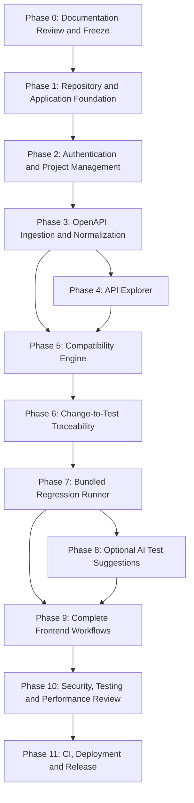

# Implementation Plan and Development Tracker

**Product:** ContractGuard

**Document version:** 1.2

**Status:** Active development tracker — updated 10 November 2026

**Development approach:** Incremental, test-driven modular monolith

**Primary language:** JavaScript

## 1. Purpose

This document is the central development roadmap and progress tracker for ContractGuard.

It consolidates:

- Implementation phases.
- Development sequence.
- Feature-level tasks.
- Testing requirements.
- Technical milestones.
- Release acceptance criteria.
- Deferred work.

The project will be developed incrementally. Each phase must have a working, testable outcome before the next major dependency is introduced.

The application must not be built as one large code-generation exercise. Each module should be implemented, understood, tested, and integrated before proceeding.

## 2. Development principles

1. **Finalize before implementing:** The product scope, architecture, security boundaries, and core data relationships must be reviewed before application development begins.

2. **Build incrementally:** Implement one feature group at a time.

3. **Test domain logic independently:** Compatibility rules must work without Express, MongoDB, React, or AI.

4. **Preserve architectural boundaries:** Parsing, normalization, comparison, traceability, and execution are separate responsibilities.

5. **Use JavaScript throughout:** TypeScript is excluded.

6. **Do not add unnecessary infrastructure:** No Redis, Kafka, Kubernetes, microservices, or Docker prerequisites.

7. **AI is optional:** The product remains fully usable without AI configuration.

8. **Prefer deterministic behavior:** The same supported inputs and ruleset must generate the same comparison findings.

9. **Document limitations:** Unsupported constructs and partial results must remain visible.

10. **Use actual evidence:** Performance and accuracy claims must be supported by reproducible tests.

11. **Preserve history:** Specification versions, comparison findings, and completed test-run evidence must remain immutable.

12. **Understand before expanding:** The developer must be able to explain the purpose, data flow, and limitations of each implemented module.

## 3. Implementation priority definitions

| Priority | Meaning |
|---|---|
| `P0` | Required for the v1 release |
| `P1` | Valuable improvement after the core v1 workflow is working |
| `P2` | Deferred beyond the initial release |

Development phase completion does not automatically mean every P1 or P2 requirement has been implemented.

The PRD is the source of truth for product scope and priorities.

## 4. Overall implementation sequence

The phases describe dependency order, not a requirement to build every frontend screen only at the end.

The core domain modules should be implemented and tested before their complete UI workflows are connected.

## 5. Phase 0 — Documentation review and freeze

**Priority:** P0

**Status:** Baseline established; final cross-document consistency review remains pending.

### Objective

Ensure that the requirements and technical specifications agree before creating the application structure.

### Tasks

- [ ] Review `README.md`.
- [ ] Review `PRD.md`.
- [ ] Review `Design.md`.
- [ ] Review `TRD.md`.
- [ ] Review `Architecture.md`.
- [ ] Review `AppFlow.md`.
- [ ] Review `Schema.md`.
- [ ] Review `API.md`.
- [ ] Review `Rules.md`.
- [ ] Review `SecurityReview.md`.
- [ ] Review `ImplementationPlan.md`.
- [ ] Verify the two Demo Store OpenAPI examples.
- [ ] Correct the optional `categoryId` inconsistency in the v2 fixture.
- [ ] Remove misleading `servers` declarations from the bundled examples.
- [ ] Confirm that the baseline/candidate comparison direction is consistent everywhere.
- [ ] Confirm that test runs reference a comparison ID.
- [ ] Confirm that test cases belong to the baseline specification version.
- [ ] Confirm that candidate responses are validated against baseline response schemas.
- [ ] Confirm that all runner eligibility and security restrictions agree.
- [ ] Confirm that the unpaid AI-provider privacy restriction is consistent.
- [ ] Confirm the supported OpenAPI and JSON Schema subset.
- [ ] Confirm that version names and ruleset identifiers are consistent.

### Acceptance criteria

- No document contradicts the approved data model or API contract.
- The comparison direction is consistently defined.
- The runner's execution boundary is unambiguous.
- The AI privacy restrictions are consistent across documents.
- The two demo specifications contain intentional, documented changes.
- The documentation is suitable as the implementation reference.

**Milestone:** Documentation approved for implementation.

## 6. Phase 1 — Repository and application foundation

**Priority:** P0

### Objective

Create the minimum working repository containing a React frontend, an Express backend, and a MongoDB connection.

### 6.1 Environment and repository setup

- [ ] Create the `ContractGuard` Git repository.
- [ ] Create the `client/` directory.
- [ ] Create the `server/` directory.
- [ ] Establish the root Git ignore configuration.
- [ ] Create `.env.example`.
- [ ] Configure the development environment.
- [ ] Verify Node.js 24 and npm compatibility.
- [ ] Initialize Git and make the initial commit.
- [ ] Add the documentation directory.
- [ ] Configure package scripts for client and server development.

Do not install the entire proposed dependency list immediately.

Install dependencies when their corresponding implementation phase begins.

### 6.2 Frontend foundation

- [ ] Initialize React using Vite.
- [ ] Configure the official Tailwind CSS 4 Vite integration.
- [ ] Configure React Router 8 Declarative Mode.
- [ ] Configure TanStack Query.
- [ ] Establish the application entry point.
- [ ] Create the basic application shell.
- [ ] Create the API-service foundation.
- [ ] Configure the development API proxy.

### 6.3 Backend foundation

- [ ] Initialize the Express 5 application.
- [ ] Configure ES modules.
- [ ] Establish the Express server entry point.
- [ ] Configure environment loading and validation.
- [ ] Configure MongoDB connection.
- [ ] Connect Mongoose.
- [ ] Establish centralized error handling.
- [ ] Establish the standard JSON response format.
- [ ] Add request-size limits and basic security headers.
- [ ] Implement the health endpoint.

### 6.4 Development integration

- [ ] Verify the React application starts.
- [ ] Verify the Express server starts.
- [ ] Verify React can call the Express health endpoint through the Vite proxy.
- [ ] Verify MongoDB connectivity.
- [ ] Verify configuration errors are understandable.
- [ ] Verify the initial application layout renders.

### Acceptance criteria

- The client and server run locally.
- The API is reachable through the Vite proxy.
- MongoDB connects successfully.
- Health checks work.
- No secrets are committed.
- A fresh developer checkout can start the basic application using the documented instructions.

**Milestone:** Working application foundation.

## 7. Phase 2 — Authentication and project management

**Priority:** P0

### Objective

Implement user authentication, protected application access, project ownership, and basic project management.

### 7.1 Database models

- [ ] Implement the User model.
- [ ] Implement the Project model.
- [ ] Add required indexes.
- [ ] Configure schema validation and timestamps.
- [ ] Verify unique email and owner-scoped project slug constraints.

### 7.2 Authentication services

- [ ] Implement Argon2id password hashing.
- [ ] Implement password verification.
- [ ] Implement JWT signing.
- [ ] Implement JWT verification.
- [ ] Configure the HttpOnly authentication cookie.
- [ ] Implement registration.
- [ ] Implement login.
- [ ] Implement logout.
- [ ] Implement current-user retrieval.
- [ ] Add login and registration rate limits.

### 7.3 Security middleware

- [ ] Implement authentication middleware.
- [ ] Implement exact request-origin validation for unsafe methods.
- [ ] Implement validated Referer fallback behavior.
- [ ] Reject missing/untrusted origin cases according to `SecurityReview.md`.
- [ ] Configure security headers.
- [ ] Ensure protected endpoints use the authenticated user ID.
- [ ] Verify cross-user access is rejected.

### 7.4 Project APIs

- [ ] Create a project.
- [ ] List owned projects.
- [ ] Retrieve project details.
- [ ] Update project name and description.
- [ ] Soft-delete a project.
- [ ] Prevent new work on deleted projects.
- [ ] Implement ownership tests.

### 7.5 Frontend workflows

- [ ] Build registration screen.
- [ ] Build login screen.
- [ ] Implement session restoration using `/auth/me`.
- [ ] Implement protected routes.
- [ ] Build the projects list.
- [ ] Build create-project form.
- [ ] Build project overview.
- [ ] Implement project update.
- [ ] Implement project deletion confirmation.
- [ ] Add loading, empty, success, and error states.

### Acceptance criteria

- User registration and login work.
- Passwords are stored as Argon2id hashes.
- JWT is stored only in the HttpOnly cookie.
- Logout clears the authentication cookie.
- Protected routes enforce authentication.
- User A cannot access User B's project.
- All major project actions work end-to-end.
- The UI handles expired authentication safely.

**Milestone:** Authenticated project workspace.

## 8. Phase 3 — OpenAPI ingestion and normalization

**Priority:** P0

### Objective

Accept bounded OpenAPI JSON/YAML documents and convert supported content into a reliable internal representation.

**Current status:** Partially verified. Both bundled Demo Store YAML versions (1.0.0 and 2.0.0) have been uploaded successfully and appear in project version history. The backend test suite has passed. The complete Phase 3 acceptance checklist has not been audited item by item in this tracker.

### 8.1 Upload processing

- [ ] Install and configure Multer.
- [ ] Configure memory-based upload handling.
- [ ] Enforce the 1 MiB upload limit.
- [ ] Accept JSON and YAML only.
- [ ] Validate file content and format.
- [ ] Reject unexpected file types.
- [ ] Configure safe YAML parsing.
- [ ] Reject duplicate YAML mapping keys.
- [ ] Disable YAML aliases.
- [ ] Reject unsupported custom YAML tags.
- [ ] Enforce depth and parsed-node limits.
- [ ] Compute SHA-256 from original file bytes.
- [ ] Implement project-scoped duplicate detection.

### 8.2 OpenAPI parsing

- [ ] Integrate the Scalar OpenAPI parser.
- [ ] Identify the declared OpenAPI version.
- [ ] Accept the explicitly supported 3.0.x, 3.1.x, and 3.2.x versions.
- [ ] Reject Swagger/OpenAPI 2.0 with a clear message.
- [ ] Validate OpenAPI structure.
- [ ] Collect parser diagnostics.
- [ ] Preserve original specification source text.
- [ ] Identify supported and unsupported constructs.

### 8.3 Reference handling

- [ ] Implement local internal-reference resolution.
- [ ] Support relevant JSON Pointer references.
- [ ] Detect unresolved references.
- [ ] Detect cyclic reference graphs.
- [ ] Enforce maximum reference depth.
- [ ] Prevent external reference fetching.
- [ ] Preserve source-location information.
- [ ] Produce unsupported diagnostics where necessary.

### 8.4 Normalization

- [ ] Create a stable internal OpenAPI representation.
- [ ] Extract path and operation definitions.
- [ ] Normalize HTTP methods.
- [ ] Build canonical operation keys.
- [ ] Preserve original paths and parameter names.
- [ ] Extract effective parameters.
- [ ] Extract request-body definitions.
- [ ] Extract response definitions.
- [ ] Extract supported schemas.
- [ ] Preserve JSON Pointers.
- [ ] Record unsupported constructs.
- [ ] Preserve OpenAPI version and applicable schema dialect information.

### 8.5 Persistence

- [ ] Implement the SpecVersion model.
- [ ] Store original source content.
- [ ] Store original content hash.
- [ ] Store parser and support status.
- [ ] Store operation count.
- [ ] Assign the runner profile only through a trusted server-side fixture registry.
- [ ] Enforce specification immutability.

### 8.6 Frontend workflow

- [ ] Build the file-upload component.
- [ ] Implement version-label input.
- [ ] Implement upload progress.
- [ ] Display validation errors.
- [ ] Display supported-feature warnings.
- [ ] Display version details.
- [ ] Display duplicate-upload feedback.
- [ ] Implement project specification history.

### Acceptance criteria

- Valid supported JSON and YAML specifications can be uploaded.
- Invalid documents produce useful diagnostics.
- Duplicate uploads are detected.
- External references are never fetched.
- Unsupported constructs are not silently discarded.
- Original source content remains immutable.
- Resource limits are enforced on the backend.

**Milestone:** Working OpenAPI ingestion pipeline.

## 9. Phase 4 — API Explorer

**Priority:** P0

**Status:** Core workflows implemented and browser-verified; final acceptance review remains partially open.

### Objective

Allow developers to inspect uploaded specification versions and navigate supported operations and schemas.

### Tasks

- [x] Implement operation-list retrieval.
- [x] Implement operation-detail retrieval.
- [x] Display paths and HTTP methods.
- [x] Display operation summaries and descriptions.
- [~] Display path, query, header, and supported cookie parameters. Path and query parameters were observed; header and cookie cases still need explicit verification.
- [~] Display request bodies. The no-request-body state was verified; a fixture containing a non-empty request body still needs verification.
- [x] Display response definitions.
- [x] Display supported schema details.
- [x] Implement internal-reference navigation.
- [~] Display unsupported constructs. The diagnostic UI exists; an unsupported-construct fixture still needs an end-to-end check.
- [x] Display source JSON Pointer information.
- [x] Build the API Explorer layout.
- [~] Implement method and path filters. Controls are present; their filtering behavior still needs an explicit browser check.
- [~] Add empty, loading, error, and partial states. The states are implemented, but each has not been independently exercised in the browser.
- [~] Verify that specification content is rendered as safe text. Rendering uses text/JSON presentation; a dedicated hostile-content verification remains outstanding.

### Acceptance criteria

- [x] A user can navigate operations in a valid uploaded specification.
- [~] Supported parameters, request bodies, and responses are inspectable. Parameters and responses were verified; a non-empty request-body fixture remains to be tested.
- [x] Internal schema references can be followed within the supported subset. Product and Error references were resolved in version 2.0.0; Product was resolved in version 1.0.0.
- [~] Unsupported information is visibly identified. The warning/diagnostic presentation still needs an end-to-end test with an intentionally unsupported construct.
- [~] Explorer actions never execute uploaded server URLs. The application reports that external references and uploaded server URLs are not contacted; dedicated security-test evidence remains to be recorded.

**Milestone:** Working read-only API Explorer.

### Verification record — 10 November 2026

**Automated verification recorded:**

- Backend: `npm test` passed — 28 test files and 290 tests.
- Frontend: `npm run lint` passed.
- Frontend: `npm run build` passed using Vite 8.3.6; 2,299 modules were transformed.

**Browser verification recorded:**

- Demo Store specification 2.0.0: operation list/detail, parameters, response definitions, component browsing, Product and Error reference resolution, target pointers, and resolution chains were inspected.
- Demo Store specification 1.0.0: operation list/detail, component browsing, and Product reference resolution were inspected.
- The reference navigator groups duplicate `$ref` values while retaining distinct source locations. The 2.0.0 browser check showed two unique references and four source locations; both references resolved after grouping.

**Remaining Phase 4 checks:**

- Verify a non-empty request body using a suitable supported fixture.
- Exercise method and path filters.
- Exercise an unsupported-construct/partial-coverage case.
- Exercise loading and error states where practical.
- Record dedicated security-test evidence confirming that external references and uploaded server URLs are never fetched or executed.

The Phase 4 milestone remains partially verified until these remaining checks are completed. The compatibility engine in Phase 5 has not been completed by this Explorer work.

## 10. Phase 5 — Compatibility engine

**Priority:** P0

**Critical technical milestone**

### Objective

Build ContractGuard's deterministic API compatibility engine independently of the frontend and database.

This is the most important domain-logic phase.

### 10.1 Engine foundation

- [ ] Establish the comparison module.
- [ ] Define the normalized baseline input contract.
- [ ] Define the normalized candidate input contract.
- [ ] Fix the direction as `BASELINE_CONSUMER_TO_CANDIDATE_PROVIDER`.
- [ ] Define the ruleset identifier `CG-COMPAT-1.1`.
- [ ] Define finding and summary structures.
- [ ] Define overall analysis statuses.

### 10.2 Path normalization and operation matching

- [ ] Implement canonical path generation.
- [ ] Preserve static path segments.
- [ ] Normalize parameter placeholders for matching.
- [ ] Preserve original parameter names.
- [ ] Match operations by canonical path and HTTP method.
- [ ] Detect operation additions and removals.
- [ ] Detect changed static path segments.
- [ ] Test parameter renaming separately from path removal/addition.

### 10.3 Version-aware schema normalization

- [ ] Identify OpenAPI 3.0 schema behavior.
- [ ] Identify OpenAPI 3.1/3.2 schema dialect behavior.
- [ ] Normalize supported OpenAPI 3.0 `nullable` semantics.
- [ ] Establish the supported JSON Schema 2020-12 subset.
- [ ] Configure the appropriate Ajv implementation.
- [ ] Integrate Ajv formats where supported.
- [ ] Reject or mark unsupported vocabulary behavior.
- [ ] Add fixtures for every normalized construct.

### 10.4 Compatibility rules

Implement the documented rules in `Rules.md`.

**Operation rules**

- [ ] Operation added.
- [ ] Operation removed.
- [ ] Path parameter rename.
- [ ] Static path change.
- [ ] `operationId` change.
- [ ] Documentation-only change.

**Parameter rules**

- [ ] Required parameter added.
- [ ] Optional parameter added.
- [ ] Required parameter removed.
- [ ] Parameter type changed.
- [ ] Parameter enum changed.
- [ ] Parameter serialization changed.
- [ ] Parameter location changed.
- [ ] Request constraints narrowed or broadened.

**Request-body rules**

- [ ] Requiredness changes.
- [ ] Media-type changes.
- [ ] Property additions and removals.
- [ ] Type changes.
- [ ] Required-property changes.
- [ ] Enum changes.
- [ ] Supported constraint changes.

**Response rules**

- [ ] Response property removed.
- [ ] Response property type changed.
- [ ] Requiredness changes.
- [ ] Property additions.
- [ ] Enum changes.
- [ ] Numeric and string constraint changes.
- [ ] Nullable behavior changes.
- [ ] Response status-code and media-type changes.

**Security and metadata rules**

- [ ] Security requirements changed.
- [ ] OAuth scope requirements changed.
- [ ] Server metadata changed.
- [ ] Documentation-only changes identified.

### 10.5 Directional correctness tests

These tests are mandatory.

- [ ] Confirm candidate requests remain at least as permissive as baseline requests.
- [ ] Confirm stricter candidate request constraints are classified appropriately.
- [ ] Confirm candidate responses remain within baseline expectations.
- [ ] Confirm narrower candidate response constraints are treated as non-breaking when proven.
- [ ] Confirm wider candidate response constraints are treated as potentially breaking when proven.
- [ ] Confirm response type incompatibilities are detected.
- [ ] Confirm request and response rules are not accidentally implemented in the same direction.

### 10.6 Deterministic findings

- [ ] Generate stable change IDs.
- [ ] Include rule IDs.
- [ ] Include JSON Pointers.
- [ ] Include canonical operation keys.
- [ ] Include affected operation keys where supported.
- [ ] Include rationale.
- [ ] Aggregate classification counts.
- [ ] Sort findings consistently.
- [ ] Ensure unsupported constructs produce partial analysis.
- [ ] Ensure the engine does not silently report unsupported changes as compatible.

### 10.7 Unit-test fixtures

Every implemented rule must have:

- Baseline fixture.
- Candidate fixture.
- Expected rule ID.
- Expected classification.
- Expected operation key.
- Expected source location.
- Expected analysis status.

Include paired directional tests wherever request and response semantics differ.

### Acceptance criteria

- Core compatibility rules operate independently of Express and MongoDB.
- Every supported rule has automated fixtures.
- Direction-sensitive request and response tests pass.
- Parameter renames do not become false operation additions/removals.
- Shared references are available for downstream impact analysis.
- Results are deterministic.
- Unsupported constructs produce partial outcomes.
- The engine can be explained and defended without relying on AI.

**Milestone:** Tested deterministic compatibility engine.

## 11. Phase 6 — Change-to-test traceability and test-case management

**Priority:** P0

### Objective

Connect compatibility findings to affected operations and the corresponding baseline test-case library.

### 11.1 Shared schema impact

- [ ] Implement reverse-reference mapping.
- [ ] Identify directly affected operations.
- [ ] Identify indirectly affected operations through supported internal references.
- [ ] Preserve affected canonical operation keys.
- [ ] Record incomplete impact analysis where necessary.
- [ ] Avoid assuming a shared component belongs to only one operation.

### 11.2 Test-case persistence

- [ ] Implement the TestCase model.
- [ ] Associate each case with one baseline specification version.
- [ ] Store the canonical operation key.
- [ ] Store original operation path.
- [ ] Store bounded path and query inputs.
- [ ] Store explicit assertion definitions.
- [ ] Store source (`MANUAL` or `AI`).
- [ ] Implement draft, approved, and archived states.
- [ ] Enforce controlled approval transitions.

### 11.3 Traceability service

- [ ] Retrieve comparison findings.
- [ ] Retrieve affected operation keys.
- [ ] Query baseline test cases.
- [ ] Match cases against affected operations.
- [ ] Separate draft and approved cases.
- [ ] Derive `COVERED`, `DRAFT_ONLY`, and `UNCOVERED`.
- [ ] Return coverage information with comparison details.
- [ ] Ensure coverage is not confused with actual regression results.

### 11.4 Test-case APIs and UI

- [ ] Implement manual test creation.
- [ ] Implement test retrieval.
- [ ] Implement draft editing.
- [ ] Implement approval.
- [ ] Implement archiving.
- [ ] Validate operation and parameter references.
- [ ] Build test-case library.
- [ ] Build test-case detail.
- [ ] Add validation and approval feedback.

### Acceptance criteria

- Every supported comparison change identifies its affected operations.
- Baseline test cases can be linked to those operations.
- Coverage is derived correctly.
- Draft-only and uncovered states are distinct.
- Only approved cases are eligible for execution.
- Cross-project and wrong-baseline references are rejected.

**Milestone:** Working change-to-test traceability.

## 12. Phase 7 — Bundled regression runner

**Priority:** P0

**Critical technical milestone**

### Objective

Build a bounded runner that executes approved baseline test cases against the known candidate Demo Store implementation.

### 12.1 Demo Store fixture preparation

- [ ] Finalize `demo-store-v1.yaml`.
- [ ] Finalize `demo-store-v2.yaml`.
- [ ] Remove inaccurate `servers` declarations.
- [ ] Correct the `categoryId` required/optional inconsistency.
- [ ] Document intentional API changes.
- [ ] Include breaking and non-breaking examples.
- [ ] Verify all example changes are detected as expected.
- [ ] Register the exact SHA-256 hashes of the trusted bundled specification files.
- [ ] Map fixture identifiers to known implementation versions.
- [ ] Define supported runner operation keys.

Fixture registration must use exact trusted content hashes and a server-controlled registry. Titles and user-supplied metadata are not sufficient for eligibility.

### 12.2 Demo Store implementation

- [ ] Implement the v1 reference/candidate API behavior required by the test fixtures.
- [ ] Implement the v2 candidate behavior.
- [ ] Support the documented GET operations.
- [ ] Model deliberate response changes.
- [ ] Keep the implementation deterministic.
- [ ] Add handler-level tests.
- [ ] Ensure the fixture behavior agrees with its OpenAPI specification.

### 12.3 Runner adapter

- [ ] Implement fixture lookup.
- [ ] Validate candidate fixture eligibility.
- [ ] Implement canonical operation dispatch.
- [ ] Validate path and query parameters.
- [ ] Construct bounded operation inputs.
- [ ] Invoke bundled handlers in-process.
- [ ] Produce a bounded response envelope.
- [ ] Record execution duration.
- [ ] Reject unsupported operation dispatch.

The runner must not use arbitrary network requests or target URLs taken from uploaded specifications.

### 12.4 Baseline response validation

- [ ] Load the baseline response definition.
- [ ] Normalize its supported schema.
- [ ] Validate candidate status and supported response metadata.
- [ ] Validate the candidate response body against the baseline schema.
- [ ] Evaluate explicit test assertions.
- [ ] Generate bounded validation diagnostics.
- [ ] Sanitize and limit stored evidence.
- [ ] Distinguish assertion failure from execution errors and unsupported cases.

### 12.5 Test-run persistence

- [ ] Implement the TestRun model.
- [ ] Associate every run with a comparison.
- [ ] Store baseline and candidate version IDs.
- [ ] Store the ruleset version.
- [ ] Store selected test-case IDs.
- [ ] Store the trusted fixture and implementation version.
- [ ] Implement the run lifecycle.
- [ ] Implement bounded result updates.
- [ ] Implement run summary calculation.
- [ ] Implement interruption recovery.
- [ ] Prevent completed-result modification.

### 12.6 Execution controls

- [ ] Maximum 20 test cases per run.
- [ ] Maximum two concurrent runs.
- [ ] Maximum two concurrent tests per run.
- [ ] Five-second per-test timeout.
- [ ] Sixty-second total run deadline.
- [ ] Maximum response body of 256 KiB.
- [ ] Maximum stored result evidence of 16 KiB per test.
- [ ] Maximum 50 validation diagnostics per test.
- [ ] No arbitrary external execution target.
- [ ] GET-only operation support.
- [ ] No user-supplied headers, credentials, or executable code.

### 12.7 Frontend execution workflow

- [ ] Display eligible baseline test cases.
- [ ] Allow selection of approved cases.
- [ ] Display selection count.
- [ ] Disable run creation when eligibility conditions fail.
- [ ] Start a run against the selected comparison.
- [ ] Display queued and running states.
- [ ] Poll run status using TanStack Query.
- [ ] Stop polling after terminal state.
- [ ] Display result counts.
- [ ] Display individual test outcomes.
- [ ] Display bounded evidence and diagnostics.
- [ ] Display interrupted and partial results honestly.

### Acceptance criteria

- A recognized bundled candidate implementation can be tested.
- Candidate responses are validated against baseline contracts.
- Every test run has an unambiguous comparison reference.
- Only approved baseline cases execute.
- Runner limits are enforced.
- No arbitrary URL execution is possible through the application.
- Test outcomes are reproducible for the same fixture and input.

**Milestone:** Working bounded regression runner.

## 13. Phase 8 — Optional AI-assisted test suggestions

**Priority:** P1 feature, with P0 privacy controls

### Objective

Use an optional AI provider to generate structured test ideas for bundled synthetic Demo Store operations.

### Tasks

- [ ] Recheck Gemini Developer API availability.
- [ ] Recheck free-tier model access.
- [ ] Recheck quotas and data-use terms.
- [ ] Select a suitable available model.
- [ ] Confirm the exact provider SDK version.
- [ ] Configure the provider key only on the backend.
- [ ] Implement synthetic fixture eligibility checks.
- [ ] Construct a bounded operation context.
- [ ] Implement a user-visible context preview.
- [ ] Implement explicit consent.
- [ ] Construct a controlled prompt.
- [ ] Request structured test suggestions.
- [ ] Parse the provider response.
- [ ] Validate output using Zod.
- [ ] Reject unknown or unsafe fields.
- [ ] Verify operation and parameter references.
- [ ] Create suggestions as draft test cases.
- [ ] Display AI source and rationale.
- [ ] Implement review and approval.
- [ ] Implement provider timeout and quota handling.
- [ ] Ensure the core application works without an API key.

### Acceptance criteria

- No AI request occurs without explicit user consent.
- Only bundled synthetic fixtures can be sent to the unpaid provider.
- The backend constructs and controls the prompt.
- AI output is schema-validated.
- No AI-generated code is executed.
- AI suggestions remain drafts until approved.
- No paid fallback is used.
- Manual test creation and all core features work without AI.

**Milestone:** Optional AI-assisted test suggestion workflow.

## 14. Phase 9 — Complete frontend workflows

**Priority:** P0

Some screens are built during their underlying feature phases. This phase completes the integration and ensures that the product feels like one cohesive application.

### Tasks

- [ ] Finalize the authenticated application shell.
- [ ] Finalize navigation and route protection.
- [ ] Finalize Projects workspace.
- [ ] Finalize Project overview.
- [ ] Finalize Specification upload and history.
- [ ] Finalize Specification detail.
- [ ] Finalize API Explorer.
- [ ] Finalize Comparison creation.
- [ ] Implement the three-panel Comparison workspace.
- [ ] Implement synchronized change selection.
- [ ] Implement affected-operation display.
- [ ] Implement test-coverage detail.
- [ ] Finalize Test-case library.
- [ ] Finalize Test-case editor and detail.
- [ ] Implement AI suggestion review when configured.
- [ ] Finalize Test-run detail and evidence.
- [ ] Implement comparison and test-run history.
- [ ] Ensure page navigation preserves useful context.
- [ ] Implement loading, empty, error, and partial states.
- [ ] Verify the responsive layout.
- [ ] Verify keyboard navigation.
- [ ] Verify visible focus and contrast.
- [ ] Verify that technical content renders as safe text.

### Design quality check

The comparison workspace receives special attention.

Verify that a user can navigate this chain without losing context:

`Change → Affected operation → Linked test case → Test run → Result evidence`

The layout must not reduce this workflow to separate unrelated dashboard cards.

### Acceptance criteria

- All P0 user journeys can be completed through the interface.
- Frontend state accurately reflects backend responses.
- Comparison coverage and regression outcomes remain distinct.
- Partial and unsupported results are visible.
- AI is visibly optional.
- The application follows the Precision Workbench design system.
- The desktop, tablet, and mobile layouts remain usable.

**Milestone:** Complete v1 application interface.

## 15. Phase 10 — Security, testing, and performance review

**Priority:** P0

### 15.1 Unit testing

- [ ] Compatibility rule tests.
- [ ] Request/response directional tests.
- [ ] Path-normalization tests.
- [ ] Schema-normalization tests.
- [ ] Shared-reference impact tests.
- [ ] Stable change-ID tests.
- [ ] Change-ordering tests.
- [ ] Coverage-derivation tests.
- [ ] Request-construction tests.
- [ ] Baseline response-validation tests.
- [ ] AI-output validation tests.

### 15.2 Integration testing

- [ ] Registration and login.
- [ ] Authentication-cookie behavior.
- [ ] Origin and CSRF enforcement.
- [ ] Project ownership.
- [ ] Specification uploads.
- [ ] Duplicate upload rejection.
- [ ] Invalid document handling.
- [ ] Comparison creation and retrieval.
- [ ] Test-case approval transitions.
- [ ] Wrong-baseline test rejection.
- [ ] Test-run creation.
- [ ] Test-run execution.
- [ ] Interrupted-run recovery.
- [ ] AI consent and eligibility checks.
- [ ] Safe error responses.

### 15.3 End-to-end testing

- [ ] Register and log in.
- [ ] Create a project.
- [ ] Upload Demo Store v1.
- [ ] Upload Demo Store v2.
- [ ] Explore API operations.
- [ ] Compare versions.
- [ ] Inspect classifications.
- [ ] Inspect shared-schema impact.
- [ ] Inspect test coverage.
- [ ] Create manual test cases.
- [ ] Approve test cases.
- [ ] Execute an eligible regression run.
- [ ] Inspect run evidence.
- [ ] Reopen comparison history.
- [ ] Reopen test-run history.
- [ ] Verify AI-disabled behavior.
- [ ] Verify AI suggestion behavior if configured.

### 15.4 Security tests

- [ ] Cross-user resource access.
- [ ] Malformed JWT rejection.
- [ ] Expired JWT rejection.
- [ ] Untrusted origin rejection.
- [ ] Null-origin rejection.
- [ ] Oversized upload rejection.
- [ ] YAML alias rejection.
- [ ] Duplicate YAML key handling.
- [ ] Excessive nesting rejection.
- [ ] External `$ref` network prevention.
- [ ] Uploaded server URL network prevention.
- [ ] Arbitrary target URL rejection.
- [ ] Test-case approval enforcement.
- [ ] Test-run size and concurrency limits.
- [ ] Mass-assignment rejection.
- [ ] MongoDB operator-injection resistance.
- [ ] AI consent requirement.
- [ ] AI synthetic-only eligibility.
- [ ] AI output validation.
- [ ] No credentials exposed to frontend or logs.

### 15.5 Benchmark preparation

Create a reproducible, labelled API compatibility fixture set.

Record:

- Fixture ID.
- Baseline input.
- Candidate input.
- Expected rule ID.
- Expected classification.
- Expected affected operation keys.
- Expected overall analysis status.

Measure:

- Breaking-change precision and recall.
- Non-breaking classification accuracy.
- Unsupported-feature detection.
- Shared-schema impact correctness.
- Regression-run completion time.
- Maximum validated operation count.
- AI suggestion acceptance rate, when relevant.

Benchmark results must state:

- Hardware/environment.
- Node.js version.
- Application version.
- Ruleset version.
- Fixture-set version.
- Number of cases.
- Measurement method.

Do not invent performance or accuracy numbers.

### Acceptance criteria

- All required tests pass.
- Security-critical test cases pass.
- No known critical production dependency vulnerability remains unaddressed.
- Benchmark results are reproducible.
- Remaining known limitations are documented.
- No test evidence is misrepresented as proof of production performance.

**Milestone:** Verified v1 release candidate.

## 16. Phase 11 — CI, deployment, and release

**Priority:** P0 for repository CI and reproducible setup; public deployment is conditional on free-service availability.

### 16.1 GitHub Actions

- [ ] Add workflow for installation.
- [ ] Run linting.
- [ ] Run frontend build.
- [ ] Run backend tests.
- [ ] Run compatibility engine fixtures.
- [ ] Run backend integration tests where the CI environment supports them.
- [ ] Run Playwright E2E tests in the selected CI configuration.
- [ ] Fail the workflow on test or build failure.

GitHub Actions is used for validating ContractGuard's own repository.

This does not mean ContractGuard has implemented customer-facing GitHub integration or CI gating.

### 16.2 Documentation

- [ ] Write complete project README.
- [ ] Add setup instructions.
- [ ] Document environment variables.
- [ ] Document local startup.
- [ ] Document the Demo Store fixtures.
- [ ] Document supported OpenAPI features.
- [ ] Document unsupported constructs.
- [ ] Document compatibility direction.
- [ ] Document runner restrictions.
- [ ] Document AI privacy limitations.
- [ ] Document test and benchmark commands.
- [ ] Add screenshots of major product screens.
- [ ] Add a short demonstration workflow.

### 16.3 Deployment

- [ ] Verify availability of selected free hosting services.
- [ ] Configure MongoDB connection.
- [ ] Configure production secrets.
- [ ] Configure HTTPS.
- [ ] Configure production application origin.
- [ ] Build the React frontend.
- [ ] Verify Express serves the production build.
- [ ] Verify cookies work in production.
- [ ] Verify CSRF/origin checks work with the deployment proxy.
- [ ] Verify database persistence after restart.
- [ ] Verify the AI feature remains optional.
- [ ] Verify free hosting cold-start behavior.
- [ ] Run a complete deployed smoke test.

Do not rely on an ephemeral local filesystem for durable application data.

### 16.4 Release checklist

- [ ] PRD P0 requirements satisfied.
- [ ] Security acceptance criteria satisfied.
- [ ] API contracts agree with implementation.
- [ ] README setup works from a clean checkout.
- [ ] Example fixtures work as documented.
- [ ] All required test suites pass.
- [ ] Known unsupported cases are documented.
- [ ] No unnecessary secrets or test credentials are committed.
- [ ] Demonstration screenshots are current.
- [ ] Demo workflow can be performed reliably.

**Milestone:** ContractGuard v1 release candidate.

## 17. Central development tracker

Use this section as the single progress tracker.

Update a task to:

- `[x]` when implemented and verified.
- `[ ]` when pending.
- `[~]` when partially implemented or awaiting verification.

### Phase tracker

| Phase | Deliverable | Priority | Status |
|---|---|---|---|
| 0 | Documentation review and freeze | P0 | In progress — baseline exists; final cross-document consistency review is pending |
| 1 | Repository and application foundation | P0 | Partially verified — client, server, and MongoDB run locally; full acceptance checklist not re-audited |
| 2 | Authentication and project management | P0 | Partially verified — authenticated project workspace is in use; full security/ownership acceptance checklist not re-audited |
| 3 | OpenAPI ingestion and normalization | P0 | Partially verified — both Demo Store YAML versions uploaded; full ingestion acceptance checklist not re-audited |
| 4 | API Explorer | P0 | Core flows browser-verified; remaining acceptance checks listed in Phase 4 verification record |
| 5 | Compatibility engine | P0 | Pending — next major implementation phase |
| 6 | Change-to-test traceability | P0 | Pending |
| 7 | Bundled regression runner | P0 | Pending |
| 8 | Optional AI test suggestions | P1 | Pending |
| 9 | Complete frontend workflows | P0 | Pending |
| 10 | Security, testing, and performance review | P0 | Pending |
| 11 | CI, deployment, and release | P0 | Pending |

### Critical dependency tracker

| Dependency | Must be completed before |
|---|---|
| User authentication and project ownership | Protected project workflows |
| OpenAPI ingestion and normalization | Comparison engine integration |
| Path matching and schema normalization | Compatibility rules |
| Compatibility engine | Comparison reports |
| Shared-reference impact analysis | Complete change-to-test traceability |
| Baseline test-case management | Regression execution |
| Trusted fixture registration | Runner eligibility |
| Baseline response validation | Regression result acceptance |
| Security and AI consent controls | Public AI-provider integration |

### Critical milestone tracker

| Milestone | Evidence required | Status |
|---|---|---|
| M1: Application foundation | Working client/server/DB connection | Partially verified — client, server, and MongoDB startup observed locally |
| M2: Authentication | Registration, login, ownership tests | Partially verified — authenticated workspace observed; full auth/ownership test evidence not audited here |
| M3: OpenAPI ingestion | Validated immutable specification version | Partially verified — both Demo Store YAML versions uploaded and listed |
| M4: API Explorer | Navigable supported operations | Core browser flows verified on Demo Store 1.0.0 and 2.0.0; remaining checks listed in Phase 4 |
| M5: Compatibility engine | Passing directional rule fixtures | Pending |
| M6: Traceability | Change-to-operation-to-test mapping | Pending |
| M7: Regression runner | Baseline response validation against candidate | Pending |
| M8: AI assistant | Consent-gated synthetic suggestions | Pending |
| M9: Complete application | All P0 workflows usable | Pending |
| M10: Release candidate | Security, CI, benchmark, and E2E evidence | Pending |

## 18. Development workflow and version control

### 18.1 Feature implementation sequence

For each feature:

1. Read the corresponding requirement and architecture sections.
2. Confirm the inputs, outputs, and data ownership.
3. Implement the backend/domain behavior.
4. Write tests for the new behavior.
5. Verify the implementation independently.
6. Add or update API endpoints if required.
7. Integrate the frontend.
8. Verify loading, empty, success, error, and partial states.
9. Update documentation if the approved behavior changed.
10. Commit the completed feature.

Do not implement frontend assumptions before the backend contract is understood.

### 18.2 Git strategy

Keep the Git workflow understandable.

Recommended branch style:

- `main` for verified project state.
- Short-lived feature branches for substantial changes.
- Small commits with descriptive messages.

Example commit descriptions:

- `chore: initialize client and server`
- `feat: add user authentication`
- `feat: implement OpenAPI upload pipeline`
- `feat: add deterministic compatibility rules`
- `feat: connect changes to baseline test cases`
- `feat: implement bounded regression runner`
- `test: add API compatibility fixtures`
- `docs: update supported schema behavior`

Do not create a complex branching strategy for a one-developer project.

### 18.3 Documentation updates

If implementation reveals that an approved requirement is technically infeasible or incorrect:

1. Identify the affected document.
2. Explain the reason for the proposed change.
3. Update the relevant specification.
4. Check related documents for consistency.
5. Update tests and acceptance criteria.
6. Record the decision in the architecture section or the affected document.

Do not silently diverge from the documented architecture.

## 19. Scope-control rules

The following are not to be added simply because they are technically interesting:

- Redis.
- BullMQ.
- Kafka.
- Docker.
- Kubernetes.
- Microservices.
- RAG.
- Vector databases.
- AI agents.
- OpenTelemetry.
- Socket.IO.
- Customer-facing GitHub Apps.
- Arbitrary API URL testing.
- Multi-tenant organization management.
- Billing or subscription management.

A proposed addition must answer:

1. What concrete product requirement does it solve?
2. Can the requirement be satisfied using the existing architecture?
3. Does it introduce a new security boundary?
4. Does it add meaningful learning or interview value?
5. What is the implementation and maintenance cost?
6. Which existing feature or milestone would it delay?

If the answer does not justify the added complexity, the feature is deferred.

## 20. Deferred work

The following enhancements are deliberately excluded from the v1 release unless their priority is explicitly revised:

| Enhancement | Priority | Reason |
|---|---|---|
| Arbitrary external API execution | P2 | Requires a separate SSRF and network-isolation architecture |
| GitHub App integration | P2 | Not necessary for the core workflow |
| Customer-facing CI compatibility gate | P2 | Depends on a stable core comparison and reporting API |
| Team collaboration | P2 | Single-user model is sufficient for v1 |
| Organization-level access management | P2 | Introduces multi-tenancy and complex ownership |
| Distributed test queue | P2 | Local bounded execution is sufficient |
| Run cancellation | P2 | Adds execution lifecycle complexity |
| Full OpenAPI/JSON Schema feature coverage | P2 | V1 uses an explicitly supported subset |
| Swagger/OpenAPI 2.0 support | P2 | Outside initial parser and normalization scope |
| Historical analytics dashboard | P1 | Requires meaningful stored run history |
| JSON comparison export | P1 | Useful enhancement after report stability |
| Advanced benchmark reporting | P1 | Depends on a validated fixture set |

Deferred features must not be represented as implemented.

## 21. Final v1 release acceptance criteria

ContractGuard v1 is complete only when:

1. The application starts from a clean checkout using documented instructions.
2. Users can register, authenticate, and manage personal projects.
3. Users can upload and explore supported OpenAPI JSON/YAML specifications.
4. Specification versions are immutable and hash-deduplicated within a project.
5. Supported specification changes are compared deterministically.
6. Request and response compatibility directions are implemented correctly.
7. Every supported compatibility rule has automated fixtures.
8. Unsupported constructs produce explicit diagnostics and partial analysis.
9. Shared-schema changes identify supported affected operations.
10. Changes connect to the relevant baseline test cases.
11. Coverage distinguishes approved, draft-only, and uncovered states.
12. Users can create, review, approve, and archive test cases.
13. Only approved cases execute.
14. The runner uses the trusted bundled candidate implementation.
15. Candidate responses are validated against baseline response schemas.
16. Every run is linked to an exact comparison and preserves execution evidence.
17. Runner resource and security boundaries are enforced.
18. AI is optional, synthetic-only, consent-gated, and human-reviewed.
19. All core features work without an AI API key.
20. The primary workflows are verified through automated tests.
21. Security acceptance tests pass.
22. Benchmarks report actual reproducible measurements.
23. Known limitations are documented honestly.
24. The project includes a useful README, screenshots, and a reproducible demonstration.

---

## 22. Progress management

This document is the central tracker. Last progress update: 10 November 2026.

Do not create a second independent TODO list that can become inconsistent.

When a phase is completed:

- Mark its tasks.
- Record the date and verification evidence where useful.
- Update the phase status.
- Record known limitations.
- Confirm that dependent phases can safely begin.

The next phase should not be treated as complete merely because its source code exists. It must satisfy its acceptance criteria.