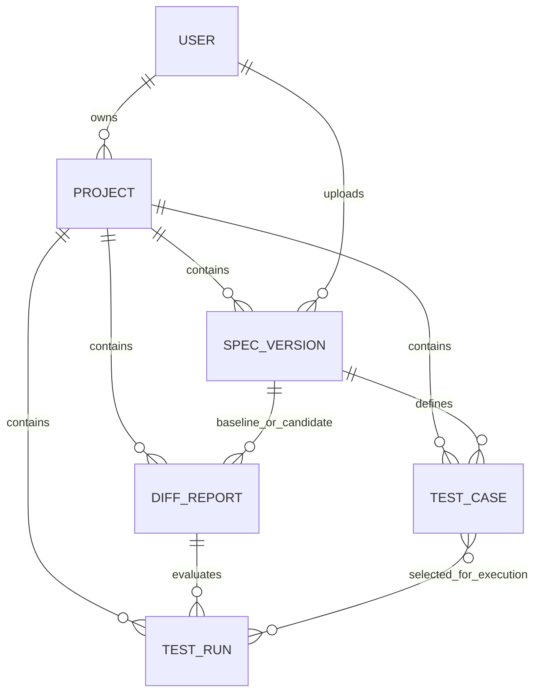

# Data Model and Schema Specification

**Product:** ContractGuard
**Version:** 1.1
**Database:** MongoDB
**ODM:** Mongoose

## 1. Overview

ContractGuard uses MongoDB to store user accounts, projects, OpenAPI specification versions, comparison reports, and test cases.

The data model follows these principles:

- Every project belongs to one authenticated user.
- Every child resource must be accessible through its owning project.
- Uploaded specification versions are immutable.
- Comparison reports preserve their original findings and ruleset version.
- Test cases are associated with a specific baseline specification version.
- Historical records must not be silently modified.
- Server-derived values must not be trusted from client requests.
- All resource sizes and nested data structures must be bounded.

### Collections

| Collection | Purpose |
|---|---|
| `users` | User accounts and authentication |
| `projects` | User-owned workspaces |
| `specVersions` | Uploaded OpenAPI specification versions |
| `diffReports` | Directional compatibility comparison reports |
| `testcases` | Test cases associated with baseline API operations |
| `testRuns` | Planned storage for regression execution results |

`testRuns` is a planned collection for the regression-runner phase. It is not part of the current Phase 6 test-case implementation.

## 2. Collection Definitions

### 2.1 Users

Stores account and authentication information.

| Field | Type | Required | Description |
|---|---|---|---|
| `_id` | ObjectId | Yes | Primary identifier |
| `email` | String | Yes | Trimmed and normalized email |
| `passwordHash` | String | Yes | bcrypt password hash |
| `displayName` | String | No | Optional display name |
| `createdAt` | Date | Yes | Creation timestamp |
| `updatedAt` | Date | Yes | Last update timestamp |

**Indexes**

- Unique index on `email`.

**Rules**

- Passwords must be hashed using bcrypt.
- Plaintext passwords must never be stored.
- Password hashes must never be returned through API responses.
- Passwords and hashes must not be written to application logs.
- Authentication uses JWTs stored in HttpOnly cookies.
- JWTs are not stored in the user collection.
- The initial implementation does not require a separate refresh-token or session collection.

### 2.2 Projects

A project represents a personal workspace owned by an authenticated user.

| Field | Type | Required | Description |
|---|---|---|---|
| `_id` | ObjectId | Yes | Primary identifier |
| `ownerId` | ObjectId | Yes | Reference to the owning user |
| `name` | String | Yes | Project name |
| `slug` | String | Yes | URL-safe project identifier |
| `description` | String | No | Project description |
| `createdAt` | Date | Yes | Creation timestamp |
| `updatedAt` | Date | Yes | Last update timestamp |
| `deletedAt` | Date | No | Soft-deletion timestamp |

**Indexes**

- `{ ownerId: 1, updatedAt: -1 }`
- Unique `{ ownerId: 1, slug: 1 }`

**Ownership rules**

- Each project belongs to exactly one user.
- The backend derives `ownerId` from the authenticated user.
- The client cannot override the project owner.
- Every project query must include the authenticated owner's ID.
- Access to child resources must verify ownership through the parent project.

**Deletion rules**

- Project deletion uses soft deletion.
- Deleted projects are excluded from normal project listings.
- Deleted projects cannot accept new specifications, comparisons, or test cases.
- Existing child records retain their project references.
- Permanent deletion and cascading deletion are outside the initial implementation scope.

### 2.3 Specification Versions

The `specVersions` collection stores uploaded OpenAPI documents as identifiable versions.

| Field | Type | Required | Description |
|---|---|---|---|
| `_id` | ObjectId | Yes | Primary identifier |
| `projectId` | ObjectId | Yes | Reference to the owning project |
| `uploadedBy` | ObjectId | Yes | User who uploaded the document |
| `label` | String | Yes | User-facing version label |
| `openapiVersion` | String | No | Declared OpenAPI version |
| `title` | String | No | Specification title |
| `sourceFormat` | String | Yes | `json` or `yaml` |
| `sourceText` | String | Yes | Original uploaded document text |
| `document` | Mixed/Object | No | Parsed or normalized representation |
| `contentHash` | String | Yes | SHA-256 hash of original uploaded bytes |
| `operationCount` | Number | Yes | Successfully extracted operation count |
| `parseStatus` | String | Yes | Document parsing status |
| `supportStatus` | String | Yes | Supported-feature status |
| `warnings` | Array | Yes | Parser and support diagnostics |
| `runnerProfile` | String | Yes | Server-derived execution profile |
| `createdAt` | Date | Yes | Creation timestamp |

**Status values**

`parseStatus`:

- `VALID`
- `INVALID`
- `UNSUPPORTED_VERSION`

`supportStatus`:

- `COMPLETE`
- `PARTIAL`

`runnerProfile`:

- `NONE`
- `DEMO_STORE_V1`
- `DEMO_STORE_V2`

**Indexes**

- `{ projectId: 1, createdAt: -1 }`
- Unique `{ projectId: 1, contentHash: 1 }`
- Unique `{ projectId: 1, label: 1 }`

**Immutability rules**

- Once created, a specification version must not be overwritten.
- Corrections require a new upload and a new version record.
- The original document text must remain separate from normalized data.
- The content hash must be calculated from the original uploaded bytes.
- Duplicate original content within a project must be detected.
- Invalid versions cannot be used for comparisons or execution.
- A structurally valid specification may still have partial support.

**Trusted fixture recognition**

The server assigns runner profiles through a trusted fixture registry.

The registry maps:

- Original specification SHA-256 hash.
- Fixture identifier.
- Candidate implementation version.
- Allowed operation keys.

A specification's title, version label, declared server URL, or user-supplied runner profile must never establish execution eligibility.

The application must never fetch arbitrary OpenAPI server URLs or external `$ref` resources.

**Initial resource limits**

| Resource | Limit |
|---|---:|
| Uploaded specification | 1 MiB |
| Path entries | 250 |
| Operations | 500 |
| Document nesting depth | 100 |
| Parsed nodes | 50,000 |
| Internal reference depth | 20 |
| Normalized representation | 8 MiB |

MongoDB documents must remain below the 16 MiB BSON document limit.

### 2.4 Comparison Reports

The `diffReports` collection stores directional compatibility analysis between two specification versions.

| Field | Type | Required | Description |
|---|---|---|---|
| `_id` | ObjectId | Yes | Primary identifier |
| `projectId` | ObjectId | Yes | Reference to the owning project |
| `baselineVersionId` | ObjectId | Yes | Existing consumer contract |
| `candidateVersionId` | ObjectId | Yes | Updated provider contract |
| `direction` | String | Yes | Compatibility direction |
| `rulesetVersion` | String | Yes | Version of the applied ruleset |
| `analysisStatus` | String | Yes | Analysis completion status |
| `summary` | Object | Yes | Finding counts |
| `changes` | Array | Yes | Individual compatibility findings |
| `warnings` | Array | Yes | Unsupported-feature and analysis warnings |
| `createdAt` | Date | Yes | Creation timestamp |

**Canonical reference fields**

The canonical fields are:

- `baselineVersionId`
- `candidateVersionId`

Older Phase 4 records may contain:

- `baselineSpecVersionId`
- `candidateSpecVersionId`

Readers should prefer canonical fields and use legacy aliases only when reading older records. New records should use canonical fields.

**Comparison direction**

`BASELINE_CONSUMER_TO_CANDIDATE_PROVIDER`

- Baseline represents the existing consumer contract.
- Candidate represents the updated provider contract.
- The comparison evaluates whether the candidate preserves the expectations of consumers built against the baseline.

**Analysis statuses**

- `COMPLETE`
- `PARTIAL`
- `FAILED`

**Finding classifications**

- `BREAKING`
- `POTENTIALLY_BREAKING`
- `NON_BREAKING`
- `INFORMATIONAL`
- `UNSUPPORTED`

**Summary structure**

| Field | Type | Description |
|---|---|---|
| `breaking` | Number | Breaking findings |
| `potentiallyBreaking` | Number | Potentially breaking findings |
| `nonBreaking` | Number | Non-breaking findings |
| `informational` | Number | Informational findings |
| `unsupported` | Number | Unsupported findings |

Counts must be generated by the backend.

**Change record structure**

Each finding contains the following conceptual fields:

| Field | Type | Description |
|---|---|---|
| `changeId` | String | Deterministic finding identifier |
| `ruleId` | String | Applied compatibility rule |
| `classification` | String | Finding classification |
| `method` | String | HTTP method when applicable |
| `path` | String | Original API path |
| `operationKey` | String | Canonical operation identifier |
| `affectedOperationKeys` | Array | All identified affected operations |
| `jsonPointer` | String | Source-document location |
| `summary` | String | Finding summary |
| `rationale` | String | Explanation of the finding |
| `oldValue` | Mixed | Bounded baseline value |
| `newValue` | Mixed | Bounded candidate value |

**Comparison constraints**

- Baseline and candidate versions must be different.
- Both versions must belong to the same project.
- The project must belong to the authenticated user.
- Both specification versions must be valid.
- The backend controls the comparison direction and ruleset version.
- Completed reports are read-only.

**Indexes**

- `{ projectId: 1, createdAt: -1 }`
- `{ baselineVersionId: 1, candidateVersionId: 1, rulesetVersion: 1 }`

### 2.5 Test Cases

The `testcases` collection stores test cases associated with operations in a baseline specification. This is the physical MongoDB collection name configured in the Mongoose `TestCase` model.

| Field | Type | Required | Description |
|---|---|---|---|
| `_id` | ObjectId | Yes | Primary identifier |
| `projectId` | ObjectId | Yes | Reference to the owning project |
| `specVersionId` | ObjectId | Yes | Baseline specification version |
| `operationKey` | String | Yes | Canonical method/path identifier |
| `operationPath` | String | Yes | Original baseline operation path |
| `title` | String | Yes | Test-case title |
| `description` | String | No | Test purpose |
| `source` | String | Yes | Test-case origin |
| `status` | String | Yes | Lifecycle status |
| `request` | Object | Yes | Supported request inputs |
| `assertions` | Object | Yes | Explicit response assertions |
| `generationMetadata` | Object | No | Optional AI-generation metadata |
| `approvedAt` | Date | Yes (nullable) | Approval timestamp; `null` until approved |
| `createdAt` | Date | Yes | Creation timestamp |
| `updatedAt` | Date | Yes | Last update timestamp |

**Allowed source values**

- `MANUAL`
- `AI`

**Allowed status values**

- `DRAFT`
- `APPROVED`
- `ARCHIVED`

**Request structure**

```json
{
  "pathParams": {
    "productId": "1001"
  },
  "queryParams": {
    "limit": "10"
  }
}
```

Only supported path and query parameter values are accepted.

Test-case requests must not contain:

- Target URLs or hostnames.
- Arbitrary network destinations.
- User-controlled execution ports.
- Arbitrary request headers.
- Authentication credentials or cookies.
- Executable code or shell commands.

The planned regression runner supports GET operations only.

**Assertions**

Supported assertion categories include:

- Expected HTTP status code.
- Response-property value assertions.
- Response-property presence assertions.
- Required-property assertions.

Assertions supplement the baseline response contract. They must not replace or override the baseline response schema.

**AI metadata**

Optional generation metadata may include:

- Provider identifier.
- Model identifier.
- Generation timestamp.
- Prompt or context version identifier.

Provider API keys, passwords, raw sensitive prompts, and confidential production data must not be stored.

AI-generated test cases must begin as drafts and require human approval.

**Indexes**

- `{ projectId: 1, specVersionId: 1, status: 1, createdAt: -1 }`
- `{ projectId: 1, specVersionId: 1, operationKey: 1 }`

**Lifecycle rules**

- Draft test cases may be edited.
- Approval is a server-controlled state transition.
- Approved test cases must not be silently modified.
- Corrections to approved cases require a new draft.
- Archived cases are excluded from active coverage and new regression runs.
- Every test case belongs to one baseline specification version.
- Test cases must be linked to operations using canonical operation keys.

**Initial limits**

- Maximum 500 test cases per specification version.
- Maximum 20 combined path and query parameter values per case.
- Maximum 256 characters per parameter value.
- Assertion arrays and serialized assertion data must be bounded.
- Only supported GET operations are eligible for the planned runner.

## 3. Test Coverage Model

Coverage is derived from the relationship between comparison findings, affected baseline operations, and their associated test cases.

The supported coverage states are:

| State | Meaning |
|---|---|
| `COVERED` | Every affected operation has at least one approved linked test case. |
| `DRAFT_ONLY` | Every affected operation has a linked case, but at least one is covered only by drafts. |
| `UNCOVERED` | At least one affected operation has no linked test case. |
| `UNMAPPED` | The finding cannot be reliably mapped to an affected operation. |

**Coverage calculation rules**

1. Read the finding's `affectedOperationKeys`.
2. Identify test cases associated with the comparison's baseline version.
3. Match cases using canonical operation keys.
4. Separate draft, approved, and archived cases.
5. Calculate coverage across every affected operation.
6. Exclude archived test cases.

Coverage is calculated as a current projection when reports are retrieved. It is not a duplicate copy of test-case records embedded in comparison reports.

Coverage represents the availability of test cases. It does not represent successful test execution.

## 4. Planned Test Runs

The `testRuns` collection is reserved for the regression-runner phase. The following describes its intended data model, not an implemented Phase 6 collection.

A test run evaluates approved baseline test cases against a candidate implementation associated with a specific comparison.

| Field | Type | Required | Description |
|---|---|---|---|
| `_id` | ObjectId | Yes | Primary identifier |
| `projectId` | ObjectId | Yes | Owning project |
| `comparisonId` | ObjectId | Yes | Associated comparison |
| `baselineVersionId` | ObjectId | Yes | Baseline version snapshot |
| `candidateVersionId` | ObjectId | Yes | Candidate version snapshot |
| `rulesetVersion` | String | Yes | Comparison ruleset |
| `testCaseIds` | Array | Yes | Selected approved cases |
| `executionTarget` | Object | Yes | Server-controlled execution target |
| `status` | String | Yes | Run lifecycle status |
| `summary` | Object | Yes | Aggregated execution counts |
| `results` | Array | Yes | Individual result snapshots |
| `startedAt` | Date | No | Execution start |
| `completedAt` | Date | No | Execution completion |
| `createdAt` | Date | Yes | Creation timestamp |

**Execution constraints**

- Every run must reference a comparison.
- Every selected test case must belong to that comparison's baseline version.
- Only approved test cases may execute.
- The candidate must have a recognized server-controlled fixture profile.
- Only supported GET operations execute.
- The client cannot provide arbitrary URLs or network destinations.
- Candidate responses are validated against baseline response schemas.

**Planned execution target**

```json
{
  "type": "BUNDLED_DEMO_STORE",
  "fixtureId": "DEMO_STORE_V2",
  "implementationVersion": "DEMO_STORE_V2"
}
```

Allowed fixture identifiers:

- `DEMO_STORE_V1`
- `DEMO_STORE_V2`

The runner uses a server-controlled in-process adapter rather than a general-purpose external HTTP proxy.

**Individual result statuses**

- `PASSED`
- `FAILED`
- `SKIPPED`
- `UNSUPPORTED`
- `ERROR`

**Run-level statuses**

- `QUEUED`
- `RUNNING`
- `PASSED`
- `FAILED`
- `PARTIAL`
- `INTERRUPTED`

Individual results must retain bounded snapshots of their test inputs, assertions, status, duration, validation diagnostics, and sanitized evidence.

Planned initial execution limits:

| Resource | Limit |
|---|---:|
| Tests per run | 20 |
| Concurrent runs | 2 |
| Concurrent tests per run | 2 |
| Per-test timeout | 5 seconds |
| Total run deadline | 60 seconds |
| Maximum response body | 256 KiB |
| Stored evidence per result | 16 KiB |
| Validation diagnostics per result | 50 |

Unfinished runs must be marked `INTERRUPTED` after process recovery. Incomplete runs must never be presented as successful.

## 5. Collection Relationships



**Relationship rules**

- A user can own multiple projects.
- A project can contain multiple specification versions.
- A project can contain multiple comparison reports.
- A comparison references one baseline and one candidate version.
- A project can contain multiple test cases.
- A test case references one baseline specification version.
- A test run references exactly one comparison.
- A test run uses test cases belonging to that comparison's baseline version.

## 6. Ownership and Reference Integrity

All resource access must be validated by the backend.

- Derive the authenticated user ID from the verified JWT.
- Scope project queries using the authenticated owner's ID.
- Verify child-resource ownership through the parent project.
- Verify that comparison versions belong to the same project.
- Verify that test cases belong to the comparison's baseline version.
- Verify that test-run selections contain only approved cases.
- Do not trust client-supplied ownership, ruleset, or execution-target fields.
- Return safe errors for inaccessible or nonexistent resources.

Mongoose references alone do not guarantee that related records belong to the correct project or user. Services must explicitly validate these relationships.

## 7. Data Integrity and Lifecycle

The following records are immutable after creation:

- Original uploaded specification content and its content hash.
- Completed comparison findings.
- Completed test-run results and execution snapshots.

The following records allow controlled updates:

- Active project metadata.
- Draft test cases.

Approved test cases cannot be silently overwritten. Corrections require a new draft.

Historical records must preserve their original relationships and must not be rewritten when newer specifications or test cases are created.

Project deletion must not silently break references to historical records.

## 8. Validation and Storage Requirements

- Use ObjectIds for database identifiers and relationships.
- Use canonical operation keys for operation matching.
- Store dates as UTC BSON dates.
- Apply Mongoose validation to persisted documents.
- Validate incoming API data independently using request validators.
- Define appropriate unique and compound indexes.
- Bound arrays, nested objects, string lengths, and serialized data.
- Exclude sensitive authentication fields from normal queries and responses.
- Never pass arbitrary client objects directly into database update operations.
- Keep MongoDB documents safely below the 16 MiB BSON limit.
- Handle production index creation deliberately.
- Validate cross-collection relationships in application services.

## 9. Schema Acceptance Criteria

The data model is accepted when:

1. User, project, specification-version, comparison-report, and test-case models enforce their documented fields and constraints.
2. Password hashes are stored securely and excluded from API responses.
3. Required indexes are defined.
4. Ownership checks protect all project and child-resource operations.
5. Specification versions preserve original content and content hashes.
6. Comparison reports preserve baseline, candidate, direction, and ruleset information.
7. Findings retain affected operation keys.
8. Test cases are associated with the correct baseline specification version.
9. Test-case lifecycle transitions are validated by the backend.
10. Coverage is calculated using affected operations and linked test cases.
11. Archived test cases do not count toward active coverage.
12. Resource limits are enforced before persistence and processing.
13. Historical comparison records remain unchanged when test cases are updated.
14. Planned test-run records preserve their comparison and execution context when implemented.
