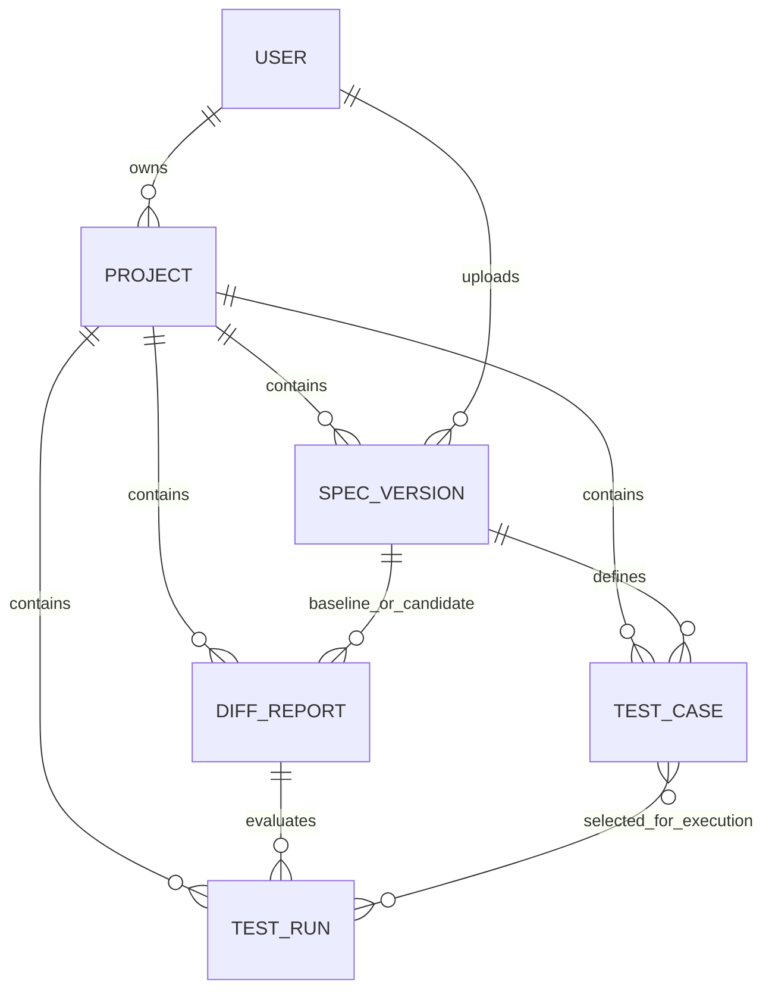

# Data Model and Schema Specification

**Product:** ContractGuard\
**Document version:** 1.2\
**Database:** MongoDB\
**ODM:** Mongoose\
**Compatibility ruleset:** `CG-COMPAT-1.1`\
**Last updated:** 14 November 2026

---

## 1. Overview

ContractGuard uses MongoDB to store user accounts, projects, uploaded OpenAPI specification versions, compatibility reports, test cases, and regression test-run records.

The data model follows these principles:

- Every project belongs to one authenticated user.
- Every child resource must be accessible through its owning project.
- Uploaded specification versions are immutable.
- Comparison reports preserve their original findings and ruleset version.
- Test cases are associated with a specific baseline specification version.
- Test runs are associated with an exact comparison.
- Historical execution records preserve the test inputs and assertions used at execution time.
- Server-derived values must never be trusted from client requests.
- Resource sizes and nested data structures must be bounded.
- Completed historical records must not be silently modified.
- AI-generated content remains distinguishable from manually created content.

## 2. Collections

V1 uses six primary collections.

| Logical collection | MongoDB collection | Purpose |
|---|---|---|
| `users` | `users` | User accounts and authentication |
| `projects` | `projects` | User-owned workspaces |
| `specVersions` | `specversions` | Uploaded OpenAPI specification versions |
| `diffReports` | `diffreports` | Directional compatibility comparison reports |
| `testCases` | `testcases` | Baseline-version test definitions |
| `testRuns` | `testruns` | Comparison-linked regression execution evidence |

Mongoose collection names are lowercase and pluralized or explicitly configured by the corresponding model.

## 3. Collection Definitions

### 3.1 Users

The `users` collection stores account and authentication information.

| Field | Type | Required | Description |
|---|---|---:|---|
| `_id` | ObjectId | Yes | Primary identifier |
| `email` | String | Yes | Trimmed and normalized email address |
| `passwordHash` | String | Yes | bcrypt password hash |
| `displayName` | String | No | Optional display name |
| `createdAt` | Date | Yes | Creation timestamp |
| `updatedAt` | Date | Yes | Last update timestamp |

**Indexes**

- Unique `{ email: 1 }`.

**Password and authentication rules**

- Passwords must be hashed using bcrypt.
- Plaintext passwords must never be stored.
- Password hashes must never be returned through API responses.
- Passwords and password hashes must not be written to application logs.
- Password verification must use the password utility's verification function.
- Authentication uses JWTs stored in HttpOnly cookies.
- JWTs are not stored in the user collection.
- A separate refresh-token or session collection is not part of the current data model.

### 3.2 Projects

A project represents a personal workspace owned by an authenticated user.

| Field | Type | Required | Description |
|---|---|---:|---|
| `_id` | ObjectId | Yes | Primary identifier |
| `ownerId` | ObjectId | Yes | Reference to the owning user |
| `name` | String | Yes | Project name |
| `slug` | String | Yes | Owner-scoped URL-safe project identifier |
| `description` | String | No | Project description |
| `createdAt` | Date | Yes | Creation timestamp |
| `updatedAt` | Date | Yes | Last update timestamp |

**Indexes**

- `{ ownerId: 1, updatedAt: -1 }`
- Unique `{ ownerId: 1, slug: 1 }`

**Ownership rules**

- Each project belongs to exactly one user.
- The backend derives `ownerId` from the authenticated user.
- The client cannot supply or override the project owner.
- Every project query must include the authenticated owner's ID.
- Access to child resources must verify ownership through the parent project.
- An inaccessible project must not expose its existence or child records to another user.

**Deletion rules**

Project deletion uses the implemented transactional workflow for deleting the project and its dependent records.

The deletion operation must:

- Verify project ownership.
- Complete the required dependent-record deletion workflow.
- Avoid leaving orphaned child records.
- Avoid reporting success before the database operation completes.
- Preserve data consistency if the transaction fails.

### 3.3 Specification Versions

The `specversions` collection stores uploaded OpenAPI documents as immutable specification versions.

A specification version preserves the exact original upload and its derived parsed representation.

| Field | Type | Required | Description |
|---|---|---:|---|
| `_id` | ObjectId | Yes | Primary identifier |
| `projectId` | ObjectId | Yes | Reference to the owning project |
| `uploadedBy` | ObjectId | Yes | User who uploaded the document |
| `label` | String | Yes | User-facing version label |
| `openapiVersion` | String | Yes | Declared OpenAPI version |
| `title` | String | Yes | Specification title |
| `sourceFormat` | String | Yes | `json` or `yaml` |
| `sourceText` | String | Yes | Original uploaded document text |
| `document` | Mixed/Object | Yes | Parsed OpenAPI document |
| `contentHash` | String | Yes | SHA-256 hash of the original uploaded text |
| `operationCount` | Number | Yes | Successfully extracted operation count |
| `parseStatus` | String | Yes | Parsing and version-validation status |
| `warnings` | Array | Yes | Bounded parser diagnostics |
| `createdAt` | Date | Yes | Upload timestamp |

**Supported OpenAPI versions**

- OpenAPI 3.0.x
- OpenAPI 3.1.x
- OpenAPI 3.2.x

Swagger 2.0 is not supported.

**Parsing status values**

- `VALID`
- `INVALID`
- `UNSUPPORTED_VERSION`

Invalid or unsupported documents are rejected during the ingestion workflow rather than treated as valid specification versions.

Parser warnings are stored as bounded diagnostic records.

A warning contains:

| Field | Type | Description |
|---|---|---|
| `field` | String | Source field or location |
| `message` | String | Human-readable diagnostic |

**Indexes**

- `{ projectId: 1, createdAt: -1 }`
- Unique `{ projectId: 1, contentHash: 1 }`
- Unique `{ projectId: 1, label: 1 }`

**Content-hash rules**

- The hash is calculated on the server.
- SHA-256 is calculated from the exact original uploaded text.
- The hash is not calculated from a re-serialized or normalized document.
- Identical original content cannot be uploaded twice to the same project.
- The client cannot supply or override the hash.

**Fixture eligibility**

Regression execution eligibility is determined through the trusted server-side fixture registry.

The registry associates known specification content with:

- Fixture identity.
- Trusted content hash.
- Supported candidate implementation.
- Allowed operation keys.

A specification title, version label, declared server URL, or client-supplied metadata is not sufficient to establish execution eligibility.

The uploaded OpenAPI `servers` entries are never used as execution targets.

**Immutability rules**

- Specification versions are immutable after creation.
- Original uploaded text must not be overwritten.
- Parsed document data must not replace original source content.
- Corrections require a new specification-version upload.
- Historical reports must continue referencing their original versions.

**Parser and upload limits**

| Resource | Limit |
|---|---:|
| Original uploaded specification | 1 MiB |
| Maximum path entries | 250 |
| Maximum operations | 500 |
| Maximum document nesting depth | 80 |
| Maximum internal reference depth | 20 |
| Maximum internal references | 5,000 |

YAML alias expansion is disabled. External `$ref` resolution is not performed.

The parser and normalized representation must remain bounded and safely below MongoDB's 16 MiB BSON document limit.

### 3.4 Compatibility Reports

The `diffreports` collection stores directional compatibility-analysis results.

A comparison report represents a specific baseline specification, candidate specification, comparison direction, and compatibility ruleset.

| Field | Type | Required | Description |
|---|---|---:|---|
| `_id` | ObjectId | Yes | Primary identifier |
| `projectId` | ObjectId | Yes | Owning project |
| `createdBy` | ObjectId | Yes | User who created the report |
| `baselineVersionId` | ObjectId | Yes | Existing consumer contract |
| `candidateVersionId` | ObjectId | Yes | New provider contract |
| `baselineSpecVersionId` | ObjectId | No | Legacy Phase 4 reference |
| `candidateSpecVersionId` | ObjectId | No | Legacy Phase 4 reference |
| `baselineContentHash` | String | Yes | Baseline content hash |
| `candidateContentHash` | String | Yes | Candidate content hash |
| `baselineLabel` | String | Yes | Baseline version label snapshot |
| `candidateLabel` | String | Yes | Candidate version label snapshot |
| `analyzerVersion` | String | Yes | Compatibility analyzer version |
| `direction` | String | Yes | Fixed comparison direction |
| `rulesetVersion` | String | Yes | Compatibility ruleset identifier |
| `analysisFingerprint` | String | Yes | Deterministic comparison fingerprint |
| `analysisStatus` | String | Yes | Overall analysis status |
| `summary` | Object | Yes | Classification and operation counts |
| `changes` | Array | Yes | Bounded compatibility findings |
| `warnings` | Array | Yes | Analysis warnings |
| `createdAt` | Date | Yes | Report creation timestamp |

The canonical reference fields are:

- `baselineVersionId`
- `candidateVersionId`

The older `baselineSpecVersionId` and `candidateSpecVersionId` fields are retained for historical compatibility.

New report data uses the canonical references. Readers handling historical records must account for legacy references where necessary.

**Comparison direction**

`BASELINE_CONSUMER_TO_CANDIDATE_PROVIDER`

- Baseline: Existing consumer contract.
- Candidate: New provider contract.

The backend determines the comparison direction. The client cannot override it.

**Ruleset**

`CG-COMPAT-1.1`

The ruleset identifier is stored with the report. Historical reports must retain their original ruleset.

**Analysis status values**

- `COMPLETE`
- `PARTIAL`
- `FAILED`

**Finding classifications**

- `BREAKING`
- `POTENTIALLY_BREAKING`
- `NON_BREAKING`
- `INFORMATIONAL`
- `UNSUPPORTED`

**Summary structure**

The summary contains the following fields:

| Field | Type | Description |
|---|---|---|
| `totalChanges` | Number | Total number of findings |
| `breakingChanges` | Number | Legacy breaking-finding count |
| `nonBreakingChanges` | Number | Legacy non-breaking-finding count |
| `informationalChanges` | Number | Legacy informational-finding count |
| `breaking` | Number | Breaking findings |
| `potentiallyBreaking` | Number | Potentially breaking findings |
| `nonBreaking` | Number | Non-breaking findings |
| `informational` | Number | Informational findings |
| `unsupported` | Number | Unsupported findings |
| `addedOperations` | Number | Added operations |
| `removedOperations` | Number | Removed operations |
| `unchangedOperations` | Number | Unchanged operations |

Summary values are derived by the backend.

**Change record**

Each change is a bounded immutable subdocument.

| Field | Type | Description |
|---|---|---|
| `category` | String | Change category |
| `changeType` | String | Change identifier |
| `changeId` | String | Stable SHA-256-derived change identifier |
| `ruleId` | String | Applied compatibility rule |
| `classification` | String | Compatibility classification |
| `severity` | String | Legacy severity representation |
| `breaking` | Boolean | Legacy breaking indicator |
| `method` | String | HTTP method, when applicable |
| `path` | String | Original API path, when applicable |
| `operationKey` | String | Primary canonical operation key |
| `affectedOperationKeys` | Array<String> | All supported affected operation keys |
| `jsonPointer` | String | Relevant source JSON Pointer |
| `summary` | String | Human-readable change summary |
| `rationale` | String | Explanation of the finding |
| `field` | String | Changed field |
| `message` | String | Human-readable change description |
| `oldValue` | Mixed | Bounded baseline value |
| `newValue` | Mixed | Bounded candidate value |
| `baselinePointer` | String | Baseline source location |
| `candidatePointer` | String | Candidate source location |

Supported change categories include:

- `operation`
- `parameter`
- `requestBody`
- `response`
- `schema`
- `security`
- `server`
- `metadata`

`affectedOperationKeys` is essential for shared-schema impact analysis.

For example, when a shared schema component is used by several operations, a supported change to that component must identify all affected operations.

If the affected operations cannot be determined reliably, the finding must preserve the relevant uncertainty and analysis warning.

**Indexes**

- `{ projectId: 1, createdAt: -1 }`
- Unique `{ projectId: 1, analysisFingerprint: 1 }`
- `{ baselineVersionId: 1, candidateVersionId: 1, rulesetVersion: 1 }`
- `{ baselineSpecVersionId: 1, candidateSpecVersionId: 1 }` for legacy queries

**Report constraints**

- A report may contain at most 2,000 findings.
- A report may contain at most 100 analysis warnings.
- Individual finding fields are length-limited.
- Old and new values must be bounded.
- The report must remain within MongoDB's document-size limit.

**Immutability rules**

- Reports are immutable after creation.
- Normal update and replacement operations are rejected.
- Findings cannot be silently rewritten.
- The original comparison direction and ruleset cannot be changed.
- Newer test cases may change the coverage projection returned by the application, but they must not modify the original persisted findings.

### 3.5 Test Cases

The `testcases` collection stores manual and AI-generated test cases associated with baseline API operations.

A test case describes a request that an existing consumer may send under the baseline contract.

| Field | Type | Required | Description |
|---|---|---:|---|
| `_id` | ObjectId | Yes | Primary identifier |
| `projectId` | ObjectId | Yes | Owning project |
| `specVersionId` | ObjectId | Yes | Baseline specification version |
| `operationKey` | String | Yes | Canonical operation identifier |
| `operationPath` | String | Yes | Original baseline operation path |
| `title` | String | Yes | Human-readable test title |
| `description` | String | No | Test purpose |
| `source` | String | Yes | `MANUAL` or `AI` |
| `status` | String | Yes | `DRAFT`, `APPROVED`, or `ARCHIVED` |
| `request` | Object | Yes | Supported path and query inputs |
| `assertions` | Object | Yes | Explicit response assertions |
| `generationMetadata` | Object | No | AI generation and consent metadata |
| `approvedAt` | Date | No | Approval timestamp |
| `createdAt` | Date | Yes | Creation timestamp |
| `updatedAt` | Date | Yes | Last update timestamp |

**Ownership and baseline rules**

- A test case belongs to exactly one project.
- A test case belongs to exactly one specification version.
- The specification version defines the baseline consumer contract.
- When selected for a comparison run, the test case's version must match the comparison's baseline version.
- The backend validates project, specification, and ownership relationships.
- The client cannot change the project or baseline version associated with an existing test case.

**Operation identity**

`operationKey` identifies the canonical baseline operation.

The stored `operationPath` preserves the original API path.

The operation key and path are immutable after creation.

**Request structure**

The request contains supported path and query parameters.

Conceptual structure:

```json
{
  "pathParams": {
    "productId": "1001"
  },
  "queryParams": {
    "limit": "10"
  }
}
```

The request must not contain:

- A target URL.
- An arbitrary hostname or IP address.
- An execution port.
- Arbitrary network destinations.
- Arbitrary request headers.
- Authentication credentials.
- User-supplied cookies.
- Executable code or shell commands.

The server constructs the actual request using the baseline operation definition and validated parameter values.

Only supported GET operations are eligible for execution.

**Assertions structure**

Assertions supplement the baseline OpenAPI response contract.

Supported assertion categories include:

- Expected HTTP status code.
- Explicit response-property value assertions.
- Explicit response-property presence assertions.
- Required-property assertions.

An individual property assertion has the following conceptual structure:

```json
{
  "type": "VALUE",
  "path": "data.product.name",
  "value": "Example Product"
}
```

A presence assertion uses the `PRESENCE` type and a boolean `present` value.

The baseline response schema remains authoritative for response validation.

Assertions must be bounded and validated before persistence.

**AI generation metadata**

AI-generated records may store:

| Field | Type | Description |
|---|---|---|
| `provider` | String | Provider name |
| `model` | String | Model identifier |
| `generatedAt` | Date | Generation timestamp |
| `contextVersion` | String | Sanitized context version |
| `consentVersion` | String | Consent version identifier |
| `consentedAt` | Date | Consent timestamp |

The provider and model fields describe generation provenance.

Consent metadata records the consent associated with the provider submission.

Do not store:

- Provider API keys.
- Passwords.
- Authentication credentials.
- Raw confidential prompts.
- Full private production specifications.
- Confidential production request or response data.

AI-generated test cases must begin as `DRAFT`.

**Lifecycle states**

- `DRAFT`
- `APPROVED`
- `ARCHIVED`

Rules:

- Draft test cases may be edited.
- Only drafts may be edited through the normal update workflow.
- Approval is a deliberate server-controlled state transition.
- Approved test cases must not be silently modified.
- Corrections to approved cases require a new draft.
- Archived cases are excluded from new test runs.
- Historical test-run snapshots must remain unchanged when the test-case library is updated.

**Bounds**

- Maximum 500 test cases per specification version.
- Maximum 20 path and query input values per case at the service/API boundary.
- Parameter values are strings with a maximum length of 256 characters.
- The Mongoose request structure provides an additional maximum of 40 combined path and query entries.
- Maximum 40 property assertions.
- Maximum 40 required-property assertions.
- Assertion paths are bounded.
- Request and assertion objects use strict schema validation.

**Indexes**

- `{ projectId: 1, specVersionId: 1, status: 1, createdAt: -1 }`
- `{ projectId: 1, specVersionId: 1, operationKey: 1 }`

### 3.6 Test Runs

The `testruns` collection stores regression execution records.

A test run executes approved baseline test cases against the candidate implementation associated with a specific comparison.

**Every test run must reference a comparison report.**

A test run must not be created directly from a specification version without an associated comparison.

| Field | Type | Required | Description |
|---|---|---:|---|
| `_id` | ObjectId | Yes | Primary identifier |
| `projectId` | ObjectId | Yes | Owning project |
| `comparisonId` | ObjectId | Yes | Associated comparison report |
| `baselineVersionId` | ObjectId | Yes | Baseline version copied from comparison |
| `candidateVersionId` | ObjectId | Yes | Candidate version copied from comparison |
| `rulesetVersion` | String | Yes | Ruleset used by the comparison |
| `testCaseIds` | Array<ObjectId> | Yes | Selected approved test cases |
| `executionTarget` | Object | Yes | Server-controlled bundled execution target |
| `status` | String | Yes | Run lifecycle status |
| `summary` | Object | Yes | Aggregated execution counts |
| `results` | Array | Yes | Bounded individual result snapshots |
| `startedAt` | Date | No | Execution start timestamp |
| `completedAt` | Date | No | Execution completion timestamp |
| `createdAt` | Date | Yes | Run creation timestamp |

**Comparison and ownership constraints**

At run creation:

- The comparison must belong to the requested project.
- The project must be owned by the authenticated user.
- Baseline and candidate versions must belong to that project.
- The versions must match the stored comparison.
- Every selected test case must belong to the comparison's baseline version.
- Every selected test case must be approved.
- Archived cases must be rejected.
- The candidate must have a recognized bundled execution profile.
- Every selected operation must be supported by the bundled implementation.
- The selected test count must not exceed the configured maximum.

The client cannot independently supply or override the execution target, fixture profile, implementation version, baseline version, or candidate version.

**Execution target**

The server selects the execution target through its trusted fixture registry.

Conceptual structure:

```json
{
  "type": "BUNDLED_DEMO_STORE",
  "fixtureId": "DEMO_STORE_V2",
  "implementationVersion": "DEMO_STORE_V2"
}
```

Allowed fixture identifiers:

- `DEMO_STORE_V1`
- `DEMO_STORE_V2`

This object must not contain a user-provided URL or arbitrary network destination.

The regression runner invokes the known bundled implementation through the server-controlled in-process adapter.

**Individual result structure**

Each result preserves enough information to understand the executed test independently of future test-case edits.

| Field | Type | Description |
|---|---|---|
| `testCaseId` | ObjectId | Original test-case identifier |
| `title` | String | Test title snapshot |
| `operationKey` | String | Canonical operation identifier |
| `operationPath` | String | Original baseline operation path |
| `method` | String | HTTP method |
| `testCaseSnapshot` | Object | Inputs and assertions used for execution |
| `resultStatus` | String | Individual outcome |
| `httpStatus` | Number | Actual HTTP status when available |
| `durationMs` | Number | Execution duration |
| `responseMediaType` | String | Actual response media type when available |
| `validationErrors` | Array | Bounded schema and assertion diagnostics |
| `evidence` | Object | Bounded sanitized response evidence |

**Test-case snapshot**

The run preserves:

- Test title.
- Canonical operation key.
- Original operation path.
- HTTP method.
- Path parameters.
- Query parameters.
- Explicit assertions.

The snapshot must be bounded.

It must not contain arbitrary executable content, credentials, or unrestricted request headers.

**Response validation**

The candidate implementation supplies the response.

The baseline specification supplies the expected response contract.

Therefore:

**Candidate responses must be validated against the baseline response schema.**

The candidate schema must not replace the baseline schema during backward-compatibility regression testing.

If relevant response-schema behavior is unsupported, the result must not be marked as a complete pass.

**Individual result statuses**

- `PASSED`
- `FAILED`
- `SKIPPED`
- `UNSUPPORTED`
- `ERROR`

A validation or assertion failure is distinct from an unsupported operation or execution error.

**Run-level statuses**

- `QUEUED`
- `RUNNING`
- `PASSED`
- `FAILED`
- `PARTIAL`
- `INTERRUPTED`

`CANCELLED` is not part of the current v1 run lifecycle.

Run interpretation:

- `PASSED`: All executed supported tests pass, with no unsupported or execution-error condition affecting the run.
- `FAILED`: At least one executed test fails and no unsupported or execution-error condition makes the run partial.
- `PARTIAL`: One or more selected tests cannot be fully evaluated, including unsupported cases or execution errors.
- `INTERRUPTED`: The process stops before the run can be finalized.

**Summary structure**

| Field | Type | Description |
|---|---|---|
| `total` | Number | Number of selected test cases |
| `passed` | Number | Number of passed tests |
| `failed` | Number | Number of failed tests |
| `skipped` | Number | Number of skipped tests |
| `unsupported` | Number | Number of unsupported tests |
| `errors` | Number | Number of tests with execution errors |

Summary values are generated by the backend.

**Execution limits**

| Resource | Limit |
|---|---:|
| Approved test cases per run | 20 |
| Concurrent runs | 2 |
| Concurrent tests per run | 2 |
| Per-test timeout | 5 seconds |
| Total run deadline | 60 seconds |
| Maximum response body | 256 KiB |
| Maximum stored evidence per result | 16 KiB |
| Maximum validation diagnostics per result | 50 |

Concurrency controls are local to the running Node.js process. V1 does not implement distributed queue coordination.

**Interruption and recovery**

If the application process restarts while a run is queued or running:

1. Identify unfinished run records during startup recovery.
2. Mark affected runs as `INTERRUPTED`.
3. Preserve safely persisted result snapshots.
4. Do not present an incomplete run as successful.
5. Allow the user to inspect available historical evidence.
6. Require a new run for a fresh execution.

The system does not claim exactly-once execution across process crashes.

**Indexes**

- `{ projectId: 1, createdAt: -1 }`
- `{ comparisonId: 1, createdAt: -1 }`
- `{ status: 1, createdAt: 1 }` for startup recovery of unfinished runs

## 4. Relationship Model

The six collections have the following principal relationships:



Additional relationship constraints:

- A `DiffReport` references exactly one baseline and one candidate version.
- Both specification versions must belong to the same project.
- A `TestCase` references exactly one baseline specification version.
- A `TestRun` references exactly one comparison report.
- A `TestRun` copies the baseline and candidate version IDs from its comparison.
- Every selected test case must belong to the comparison's baseline version.
- Every selected test case must be approved.
- A test run cannot be reassigned to another comparison after creation.

## 5. Identifier and Ownership Rules

- Use MongoDB ObjectIds for primary identifiers and database relationships.
- Use canonical operation keys for stable API operation matching.
- Preserve original operation paths for display and parameter binding.
- Derive authenticated user IDs from verified JWTs.
- Every project query must include the authenticated `ownerId`.
- Every child-resource access must verify ownership through the parent project.
- Never trust `ownerId` supplied in a request body.
- Comparison creation must verify that both versions belong to the same owned project.
- Test-run creation must verify that the comparison and selected test cases belong to the same owned project.
- Test-run creation must verify that each selected case belongs to the comparison's baseline version.
- Test-run creation must reject unapproved and archived test cases.
- The server controls ruleset versions and execution targets.
- Return a safe `404` for inaccessible or nonexistent resources where appropriate to avoid disclosing another user's resource existence.

## 6. Immutability and Historical Integrity

The following records are immutable after creation:

- Uploaded specification source text and its original content hash.
- Parsed specification snapshots.
- Completed comparison findings.
- Completed regression test-run results and snapshots.

The following records may be edited under controlled rules:

- Active project metadata.
- Draft test cases.

Approved test cases must not be silently modified through the normal update API.

Corrections require a new draft test case.

Historical execution must preserve:

- Associated comparison ID.
- Baseline and candidate specification-version IDs.
- Comparison direction.
- Ruleset version.
- Selected test-case identifiers.
- Test-case input and assertion snapshots.
- Candidate fixture identifier.
- Candidate implementation version.
- Individual execution results.
- Bounded evidence and validation diagnostics.

Creating a newer specification version or editing a draft test case must not silently rewrite historical records.

A future compatibility-rule change must preserve the ruleset identifier stored with older comparison reports.

## 7. Data Lifecycle and Deletion

- Project deletion follows the implemented transactional dependent-record deletion workflow.
- The deletion operation must not report success before the required database work completes.
- Specification versions referenced by retained historical records must not be removed independently without handling dependent records.
- Completed comparison reports are read-only.
- Completed test-run records are read-only.
- No background TTL deletion is configured in v1.
- No automatic expiration of historical comparison or test-run evidence is configured.

Deletion must not silently break remaining historical references.

## 8. Validation, Resource, and Storage Constraints

The following limits define the current v1 resource baseline.

| Resource | Limit |
|---|---:|
| Original uploaded specification | 1 MiB |
| Maximum path entries | 250 |
| Maximum operations | 500 |
| Maximum document nesting depth | 80 |
| Maximum internal reference depth | 20 |
| Maximum internal references | 5,000 |
| Maximum stored comparison findings | 2,000 |
| Maximum stored analysis warnings per report | 100 |
| Maximum test cases per specification version | 500 |
| Maximum path and query inputs per test case at service/API level | 20 |
| Maximum path and query entries accepted by the Mongoose safeguard | 40 |
| Maximum property assertions per case | 40 |
| Maximum required-property assertions per case | 40 |
| Approved test cases per run | 20 |
| Concurrent test runs | 2 |
| Concurrent tests per run | 2 |
| Per-test timeout | 5 seconds |
| Total run deadline | 60 seconds |
| Maximum response body | 256 KiB |
| Maximum stored evidence per result | 16 KiB |
| Maximum validation diagnostics per result | 50 |

Additional requirements:

- User text fields have explicit maximum lengths.
- MongoDB documents must remain safely below the 16 MiB BSON limit.
- Parser depth and reference resolution are bounded.
- YAML alias expansion is disabled.
- Comparison finding arrays and individual finding values are bounded.
- Test-run result arrays cannot exceed the selected test-case count.
- Response evidence and validation diagnostics are size-limited.
- AI generation metadata must not contain provider keys or confidential prompt content.
- Mongoose validation provides persistence safeguards.
- Zod validates API input independently of Mongoose validation.
- Production index creation must be handled deliberately rather than relying on uncontrolled startup index builds.

## 9. Mongoose Implementation Requirements

Mongoose models must reflect the collection definitions in this document.

Implementation requirements:

- Use ObjectId references where relationships are defined.
- Use timestamps where appropriate.
- Define unique and compound indexes for actual lookup patterns.
- Define allowed enum values for statuses and classification fields.
- Apply maximum lengths and bounded array structures.
- Validate object references and relationships at the service layer.
- Use explicit field selection and projections for sensitive data.
- Exclude `passwordHash` from normal user queries and API responses.
- Do not pass arbitrary client objects directly into model updates.
- Prevent normal API routes from modifying completed historical records.
- Do not depend on Mongoose references alone to establish ownership.

Mongoose does not automatically guarantee that every referenced ObjectId belongs to the correct project or user.

Those relationships must be checked explicitly in application services.

## 10. Schema Acceptance Criteria

The data model is accepted when:

1. All six collection definitions are reflected in the application persistence layer.
2. User passwords are stored using bcrypt hashes.
3. Password hashes are excluded from API responses.
4. Documented indexes are created in development and test environments.
5. Ownership and reference-integrity checks have integration tests.
6. Comparison creation rejects mismatched projects and identical baseline/candidate versions.
7. Comparison records store the explicit comparison direction and ruleset version.
8. Specification versions preserve original source text and content hashes.
9. Specification parsing and diagnostics are retained for valid uploaded versions.
10. Fixture eligibility is determined through the trusted server-side registry.
11. Test cases are associated with one baseline specification version.
12. Test-run creation requires a valid comparison ID.
13. Test-run creation rejects cases that do not belong to the comparison's baseline version.
14. Test-run creation rejects unapproved and archived test cases.
15. Test-run execution targets are server-controlled.
16. Candidate responses are validated against baseline response schemas.
17. Test-run records preserve selected test-case inputs and assertions.
18. Completed comparison and test-run records cannot be silently modified.
19. A supported change to a shared schema component can identify all affected operations.
20. Change-to-test coverage can be derived using affected operation keys and baseline test cases.
21. Archived test cases do not count toward active coverage.
22. Historical test-run results remain unchanged when the test-case library is updated.
23. Unfinished runs are marked `INTERRUPTED` during recovery.
24. Document, comparison, evidence, and execution limits are enforced by the backend.

## 11. Related Documents

- `PRD.md` — Product requirements and functional priorities.
- `Rules.md` — Directional compatibility rules and classifications.
- `API.md` — Backend routes, request contracts, and response contracts.
- `TRD.md` — Technology selection, normalization strategy, validation, and runtime constraints.
- `Architecture.md` — Application modules, responsibilities, and data flow.
- `SecurityReview.md` — Authentication, ownership, upload, execution, and AI security requirements.
- `AppFlow.md` — User workflows and application behavior.
- `ImplementationPlan.md` — Development phases, tasks, and acceptance milestones.