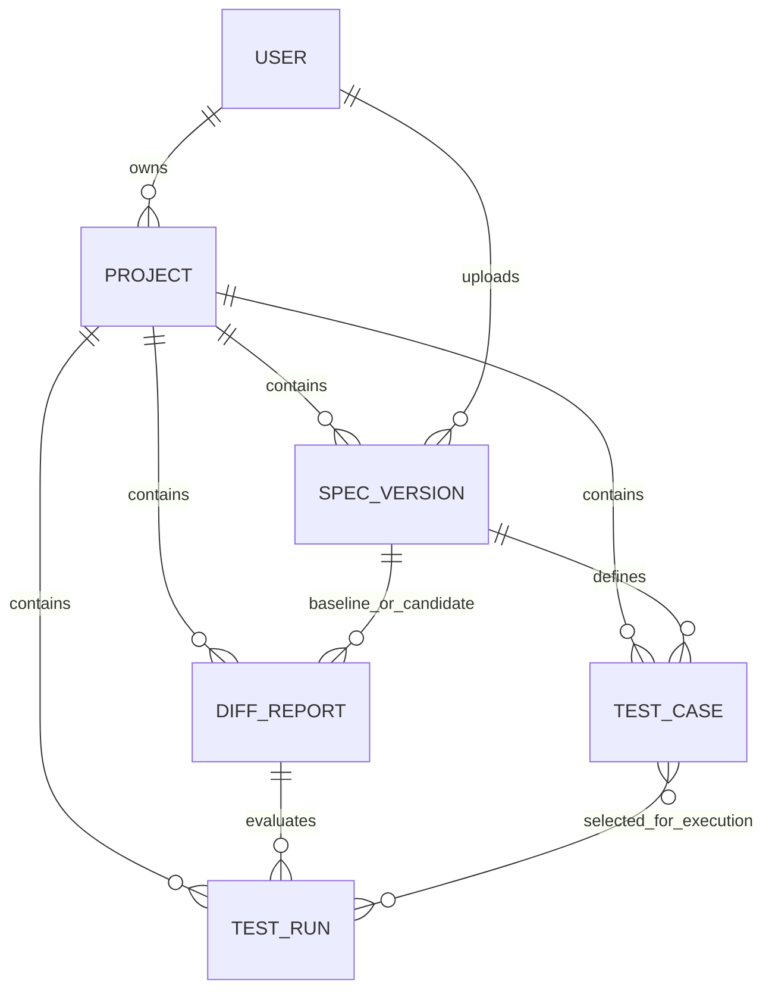

# Data Model and Schema Specification

**Product:** ContractGuard  
**Document version:** 1.1  
**Database:** MongoDB 8.x with Mongoose 9.x  
**Ruleset reference:** `CG-COMPAT-1.1`  
**Status:** Revised implementation baseline

## 1. Data-modeling principles

- Model ownership explicitly. Every project belongs to one user in v1.
- Preserve uploaded specification versions as immutable snapshots.
- Store large analysis details in bounded documents; do not embed unbounded histories.
- Use stable IDs and explicit references for report/version relationships.
- Store dates as BSON dates in UTC.
- Store original upload text separately from derived analysis data.
- Store comparison direction and ruleset version with every report.
- Associate test cases with the baseline specification version they were written against.
- Associate every test run with the exact comparison it evaluates.
- Preserve baseline and candidate version IDs in each test run for historical clarity.
- Preserve the selected test-case inputs and assertions as execution snapshots.
- Use Mongoose validation as a persistence safeguard; request validation remains the responsibility of Zod.
- Never treat a client-supplied resource ID as proof of ownership.
- Never trust client-supplied values for security-sensitive or server-derived fields.

V1 uses six collections:

1. `users`
2. `projects`
3. `specVersions`
4. `diffReports`
5. `testCases`
6. `testRuns`

## 2. Collections

### 2.1 `users`

Stores user account and authentication information.

| Field | Type | Required | Notes |
|---|---|---:|---|
| `_id` | ObjectId | Yes | Primary identifier |
| `email` | String | Yes | Trimmed and lowercased |
| `passwordHash` | String | Yes | Argon2id encoded password hash |
| `displayName` | String | No | Optional profile name |
| `createdAt` | Date | Yes | UTC |
| `updatedAt` | Date | Yes | UTC |

Indexes:

- Unique `{ email: 1 }`.

Password requirements:

- Passwords must be hashed using Argon2id.
- The application must use a maintained Argon2 implementation.
- Use library-generated salts.
- Use the approved Argon2id parameters documented in `SecurityReview.md`.
- Never store plaintext or reversibly encrypted passwords.
- Never return `passwordHash` in API responses.
- Never log passwords or password hashes.
- Password verification must use the library's verification function.

Authentication requirements:

- V1 uses JWT authentication through an HttpOnly cookie.
- JWTs are not stored in this collection.
- V1 does not implement a refresh-token database, token blacklist, or session-management collection.

### 2.2 `projects`

A project is a personal workspace owned by one authenticated user.

| Field | Type | Required | Notes |
|---|---|---:|---|
| `_id` | ObjectId | Yes | Primary identifier |
| `ownerId` | ObjectId | Yes | Reference to `users` |
| `name` | String | Yes | Project display name |
| `slug` | String | Yes | Owner-scoped URL-safe identifier |
| `description` | String | No | Short description |
| `createdAt` | Date | Yes | UTC |
| `updatedAt` | Date | Yes | UTC |
| `deletedAt` | Date | No | Set when project is soft-deleted |

Indexes:

- `{ ownerId: 1, updatedAt: -1 }`.
- Unique `{ ownerId: 1, slug: 1 }`.

Ownership requirements:

- A project belongs to exactly one user in v1.
- Every project query must include the authenticated owner ID.
- The backend derives `ownerId` from the authenticated principal.
- The client cannot supply or override `ownerId`.
- Every child-resource operation must verify ownership through its parent project.

Deletion requirements:

- Project deletion is a soft-delete operation in v1.
- Soft-deleted projects must not appear in normal project lists.
- Soft-deleted projects cannot accept new uploads, comparisons, test cases, or test runs.
- Existing child records remain associated with a soft-deleted project.
- Permanent deletion and cascading deletion are outside the initial v1 scope.

### 2.3 `specVersions`

A specification version is an immutable snapshot of an uploaded OpenAPI document.

| Field | Type | Required | Notes |
|---|---|---:|---|
| `_id` | ObjectId | Yes | Primary identifier |
| `projectId` | ObjectId | Yes | Reference to `projects` |
| `uploadedBy` | ObjectId | Yes | Reference to `users` |
| `label` | String | Yes | User-facing version label |
| `openapiVersion` | String | No | For example, `3.0.3` or `3.2.1` |
| `title` | String | No | From `info.title` when available |
| `sourceFormat` | String | Yes | `json` or `yaml` |
| `sourceText` | String | Yes | Original bounded document text |
| `document` | Mixed/Object | No | Bounded parsed/normalized representation |
| `contentHash` | String | Yes | SHA-256 of original uploaded document bytes |
| `operationCount` | Number | Yes | Successfully extracted operation count |
| `parseStatus` | String | Yes | `VALID`, `INVALID`, or `UNSUPPORTED_VERSION` |
| `supportStatus` | String | Yes | `COMPLETE` or `PARTIAL` |
| `warnings` | Array | Yes | Bounded parser and support diagnostics |
| `runnerProfile` | String | Yes | Server-derived execution profile |
| `createdAt` | Date | Yes | UTC |

#### `runnerProfile` values

- `NONE`
- `DEMO_STORE_V1`
- `DEMO_STORE_V2`

The runner profile is assigned by the server through a trusted fixture registry.

The client cannot select or override it.

#### Fixture recognition

The server maintains a trusted registry mapping:

- Exact SHA-256 hash of bundled specification file bytes.
- Fixture identifier.
- Candidate implementation version.
- Allowed operation keys.

A specification is eligible for bundled execution only when its original uploaded bytes match a trusted registered fixture.

The following are not sufficient to establish fixture eligibility:

- API title.
- API description.
- Version label.
- Declared server URL.
- User-supplied runner profile.
- Similar-looking schema structure.

Changing a bundled fixture requires an explicit registry update and corresponding tests.

#### Indexes

- `{ projectId: 1, createdAt: -1 }`.
- Unique `{ projectId: 1, contentHash: 1 }`.
- Unique `{ projectId: 1, label: 1 }`.

#### Rules

- Specification versions are immutable after creation.
- Corrections require a new version upload.
- Duplicate original content within a project is detected using the SHA-256 hash.
- Invalid bounded uploads may retain their original source text and safe parser diagnostics.
- Invalid versions cannot be compared or executed.
- A structurally valid document may still have `supportStatus: PARTIAL`.
- The original uploaded text is never overwritten by normalized data.
- External `$ref` resolution is disabled.
- The application must never fetch declared OpenAPI server URLs.

#### Resource constraints

- Maximum original upload size: 1 MiB.
- Maximum path entries: 250.
- Maximum operations: 500.
- Maximum document nesting depth: 100.
- Maximum parsed node count: 50,000.
- Maximum internal reference depth: 20.
- Maximum bounded normalized representation: 8 MiB.

The actual MongoDB document, including source text and normalized content, must remain safely below MongoDB's 16 MiB BSON document limit.

Do not store unbounded expanded copies of referenced schemas.

### 2.4 `diffReports`

A comparison report represents a directional compatibility analysis between two specification versions.

| Field | Type | Required | Notes |
|---|---|---:|---|
| `_id` | ObjectId | Yes | Primary identifier |
| `projectId` | ObjectId | Yes | Reference to `projects` |
| `baselineVersionId` | ObjectId | Yes | Existing consumer contract |
| `candidateVersionId` | ObjectId | Yes | New provider contract |
| `direction` | String | Yes | `BASELINE_CONSUMER_TO_CANDIDATE_PROVIDER` |
| `rulesetVersion` | String | Yes | For example, `CG-COMPAT-1.1` |
| `analysisStatus` | String | Yes | `COMPLETE`, `PARTIAL`, or `FAILED` |
| `summary` | Object | Yes | Counts by classification |
| `changes` | Array | Yes | Bounded individual findings |
| `warnings` | Array | Yes | Unsupported/partial-analysis warnings |
| `createdAt` | Date | Yes | UTC |

#### Comparison constraints

A comparison must satisfy:

- Baseline and candidate IDs must be different.
- Both specification versions must belong to the same project.
- The project must belong to the authenticated user.
- Both versions must have passed document validation.
- Baseline and candidate roles must be explicit.
- The comparison direction is fixed by the server.
- The ruleset version is selected by the server.
- The client cannot override the ruleset version or compatibility direction.

#### Comparison direction

`BASELINE_CONSUMER_TO_CANDIDATE_PROVIDER`

- **Baseline:** Existing consumer contract.
- **Candidate:** New provider contract.

The compatibility engine evaluates whether the candidate preserves the expectations of consumers built against the baseline.

#### Classification values

- `BREAKING`
- `POTENTIALLY_BREAKING`
- `NON_BREAKING`
- `INFORMATIONAL`
- `UNSUPPORTED`

#### Analysis-status values

- `COMPLETE`
- `PARTIAL`
- `FAILED`

An unsupported relevant construct must result in an appropriate `UNSUPPORTED` finding and `PARTIAL` analysis status.

A complete report does not prove that a real API implementation is runtime-compatible. It means only that the compared supported constructs were analyzed successfully.

#### Summary structure

The summary contains:

| Field | Type | Description |
|---|---|---|
| `breaking` | Number | Number of breaking findings |
| `potentiallyBreaking` | Number | Number of potentially breaking findings |
| `nonBreaking` | Number | Number of non-breaking findings |
| `informational` | Number | Number of informational findings |
| `unsupported` | Number | Number of unsupported findings |

Counts are generated by the server.

#### Change record

Each item in `changes` contains:

| Field | Type | Notes |
|---|---|---|
| `changeId` | String | Stable deterministic identifier |
| `ruleId` | String | Applied rule, for example `RES-002` |
| `classification` | String | Classification value |
| `method` | String | HTTP method when applicable |
| `path` | String | Original API path when applicable |
| `operationKey` | String | Canonical operation identifier |
| `affectedOperationKeys` | Array<String> | All supported affected operations |
| `jsonPointer` | String | Relevant source-document location |
| `summary` | String | Short human-readable description |
| `rationale` | String | Explanation of classification |
| `oldValue` | Mixed | Bounded baseline value representation |
| `newValue` | Mixed | Bounded candidate value representation |

`affectedOperationKeys` is essential for shared-schema changes.

For example, if a shared `Product` schema is referenced by three operations, a supported change to that component must identify all three affected operations.

If the relationship cannot be completely determined, the report must preserve the unsupported-impact warning and partial-analysis status.

#### Indexes

- `{ projectId: 1, createdAt: -1 }`.
- `{ baselineVersionId: 1, candidateVersionId: 1, rulesetVersion: 1 }`.

#### Change-to-test traceability

Each test case belongs to one baseline specification version and identifies its operation through a canonical `operationKey`.

For every change:

1. Read its `affectedOperationKeys`.
2. Find test cases belonging to the comparison's baseline version.
3. Match the canonical operation keys.
4. Separate approved cases from draft cases.
5. Derive the coverage state.

Coverage is calculated from the current test-case library when the comparison is retrieved.

It is not stored as a duplicate, mutable copy of test-case records inside the comparison document.

Coverage states:

- `COVERED`: At least one approved linked test case exists.
- `DRAFT_ONLY`: Linked test cases exist, but none is approved.
- `UNCOVERED`: No linked test case exists.

Coverage means test-case availability, not successful regression execution.

Actual regression evidence is stored separately in `testRuns`.

A completed comparison report is read-only. Adding test cases later may change the coverage projection returned by the application, but must not change the original comparison findings or ruleset.

### 2.5 `testCases`

A test case describes an existing consumer request based on the baseline API contract.

It is not a test of whether the candidate specification agrees with itself.

| Field | Type | Required | Notes |
|---|---|---:|---|
| `_id` | ObjectId | Yes | Primary identifier |
| `projectId` | ObjectId | Yes | Reference to `projects` |
| `specVersionId` | ObjectId | Yes | Baseline specification version |
| `operationKey` | String | Yes | Canonical method/path identifier |
| `operationPath` | String | Yes | Original path from baseline specification |
| `title` | String | Yes | Human-readable test name |
| `description` | String | No | Test purpose |
| `source` | String | Yes | `MANUAL` or `AI` |
| `status` | String | Yes | `DRAFT`, `APPROVED`, or `ARCHIVED` |
| `request` | Object | Yes | Bounded path and query input values |
| `assertions` | Object | Yes | Supported explicit status and response assertions |
| `generationMetadata` | Object | No | Provider/model/time metadata for AI suggestions |
| `createdAt` | Date | Yes | UTC |
| `updatedAt` | Date | Yes | UTC |
| `approvedAt` | Date | No | UTC |

#### Ownership and baseline requirements

- A test case belongs to exactly one project.
- A test case belongs to exactly one specification version.
- Its specification version defines the baseline consumer contract.
- When selected for a comparison run, its version must match that comparison's baseline version.
- The backend independently validates all project, version, and ownership relationships.

#### Request structure

The request contains only supported test inputs.

Conceptual structure:

```json
{
  "pathParams": {
    "productId": "1001"
  },
  "queryParams": {
    "limit": "10"
  }
}
```

The runner constructs the request using the baseline operation definition and supplied parameter values.

The request must not contain:

- A target URL.
- An arbitrary hostname.
- An IP address.
- An execution port.
- Arbitrary network destinations.
- Arbitrary request headers.
- Authentication credentials.
- User-supplied cookies.
- Executable code or shell commands.

The runner controls request dispatch and execution headers.

Only GET operations are supported in v1.

#### Assertions structure

Assertions are supplementary to the baseline OpenAPI response contract.

Supported assertion categories may include:

- Expected HTTP status code.
- Explicit response-property value assertions.
- Explicit response-property presence assertions.
- Required-property assertions.

The baseline response schema remains authoritative for response validation.

A test case must not replace or override that schema with a candidate response schema.

Assertions must be bounded and validated before saving.

#### AI generation metadata

When present, metadata may contain:

- Provider identifier.
- Model identifier.
- Generation timestamp.
- Prompt/context version identifier.

Do not store:

- Provider API keys.
- Passwords or authentication credentials.
- Raw sensitive prompts.
- Full uploaded private specifications.
- Confidential production information.

AI-generated test cases begin as `DRAFT`.

They cannot be executed until a user reviews and approves them.

#### Indexes

- `{ projectId: 1, specVersionId: 1, status: 1 }`.
- `{ projectId: 1, specVersionId: 1, operationKey: 1 }`.

#### Editing and approval rules

- Draft test cases may be edited.
- Only draft test cases may be edited through the normal update API.
- Approval is a deliberate server-controlled state transition.
- Approved test cases must not be silently modified after approval.
- A correction to an approved test case requires a new draft test case.
- Archived test cases are excluded from new test runs.
- Historical test-run snapshots must not change when the test-case library is updated.

### 2.6 `testRuns`

A test run executes approved baseline test cases against the candidate implementation associated with a specific comparison.

**Every test run must reference a `diffReport`.**

A test run must not be created directly from a specification version without an associated comparison.

| Field | Type | Required | Notes |
|---|---|---:|---|
| `_id` | ObjectId | Yes | Primary identifier |
| `projectId` | ObjectId | Yes | Reference to `projects` |
| `comparisonId` | ObjectId | Yes | Reference to `diffReports` |
| `baselineVersionId` | ObjectId | Yes | Copied from comparison |
| `candidateVersionId` | ObjectId | Yes | Copied from comparison |
| `rulesetVersion` | String | Yes | Ruleset used by comparison |
| `testCaseIds` | Array<ObjectId> | Yes | Approved cases selected at run creation |
| `executionTarget` | Object | Yes | Server-controlled bundled target |
| `status` | String | Yes | Run lifecycle status |
| `summary` | Object | Yes | Total/pass/fail/skip/unsupported/error counts |
| `results` | Array | Yes | Bounded individual result snapshots |
| `startedAt` | Date | No | UTC |
| `completedAt` | Date | No | UTC |
| `createdAt` | Date | Yes | UTC |

#### Comparison constraints

At run creation:

- The comparison must belong to the requested project.
- The project must be owned by the authenticated user.
- Baseline and candidate versions must belong to that project.
- Baseline and candidate versions must match the stored comparison.
- Every selected test case must belong to that comparison's baseline version.
- Every selected test case must be approved.
- The candidate must have a recognized bundled execution profile.
- The selected operations must be supported by the bundled implementation.
- The selected test count must not exceed 20.

The client cannot supply or override the baseline, candidate, execution target, fixture profile, or implementation version independently of the selected comparison.

#### Execution target

The server sets this object from its trusted fixture registry.

Conceptual structure:

```json
{
  "type": "BUNDLED_DEMO_STORE",
  "fixtureId": "DEMO_STORE_V2",
  "implementationVersion": "DEMO_STORE_V2"
}
```

Allowed fixture identifiers:

- `DEMO_STORE_V1`
- `DEMO_STORE_V2`

The object must not contain a user-provided URL or arbitrary network destination.

The runner uses a server-controlled in-process adapter to invoke known bundled candidate handlers.

It must not derive network targets from uploaded OpenAPI `servers` definitions.

#### Individual test-run result

Each result contains a bounded snapshot of:

| Field | Type | Notes |
|---|---|---|
| `testCaseId` | ObjectId | Original test-case identifier |
| `title` | String | Test title snapshot |
| `operationKey` | String | Canonical operation identifier |
| `operationPath` | String | Original baseline operation path |
| `method` | String | HTTP method |
| `testCaseSnapshot` | Object | Bounded inputs and assertions at run creation |
| `resultStatus` | String | Individual outcome |
| `httpStatus` | Number | Actual HTTP status when available |
| `durationMs` | Number | Execution duration |
| `responseMediaType` | String | Actual response media type when available |
| `validationErrors` | Array | Bounded schema/assertion diagnostics |
| `evidence` | Object | Bounded, sanitized response evidence |

#### Test-case snapshot

The run must preserve enough information to understand exactly which test was executed even if the original test-case record is later archived.

The snapshot contains:

- Test title.
- Canonical operation key.
- Original operation path.
- HTTP method.
- Selected path parameters.
- Selected query parameters.
- Explicit assertions.

The snapshot must be bounded.

Do not store arbitrary executable content, authentication credentials, or unrestricted request headers.

#### Response validation

The candidate implementation supplies the response.

The baseline specification supplies the expected response contract.

Therefore:

**Candidate responses must be validated against the baseline response schema.**

The candidate response schema is not a substitute for the baseline response schema during backward-compatibility regression testing.

The validator must apply the supported version-aware OpenAPI-to-Ajv normalization rules.

If relevant response-schema behavior is unsupported, the result must not be marked as a complete pass.

#### Evidence constraints

Evidence must be bounded and sanitized.

Do not store:

- Secrets.
- Authentication credentials.
- Provider API keys.
- Full unrestricted request/response bodies.
- Data exceeding the configured evidence limit.

Initial limits:

- Maximum response body: 256 KiB.
- Maximum stored evidence per result: 16 KiB.
- Maximum validation diagnostics per result: 50.

Store only the evidence required to understand the execution outcome.

#### Individual result statuses

- `PASSED`
- `FAILED`
- `SKIPPED`
- `UNSUPPORTED`
- `ERROR`

A validation/assertion failure is distinct from an unsupported operation or execution error.

#### Run-level statuses

- `QUEUED`
- `RUNNING`
- `PASSED`
- `FAILED`
- `PARTIAL`
- `INTERRUPTED`

`CANCELLED` is not part of the v1 run lifecycle.

Run interpretation:

- `PASSED`: Every executed supported test passes, with no unsupported or error result affecting the run.
- `FAILED`: At least one executed test fails and no unsupported or execution-error condition makes the run partial.
- `PARTIAL`: One or more selected tests cannot be fully evaluated, including unsupported cases or execution errors.
- `INTERRUPTED`: The process stops before the run can be finalized.

#### Summary structure

The run summary contains:

| Field | Type | Description |
|---|---|---|
| `total` | Number | Number of selected test cases |
| `passed` | Number | Number of passed tests |
| `failed` | Number | Number of failed tests |
| `skipped` | Number | Number of skipped tests |
| `unsupported` | Number | Number of unsupported tests |
| `errors` | Number | Number of tests with execution errors |

Counts are generated by the server.

#### Execution constraints

- Maximum 20 approved test cases per run.
- Maximum two concurrent runs.
- Maximum two concurrent tests per run.
- Five-second per-test timeout.
- Sixty-second total run deadline.
- Bounded response and evidence sizes.
- GET operations only.

Execution concurrency is local to the running Node.js process. V1 does not implement distributed queue coordination.

#### Interruption and recovery

If the application process restarts while a run is queued or running:

1. Identify unfinished run records during startup recovery.
2. Mark affected runs as `INTERRUPTED`.
3. Preserve any safely persisted result snapshots.
4. Do not automatically present an incomplete run as successful.
5. Allow the user to inspect the available historical evidence.
6. Require a new run for a fresh execution.

The system does not claim exactly-once execution across process crashes.

#### Indexes

- `{ projectId: 1, createdAt: -1 }`.
- `{ comparisonId: 1, createdAt: -1 }`.
- `{ status: 1, createdAt: 1 }` for startup recovery of unfinished runs.

## 3. Relationship model

The six collections have the following principal relationships:



Additional relationship constraints:

- A `DiffReport` references exactly one baseline and one candidate version.
- Both versions must belong to the same project.
- A `TestCase` references exactly one baseline specification version.
- A `TestRun` references exactly one `DiffReport`.
- A `TestRun` copies baseline and candidate version IDs from its comparison for historical clarity.
- Every test case selected for a run must belong to the comparison's baseline version.
- Every selected test case must be approved.
- A test run cannot change its comparison or specification-version references after creation.

## 4. Identifier and ownership rules

- Use MongoDB ObjectIds for primary identifiers and database relationships.
- Use canonical operation keys for stable operation matching.
- Preserve original operation paths for display and parameter binding.
- Derive the authenticated user ID from the verified JWT.
- Every project query must include the authenticated `ownerId`.
- Every child-resource access must verify that the resource belongs to an owned project.
- Never trust `ownerId` supplied in a request body.
- Comparison creation must verify that both versions belong to the same owned project.
- Test-run creation must verify that the comparison and every selected test case belong to the same owned project.
- Test-run creation must verify that each selected case belongs to the comparison's baseline version.
- Test-run creation must reject unapproved or archived test cases.
- The server controls ruleset versions and execution targets.
- Return a safe `404` for inaccessible or nonexistent resources where appropriate to avoid disclosing another user's resource existence.

## 5. Immutability and historical integrity

The following records are immutable after creation:

- Validated specification-version source content and its original content hash.
- Normalized specification-version snapshot.
- Completed comparison findings.
- Completed test-run results and snapshots.

The following records may be edited under controlled rules:

- Projects, while active.
- Draft test cases.

Approved test cases must not be silently modified through the normal update API.

Corrections require a new draft test case.

Historical execution must preserve:

- The associated comparison ID.
- Baseline and candidate specification-version IDs.
- Comparison direction.
- Ruleset version.
- Selected test-case identifiers.
- Test-case input and assertion snapshots.
- Candidate fixture identifier.
- Candidate implementation version.
- Individual execution results.
- Bounded evidence and validation diagnostics.

Changing a newer test case or creating a newer specification version must not silently rewrite historical run results.

A future implementation of rule changes must preserve the ruleset identifier stored with older comparison reports.

## 6. Data lifecycle and deletion

- Project deletion is a soft-delete operation in v1.
- Soft-deleted projects are hidden from normal project lists.
- Soft-deleted projects cannot accept new uploads, comparisons, test cases, or test runs.
- Existing specification versions, comparison reports, test cases, and test runs retain their original references.
- Completed comparison reports and test-run results remain read-only.
- Permanent project deletion and user-level data export are outside the initial v1 implementation scope.
- No background TTL deletion is configured in v1.
- No automatic deletion of historical comparison or test-run evidence is configured.

Deletion must not silently break existing historical references.

## 7. Validation, resource, and storage constraints

The following limits form the initial v1 baseline and must be enforced by the backend.

| Resource | Initial limit |
|---|---:|
| Original uploaded specification | 1 MiB |
| Maximum path entries | 250 |
| Maximum operations | 500 |
| Maximum document nesting depth | 100 |
| Maximum parsed node count | 50,000 |
| Maximum internal reference depth | 20 |
| Maximum normalized document representation | 8 MiB |
| Maximum comparison findings | 5,000 |
| Maximum approved tests per run | 20 |
| Concurrent test runs | 2 |
| Concurrent tests per run | 2 |
| Per-test timeout | 5 seconds |
| Total run deadline | 60 seconds |
| Maximum response body | 256 KiB |
| Maximum evidence per test result | 16 KiB |
| Maximum validation diagnostics per test | 50 |

Additional requirements:

- User text fields have explicit maximum lengths.
- MongoDB document sizes must remain safely below the 16 MiB BSON limit.
- Parsed document depth and reference resolution are bounded.
- YAML alias expansion is disabled in v1.
- Comparison change arrays and individual change values are bounded.
- Test-run result arrays cannot exceed the selected test-case count.
- Response evidence and validation diagnostics are size-limited.
- AI generation metadata excludes API keys, raw sensitive prompts, and private production data.
- Mongoose schemas use timestamps and appropriate indexes.
- Zod validates API input independently of Mongoose validation.
- Production index creation is handled deliberately rather than relying on uncontrolled startup index builds.

## 8. Mongoose implementation requirements

The Mongoose models must reflect the collection definitions in this document.

Implementation requirements:

- Use ObjectId references where relationships are defined.
- Use timestamps where appropriate.
- Define unique and compound indexes.
- Define allowed enum values for statuses and classification fields.
- Apply maximum lengths and bounded array structures.
- Validate object references and relationships at the service layer.
- Use explicit field selection and projections for sensitive data.
- Exclude `passwordHash` from normal user queries and API responses.
- Do not pass arbitrary client objects directly into model updates.
- Prevent normal API routes from modifying completed historical records.
- Do not depend on Mongoose references alone to establish ownership.

Mongoose does not automatically guarantee that every referenced ObjectId belongs to the correct project or user. These relationships must be checked explicitly in application services.

## 9. Schema acceptance criteria

The data model is accepted when:

1. All six collection definitions are reflected in Mongoose schemas.
2. User passwords are stored using Argon2id encoded hashes.
3. Password hashes are excluded from API responses.
4. All documented indexes are created in development/test setup.
5. Ownership and reference-integrity checks have integration tests.
6. Comparison creation rejects mismatched projects and identical baseline/candidate versions.
7. Comparison records store the explicit comparison direction and ruleset version.
8. Specification versions preserve original source text and content hashes.
9. Specification support status distinguishes complete and partial support.
10. Runner eligibility is assigned only through the trusted server-side fixture registry.
11. Test cases are associated with one baseline specification version.
12. Test-run creation requires a valid comparison ID.
13. Test-run creation rejects test cases that do not belong to the comparison's baseline version.
14. Test-run creation rejects unapproved and archived test cases.
15. Test-run execution targets are server-controlled.
16. Candidate responses are validated against baseline response schemas.
17. Test-run records preserve selected test-case inputs and assertions.
18. Completed comparison and test-run records cannot be silently modified.
19. A change to a shared schema component can identify all supported affected operations.
20. Change-to-test coverage can be derived using affected operation keys and baseline test cases.
21. Historical test-run results remain unchanged when the test-case library is updated.
22. Unfinished runs are marked `INTERRUPTED` after process recovery.
23. All document, comparison, evidence, and execution limits are enforced by the backend.

## 10. Related documents

- `PRD.md` — Product requirements and functional priorities.
- `Rules.md` — Directional compatibility rules and classifications.
- `API.md` — Backend routes, request contracts, and response contracts.
- `TRD.md` — Technology selection, normalization strategy, validation and runtime constraints.
- `Architecture.md` — Application modules, responsibilities, and data flow.
- `SecurityReview.md` — Authentication, ownership, upload, execution and AI security requirements.
- `AppFlow.md` — User workflows and application behavior.
- `ImplementationPlan.md` — Development phases, tasks, and acceptance milestones.
