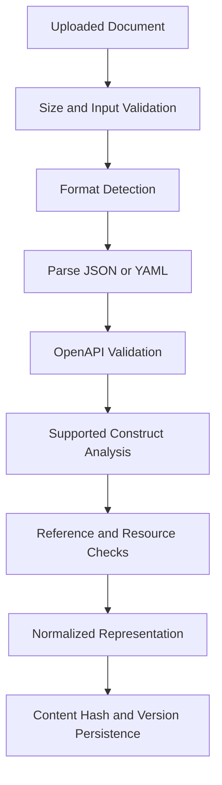

# Technical Requirements Document (TRD)

**Product:** ContractGuard\
**Document version:** 1.2\
**Document status:** Technical implementation baseline\
**Last updated:** 14 November 2026

---

## 1. Technical Objectives

ContractGuard uses a JavaScript-based full-stack architecture designed to support API specification processing, deterministic compatibility analysis, change-to-test traceability, controlled regression execution, and optional AI-assisted test generation.

The technical design prioritizes:

- Clear separation of responsibilities.
- Deterministic and testable domain logic.
- Explicit input validation.
- Controlled processing of uploaded specifications.
- Safe handling of persisted resources.
- Server-side authorization and ownership enforcement.
- Bounded regression execution.
- Optional integration with external AI services.

The application uses a React single-page frontend, an Express backend, and MongoDB persistence.

The backend follows a modular-monolith structure. No distributed infrastructure is required for the current scope.

## 2. Technology Stack

### 2.1 Runtime and Language

| Component | Technology |
|---|---|
| Runtime | Node.js |
| Language | JavaScript |
| Module system | ECMAScript Modules |
| Package manager | npm |
| Frontend build system | Vite |

The project uses JavaScript throughout the application. TypeScript is not part of the current implementation baseline.

The runtime and dependency versions are maintained through the project package manifests and lockfiles.

### 2.2 Frontend

| Technology | Responsibility |
|---|---|
| React | Component-based user interface |
| Vite | Development server and production build |
| React Router | Client-side navigation |
| Tailwind CSS | Utility-based styling |
| TanStack Query | Server-state fetching and caching |
| React Hook Form | Form state and interaction |
| Zod | Runtime input validation |
| Lucide React | Interface icons |

Frontend responsibilities include:

- Rendering application screens.
- Managing local interaction state.
- Navigating between application routes.
- Submitting API requests.
- Displaying server-generated compatibility findings.
- Displaying test coverage and execution results.
- Handling loading, empty, error, and partial states.
- Obtaining explicit consent before eligible AI-provider submissions.

The frontend is not authoritative for authorization, compatibility classification, or regression pass/fail decisions.

### 2.3 Backend

| Technology | Responsibility |
|---|---|
| Node.js | Backend runtime |
| Express | HTTP server and API routing |
| MongoDB | Persistent document database |
| Mongoose | Data models and persistence |
| bcrypt | Password hashing |
| JSON Web Token | Authentication token signing and verification |
| cookie-parser | Authentication cookie handling |
| Helmet | HTTP security headers |
| express-rate-limit | Request rate limiting |
| Multer | Multipart file upload handling |
| Zod | Request and structured-output validation |

Backend responsibilities include:

- Authentication and authorization.
- Project and specification management.
- File upload validation.
- OpenAPI parsing and normalization.
- Compatibility analysis.
- Change-impact analysis.
- Test-case management.
- Regression execution.
- AI provider integration.
- Persistence and historical records.
- Consistent error handling.

### 2.4 Specification Processing and Validation

| Technology | Responsibility |
|---|---|
| `@scalar/openapi-parser` | OpenAPI parsing and document processing |
| `yaml` | YAML document parsing |
| Ajv | JSON Schema validation |
| Zod | Runtime validation of application inputs and structured outputs |

The parser layer is isolated from compatibility rules. Parsed documents are processed into an application-controlled representation before compatibility analysis.

Third-party parser behavior must not silently determine the application's compatibility policy.

### 2.5 AI Integration

| Component | Responsibility |
|---|---|
| Google Gemini Developer API | Generate structured test suggestions |
| `@google/genai` | Official JavaScript SDK |
| AI context service | Prepare trusted and sanitized operation context |
| AI output validator | Validate generated suggestions |
| Persistence service | Save valid suggestions as draft test cases |

AI integration is optional. Core functionality must remain available when the API key is missing, the provider is unavailable, or quotas are exhausted.

### 2.6 Testing

| Technology | Responsibility |
|---|---|
| Vitest | Unit and integration testing |
| Supertest | HTTP API integration testing |
| ESLint | Frontend and code-quality checks |
| Vite build | Production frontend build verification |

Tests should cover services, validators, models, middleware, routes, and end-to-end API workflows where applicable.

## 3. Application Architecture

### 3.1 Architecture Style

ContractGuard uses a modular monolith.

The repository contains separate frontend and backend application directories.

The backend runs as one Express application. Internal modules are separated by responsibility, but they are not independently deployed microservices.

### 3.2 Frontend Responsibilities

The React application manages:

- Authentication screens.
- Projects workspace.
- Specification upload and exploration.
- Comparison selection and result views.
- Change-impact and coverage displays.
- Test-case management.
- AI suggestion preview and review.
- Regression-run history and results.

Server-state management is handled through TanStack Query.

Local interface state is managed through React state and component-level hooks where appropriate.

### 3.3 Backend Responsibilities

The backend is responsible for:

- Verifying authenticated requests.
- Enforcing project ownership.
- Validating request payloads.
- Processing uploaded specifications.
- Applying deterministic compatibility rules.
- Computing affected operations.
- Computing test coverage projections.
- Managing test-case lifecycle transitions.
- Executing eligible regression cases.
- Validating candidate responses.
- Calling the AI provider after consent.
- Validating AI-generated data.
- Persisting comparison, test-case, and test-run records.

## 4. API and Request Processing

The backend exposes versioned REST API routes under:

`/api/v1`

A normal authenticated request follows this processing sequence:

1. Receive the HTTP request.
2. Apply relevant security and request middleware.
3. Validate authentication where required.
4. Validate resource ownership and policy.
5. Validate request input.
6. Invoke the relevant controller.
7. Execute domain logic through services.
8. Access persistence models where required.
9. Return a structured response.
10. Handle errors through the application's centralized error-handling layer.

Controllers should remain focused on coordinating requests and responses. Compatibility logic, reference traversal, test eligibility, and provider-output validation belong in services or dedicated domain modules.

## 5. Authentication and Authorization

### 5.1 Password Handling

Passwords are hashed using bcrypt.

Requirements:

- Hash passwords before persistence.
- Verify credentials through the hashing library.
- Never persist plaintext passwords.
- Never include password hashes in normal API responses.
- Never log passwords or password hashes.
- Do not expose authentication secrets to frontend code.

### 5.2 Token Handling

JWT authentication is handled on the backend.

The authentication token is transported through an HttpOnly cookie.

Requirements:

- Validate token signatures.
- Enforce configured expiration.
- Keep signing secrets server-side.
- Use appropriate cookie security settings.
- Clear the authentication cookie during logout.
- Avoid storing JWTs in browser localStorage or sessionStorage.

### 5.3 Ownership Enforcement

The authenticated user is the owner of their projects.

For every project and child-resource operation, the backend must verify that the requested resource belongs to a project owned by the authenticated user.

Client-supplied owner identifiers must never be accepted as authoritative ownership information.

## 6. OpenAPI Document Processing

### 6.1 Supported Input Formats

The upload pipeline accepts:

- JSON.
- YAML.

The backend must validate uploaded content independently of frontend file-extension checks.

### 6.2 Processing Pipeline

### 6.3 Validation Requirements

The processing pipeline must:

- Reject malformed documents.
- Validate supported OpenAPI versions and document structure.
- Enforce upload-size constraints.
- Enforce parser and normalized-document limits.
- Reject or report unsupported constructs.
- Prevent unbounded schema expansion.
- Avoid external network requests while resolving references.
- Preserve the original uploaded content.
- Preserve relevant source locations for diagnostics.

### 6.4 Resource Limits

The initial document-processing constraints include:

| Resource | Limit |
|---|---:|
| Original uploaded specification | 1 MiB |
| Path entries | 250 |
| Operations | 500 |
| Document nesting depth | 100 |
| Parsed node count | 50,000 |
| Internal reference depth | 20 |
| Normalized representation | 8 MiB |

These constraints must be enforced server-side.

A limit violation must produce a controlled diagnostic or rejection rather than uncontrolled processing.

### 6.5 Version Persistence

A specification version stores:

- Original content.
- Source format.
- SHA-256 content hash.
- Parsed or normalized representation where supported.
- Operation count.
- Parsing status.
- Support status.
- Warnings and diagnostics.
- Server-derived execution profile.

Uploaded specification versions are immutable.

## 7. Compatibility Analysis Requirements

### 7.1 Comparison Direction

The compatibility engine evaluates:

`BASELINE_CONSUMER_TO_CANDIDATE_PROVIDER`

The baseline describes the existing consumer contract.

The candidate describes the newer provider contract.

### 7.2 Ruleset Versioning

The current compatibility ruleset identifier is:

`CG-COMPAT-1.1`

Every comparison report must retain the ruleset version used to generate its findings.

Changing compatibility rules must not silently rewrite historical reports.

### 7.3 Supported Finding Classifications

- `BREAKING`
- `POTENTIALLY_BREAKING`
- `NON_BREAKING`
- `INFORMATIONAL`
- `UNSUPPORTED`

### 7.4 Analysis Status

- `COMPLETE`
- `PARTIAL`
- `FAILED`

Unsupported relevant constructs must remain visible and must not silently become a successful compatibility result.

### 7.5 Change Record Requirements

A compatibility finding should retain:

- Stable change identifier.
- Rule identifier.
- Classification.
- HTTP method where applicable.
- API path where applicable.
- Canonical operation key.
- Affected operation keys.
- JSON Pointer or relevant source location.
- Summary.
- Rationale.
- Previous value.
- Candidate value.

### 7.6 Determinism

Compatibility analysis must not depend on AI output.

For identical supported normalized inputs and the same ruleset version, the engine should produce stable findings.

Compatibility rules must have automated fixtures for supported behavior.

## 8. Change Impact and Coverage Requirements

The impact layer connects compatibility findings to affected API operations and baseline test cases.

Requirements:

- Preserve canonical operation identifiers.
- Resolve supported internal schema references.
- Identify operations affected by supported shared-schema changes.
- Avoid silently assuming unresolved relationships are complete.
- Link findings to test cases using the comparison's baseline version.
- Distinguish draft cases from approved cases.
- Exclude archived test cases from active coverage.

Coverage states:

- `COVERED`
- `DRAFT_ONLY`
- `UNCOVERED`
- `UNMAPPED`

Coverage represents the availability of test cases, not successful execution.

The regression runner remains responsible for execution evidence.

## 9. Test Case Requirements

A test case represents a bounded request scenario associated with a baseline API operation.

Required attributes include:

- Project identifier.
- Baseline specification version identifier.
- Canonical operation key.
- Operation path.
- Title.
- Source.
- Lifecycle status.
- Request parameters.
- Assertions.
- Optional AI generation metadata.

Supported lifecycle states:

- `DRAFT`
- `APPROVED`
- `ARCHIVED`

Only approved and eligible cases can be selected for regression execution.

Draft cases may be edited. Approval must be a deliberate backend-controlled transition.

Approved cases must not be silently changed through the normal draft-update path.

## 10. Regression Runner Requirements

### 10.1 Execution Boundary

The runner is intentionally restricted to the bundled Demo Store implementation.

It does not execute against arbitrary user-supplied URLs, remote hosts, or uploaded OpenAPI server declarations.

### 10.2 Eligibility

A run requires:

- An existing comparison.
- A valid baseline and candidate relationship.
- A recognized server-side candidate fixture.
- Approved test cases.
- Test cases belonging to the comparison's baseline specification version.
- Supported GET operations.

### 10.3 Execution Model

The runner uses a server-controlled implementation adapter for the bundled candidate.

The client cannot choose:

- Arbitrary target URLs.
- Hostnames.
- Ports.
- Network destinations.
- Fixture identifiers.
- Candidate implementation versions.

### 10.4 Response Validation

Candidate responses must be evaluated against the applicable baseline response contract.

Validation may include supported:

- HTTP status expectations.
- Response media-type expectations.
- JSON Schema constraints.
- Explicit test-case assertions.

A successful HTTP status alone is not sufficient evidence of a passing regression test.

Unsupported validation behavior must not be represented as a complete pass.

### 10.5 Execution Status

Run-level statuses:

- `QUEUED`
- `RUNNING`
- `PASSED`
- `FAILED`
- `PARTIAL`
- `INTERRUPTED`

Individual test outcomes:

- `PASSED`
- `FAILED`
- `SKIPPED`
- `UNSUPPORTED`
- `ERROR`

The runner must persist bounded result snapshots and relevant execution evidence.

### 10.6 Execution Limits

The runner applies bounded execution controls, including limits on:

- Test cases per run.
- Concurrent runs.
- Concurrent tests within a run.
- Individual test duration.
- Total run duration.
- Response size.
- Stored evidence size.
- Validation diagnostic count.

These constraints must be enforced by the backend, not by the frontend.

## 11. AI Integration Requirements

### 11.1 Provider

Google Gemini Developer API through:

`@google/genai`

The model is selected through backend configuration rather than hardcoded into frontend code.

### 11.2 Supported Operations

| Operation | Method | Path |
|---|---|---|
| `listProducts` | GET | `/products` |
| `getProduct` | GET | `/products/{productId}` |

### 11.3 Context Boundary

The AI integration uses trusted synthetic Demo Store context.

The application must not send arbitrary uploaded production specifications, customer data, authentication credentials, or confidential business data through the current unpaid AI integration.

### 11.4 Consent and Submission

The generation pipeline requires:

1. Supported operation selection.
2. Trusted context construction.
3. Submission preview.
4. Explicit user consent.
5. Backend provider invocation.
6. Structured output validation.
7. Draft persistence.

The backend is responsible for validating the operation identity and selected context.

### 11.5 Output Validation

AI output must satisfy a strict structured format.

The application must reject:

- Invalid structured output.
- Suggestions for a different operation.
- Missing required draft fields.
- Unsupported request or assertion formats.
- Oversized or malformed responses.

AI output is data, not executable code.

### 11.6 Failure Handling

The AI integration must handle:

- Missing API key.
- Provider authentication failure.
- Provider quota exhaustion.
- Provider rate limits.
- Network errors.
- Invalid model output.
- Operation mismatch.
- Persistence errors.

Failure of AI generation must not block the non-AI workflows.

## 12. Persistence Requirements

MongoDB collections:

- `users`
- `projects`
- `specVersions`
- `diffReports`
- `testCases`
- `testRuns`

Mongoose models define persistence constraints, references, timestamps, and indexes.

Zod validates incoming application data independently of Mongoose validation.

Every child-resource relationship must be checked at the service layer.

Completed comparison findings and completed test-run evidence must remain historically consistent.

Refer to [Schema.md](Schema.md) for the detailed model.

## 13. Error Handling

The backend should return consistent error structures.

Errors must distinguish relevant categories such as:

- Authentication failure.
- Authorization or ownership failure.
- Validation failure.
- Missing resource.
- Duplicate resource.
- Unsupported specification.
- Partial analysis.
- Compatibility processing failure.
- Test execution failure.
- AI configuration failure.
- AI provider failure.
- Rate-limit rejection.

Internal stack traces, secrets, and sensitive implementation details must not be returned to clients.

## 14. Testing Requirements

### Unit Tests

Cover:

- Compatibility rules.
- Normalization.
- Reference-impact analysis.
- Traceability.
- Test-case validation.
- Test eligibility.
- AI context construction.
- AI output validation.
- Persistence transformations.

### Integration Tests

Cover:

- Authentication routes.
- Ownership enforcement.
- Specification upload.
- Comparison creation and retrieval.
- Test-case lifecycle.
- Regression execution.
- AI suggestion routes.
- Draft persistence.

### Frontend Verification

Run:

- ESLint.
- Production build.
- Relevant component and interaction tests where available.

Tests must verify failure paths as well as successful workflows.

## 15. Related Documentation

- [Product Requirements](PRD.md)
- [Design Specification](Design.md)
- [System Architecture](Architecture.md)
- [Application Flow](AppFlow.md)
- [Data Model and Schema](Schema.md)
- [Compatibility Rules](Rules.md)
- [Backend API](API.md)
- [Security Review](SecurityReview.md)